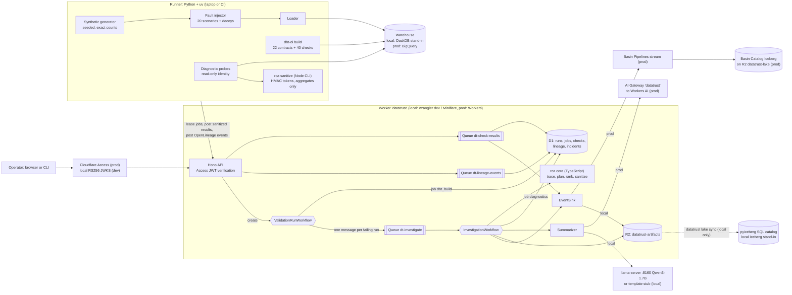

# DataTrust

Lineage-aware data quality and root-cause analysis for workforce data (HR, recruiting, compensation, payroll).

DataTrust builds a synthetic workforce warehouse with dbt, guards it with schema contracts and 40 data checks, captures column-level lineage as OpenLineage events, and when checks or metrics fail it traces the failure upstream, runs read-only diagnostic SQL probes, ranks the likely root cause, and writes an incident summary from sanitized evidence. Validation and investigation are coordinated by Cloudflare Queues and Workflows; summaries come from Workers AI in production.

> **Status: v1 core implemented; production not yet executed.** Built against [SPEC.md](SPEC.md). Everything runs locally and in CI on stand-ins (DuckDB for BigQuery, Miniflare for Cloudflare, a local LLM or template for Workers AI). The production path is implemented and waits for the account setup below. The status table never claims more than the repo has run.

All data is synthetic. No real employee or candidate data is used anywhere; emails use the reserved `example.com` domain.

## Status

Every component carries exactly one label (SPEC section 4.1). A label changes only with a dated command.

| Component | Status |
|---|---|
| Synthetic data generator (exact, seeded counts) | implemented; tests pass locally (`uv run pytest`), CI configured |
| dbt models, 22 enforced contracts, 40 checks | implemented: 29 models, 22 enforced contracts and 40 checks build and pass on clean seeds on DuckDB (stand-in), tested locally; CI configured to run them under `TZ=UTC` and `TZ=America/Los_Angeles` |
| OpenLineage capture and column-level lineage graph | implemented: `dbt-ol build` (openlineage-dbt 1.53.0, file transport) on DuckDB (stand-in), TypeScript graph and upstream closure; tested locally |
| Diagnostic probes, root-cause ranker, baselines | implemented: 14 read-only probe templates (DuckDB executed, BigQuery rendered only), TypeScript trace, planner, ranker, ablations, naive baselines and HMAC sanitizer; tested locally |
| Fault-injection benchmark (20 scenarios) | executed locally on DuckDB (stand-in), 2026-10-10, `uv run datatrust bench --seeds 101-105` (see Results); CI gate on seed 101 configured |
| Worker API, D1, R2, Queues, ValidationRunWorkflow, InvestigationWorkflow | executed in Miniflare (`wrangler dev --local` and `@cloudflare/vitest-plugin`) only; 2026-10-10 `npm run bench:e2e` (seed 101, 20 scenarios) |
| Access JWT verification | executed against local RS256 keys only (`npm run dev:keys`, `npm run dev:token`) |
| Workers AI summaries, AI Gateway | implemented, not executed (tests mock the AI binding; the local stand-ins are llama-server with Qwen3-1.7B and a deterministic template) |
| Basin Pipelines, Basin Catalog (Iceberg) | implemented, not executed (local pyiceberg SQL catalog stand-in executed: `uv run datatrust lake sync`) |
| BigQuery path, policy tags, masking, authorized view, time travel | implemented, not executed (CI renders the BigQuery macro branches, runs `dbt parse --target bigquery` and tests the governance logic against fakes; `npm run prod:validate` is the first real check) |
| `setup:prod` and `doctor` | implemented; `npm run doctor` (local) executed; `npm run doctor -- --prod` and `setup:prod` executed only up to their local preconditions (no Cloudflare or Google Cloud account connected) |

## Synthetic dataset

`uv run datatrust synth --seed <n>` writes 13 Parquet tables and a `manifest.json` (row counts and SHA-256 of a canonical CSV rendering) to `.data/raw/<n>/`. Counts are fixed by construction; the seed changes values only. Seed 101 hashes are pinned in `pipelines/tests/golden/seed101.sha256.json` and checked on ubuntu-latest in CI, so macOS and Linux must agree byte for byte (integer-only arithmetic, `random.Random.random()` only, tz-aware UTC instants, `tzdata` 2026.5 pinned through `zoneinfo.reset_tzpath([])`).

| Table | Rows | Table | Rows |
|---|---|---|---|
| departments | 12 | applications | 4,800 |
| locations | 8 | stage_events | 13,440 |
| employees | 1,200 | offers | 480 |
| job_assignments | 2,820 | hires | 360 |
| requisitions | 240 | compensation | 1,980 |
| candidates | 3,600 | fx_rates | 2,190 |
| payroll_lines | 12,060 | **total** | **43,190** |

Employees: 780 tenured, 60 leavers (2025-06-30), 360 hired in 2025 (30 per month). Eight locations in six currencies; FX rates are a bounded daily random walk that never repeats on consecutive days. People are synthetic: names are drawn from fixed word lists and emails use `example.com`.

## Checks

40 dbt test nodes, all named `dq_*` and listed in [`checks/registry.yml`](checks/registry.yml): 18 generic tests and 22 singular SQL tests. No dbt packages are used.

| Category | Count | Examples |
|---|---|---|
| Record uniqueness | 8 | unique employee, hire and application keys; one compensation row per employee; one FX rate per currency-day |
| Referential integrity | 8 | assignments, applications, hires, offers and payroll lines point at existing parents; every hire has an accepted offer |
| Historical intervals | 7 | no overlapping or gapped assignment and compensation history; first assignment starts at hire; no payroll after termination |
| Recruiting-stage transitions | 7 | allowed stage pairs, monotonic timestamps, terminal stage last, recruiter events in local business hours, hired event on the local hire date |
| Compensation and FX | 6 | USD salary recomputes from staging and the daily rate, FX not stale, complete 2025 calendar, within 15% of the trailing 30-day median |
| SQL reconciliation | 4 | payroll actual vs expected, headcount, payroll cost and a three-way hires reconciliation across metric, fact and HRIS events |

Separately, 22 enforced dbt model contracts (13 staging, 5 marts, 4 metrics) are the schema contracts. Staging passes raw integer money columns through uncast, so a source that starts delivering salary as text fails the `stg_compensation` contract at build time; the runner classifies that as `schema_contract` with the column name.

## Root-cause analysis

When checks fail, the TypeScript RCA core (`packages/rca`, the same code in the Worker and in the offline benchmark CLI) does four things:

1. **Trace.** From each failing check's tested columns, walk upstream through OpenLineage column lineage (falling back to dataset edges for columns the SQL parser could not trace). Candidates are the union of the closures.
2. **Plan.** Pick diagnostic probes from each candidate's dbt meta (grain, unique keys, foreign keys, intervals, time zones, FX, recomputable columns, casts) and probe the candidates' parents too. Planning is metadata-driven and the same for every incident.
3. **Probe.** The Python runner renders each probe from its own SQL templates (the Worker never sends SQL), checks it with a sqlglot read-only guard, runs it on a read-only connection and returns aggregates plus at most five sample keys, which `rca sanitize` turns into HMAC tokens (pseudonymization) before upload.
4. **Rank.** `score = 0.40 coverage + 0.35 own_anomaly + 0.15 changed - 0.10 unexplained_pass` (initial weights; ADR-0004 freezes the tuned ones). `own_anomaly` subtracts the same probe's anomaly on the lineage-mapped parent columns, so the first anomalous node along the column path wins; row-multiplicity anomalies are discounted against any dataset parent.

Ablations (`coverage_only`, `dataset_lineage_only`, `no_probes`, `no_change_signal`) and naive baselines (`change_only`, `nearest_upstream_source`, `random_in_closure`) are computed from the same probe results.

## Fault-injection benchmark

20 scenarios (`pipelines/datatrust/bench/scenarios.py`): 13 source-data defects injected into the generated tables before loading, and 7 transformation bugs applied as patches to a temporary copy of the dbt project. The named resume defects are duplicate hires (S01), join fan-out (T14, T15), stale exchange rates (S03) and timezone mismatches (S04, T16). Every trial also applies 0 to 4 decoy patches (12 benign refactors across staging, intermediate, marts and metrics, half the time including one on the failing lineage path), so "the model that changed" is often innocent. Severities are drawn per seed and include low ones on purpose.

Protocol: weights are tuned only on dev seeds 1-3 and frozen (ADR-0004) before the test seeds 101-105 run (100 injected trials plus 5 clean trials). Detection recall and top-3 root-cause accuracy are reported with Wilson intervals and scenario-clustered bootstrap intervals, next to ablations, naive baselines and a leave-one-scenario-out figure.

## Incident summaries

Summaries are written from sanitized evidence only. The model never writes numbers: it cites `{ev:<key>.<field>}` placeholders and the Worker substitutes the values. A draft is accepted only if it matches the schema, every placeholder resolves, no digit appears outside placeholders and known identifiers, the root cause is a top-five candidate, its references exist, and nothing looks like PII. A failed draft gets one repair request that quotes the violations; after that the deterministic template is used and the fallback is recorded on the incident. Recovery commands (BigQuery time-travel `bq cp`, or the local snapshot restore) are attached by the server, never written by the model.

| Provider | Where | Status |
|---|---|---|
| Workers AI `@cf/meta/llama-3.3-70b-instruct-fp8-fast` through AI Gateway `datatrust` | production only (the AI binding does not run in `wrangler dev --local`) | implemented, not executed |
| OpenAI-compatible llama-server, Qwen3-1.7B Q4_0 on 127.0.0.1:8160 | local stand-in (`npm run dev:up -- --llm`) | executed locally |
| Deterministic template | CI and fallback | executed locally and in tests |

## Architecture



The Worker never holds warehouse credentials and never sends free-form SQL. A Python runner (on a laptop or in CI) leases jobs from the Worker over HTTPS, runs dbt and the diagnostic probes against the warehouse, sanitizes the probe output, and posts results back. The root-cause logic is one TypeScript package used by both the Worker and the offline benchmark.

## What runs where

Local stand-ins are labelled as stand-ins. They are never presented as the production service.

| Concern | Local and CI (offline) | Production |
|---|---|---|
| HTTP API, queue consumers, workflows | `wrangler dev --local` (Miniflare, workerd) on 127.0.0.1:8792 | Cloudflare Workers, Queues, Workflows |
| Metadata store | D1 (Miniflare) | D1 `datatrust` |
| Artifacts | R2 (Miniflare) bucket `datatrust-artifacts` | R2 `datatrust-artifacts` |
| Warehouse | **DuckDB 1.5.6 via dbt-duckdb 1.11.0 (stand-in for BigQuery)**, session pinned to UTC | BigQuery via dbt-bigquery 1.12.1 |
| BigQuery SQL validity | BigQuery macro branches rendered and checked for banned constructs; nothing executes on BigQuery | `datatrust prod validate`: compile, `dbt build --empty`, dry runs of every probe |
| Restricted / authorized views | plain DuckDB views (stand-in) | BigQuery authorized view over an untagged aggregate table |
| Column masking | none (stand-in: sanitizer and tests) | BigQuery policy tags and data masking policies |
| Time travel / recovery | per-run Parquet snapshots of marts (stand-in) | `FOR SYSTEM_TIME AS OF`, 7-day window, `bq cp table@<ms>` restore |
| Iceberg lake | **pyiceberg SqlCatalog on SQLite (stand-in for Basin Catalog)** | Basin Pipelines stream to a Basin Catalog Iceberg table |
| LLM summaries | **llama-server (Qwen3-1.7B Q4_0) on 127.0.0.1:8160 (stand-in)** or a deterministic template (CI) | Workers AI `@cf/meta/llama-3.3-70b-instruct-fp8-fast` through AI Gateway `datatrust` |
| Auth | locally generated RS256 keypair and JWKS | Cloudflare Access (team JWKS) |
| Runner identity | local dev JWT (role `runner`) | Access service token `datatrust-runner` |
| Probe identity | DuckDB connection opened read-only | impersonated service account `datatrust-prober`, dry run plus byte cap |
| Lineage | `dbt-ol` file transport, uploaded by the runner | same |

## Local setup

Prerequisites: Node 22 or newer (CI uses Node 24 from `.nvmrc`), npm, [uv](https://docs.astral.sh/uv/) and Python 3.12 (uv installs it if missing). No cloud account is needed for the local path.

```sh
npm run setup        # npm ci && uv sync --locked
npm run doctor       # checks the local prerequisites and prints the fix for anything missing
npm run typecheck    # TypeScript strict, all workspaces
npm test             # vitest (packages/rca, apps/worker) and pytest
```

Generate, load and build one seed locally (DuckDB is the local stand-in for BigQuery):

```sh
uv run datatrust synth --seed 101   # .data/raw/101/*.parquet + manifest.json
uv run datatrust load --seed 101    # raw.* tables in .data/warehouse.duckdb (session pinned to UTC)
uv run datatrust build              # dbt-ol build: 29 models, 22 contracts, 40 checks, OpenLineage events in dbt/target/
```

Run the offline fault-injection benchmark (DuckDB stand-in; about 30 seconds per seed with 6 workers on a laptop):

```sh
npm run build -w @datatrust/rca                          # bundle the TypeScript RCA CLI the runner calls
uv run datatrust bench --seeds 1 --workers 6 --out /tmp/dt # 20 injected trials + 1 clean trial
```

Full local loop through Queues and Workflows (Miniflare, local Access stand-in, DuckDB stand-in):

```sh
npm run dev:up                                       # dev keys if missing, D1 migrations, wrangler dev on 127.0.0.1:8792 (inspector 9242)
OP=$(npm run -s dev:token -- --role operator)
curl -s -X POST -H "Cf-Access-Jwt-Assertion: $OP" -H 'content-type: application/json' \
  -d '{"target":"duckdb","seed":101,"scenario":"S01"}' http://127.0.0.1:8792/api/runs
uv run datatrust runner --watch --idle-exit 30       # leases the dbt_build job, then the diagnostics job
curl -s -H "Cf-Access-Jwt-Assertion: $OP" http://127.0.0.1:8792/api/runs/<runId>          # status, failing checks, incidentId
curl -s -H "Cf-Access-Jwt-Assertion: $OP" http://127.0.0.1:8792/api/incidents/<incidentId>
npm run dev:down                                     # stops everything dev:up started and confirms the ports are free
```

`npm run bench:e2e` runs the seed-101 benchmark through all of the above (20 scenarios, each through Queues and both Workflows) and checks that the incident top-3 lists equal the offline mode's; `npm run bench:e2e -- --pytest` is the CI subset (S01, T14, S04). Both stop everything they started.

Audit events (check results, completed runs, incidents) go to the lake. Locally the Worker writes NDJSON to its R2 bucket and `uv run datatrust lake sync` appends them to a pyiceberg SQL catalog under `.data/lake/` (stand-in for Basin Catalog); `uv run datatrust lake query` reads the Iceberg table through DuckDB.

`npm run dev:up -- --llm` also starts llama-server (Qwen3-1.7B) on 127.0.0.1:8160; set `DATATRUST_LLM_MODEL_PATH` if the GGUF lives elsewhere.

More commands are added here as the components land.

## Production setup

Everything below is implemented and tested locally against stand-ins, and has **not yet run on Cloudflare or Google Cloud**. These are the steps only the account owner can do; the scripts do the rest. `npm run doctor -- --prod` prints one line per prerequisite with the exact fix, so run it whenever you are unsure what is left.

Start with the values file (gitignored; never put `CLOUDFLARE_API_TOKEN` in it, because wrangler would use it instead of your `wrangler login`):

```sh
cp .env.example .env.prod && chmod 600 .env.prod
```

### Cloudflare

| # | What you do | Where | Cost |
|---|---|---|---|
| 1 | Create a Cloudflare account | https://dash.cloudflare.com/sign-up | free |
| 2 | Subscribe to Workers Paid (Basin Pipelines needs it; also covers Queues and Workflows headroom) | dashboard: Workers & Pages, Plans | $5/month |
| 3 | Activate R2 (a payment card is required; usage stays in the free tier) | dashboard: R2 Object Storage | free tier |
| 4 | Create a Zero Trust organization on the Free plan (choose a team name) | https://one.dash.cloudflare.com/ | free |
| 5 | Log wrangler in with OAuth, with no Cloudflare token exported in the shell | `cd apps/worker && unset CLOUDFLARE_API_TOKEN CLOUDFLARE_API_KEY CLOUDFLARE_EMAIL && npx wrangler login && npx wrangler whoami` | free |
| 6 | Put the account id in `.env.prod` as `CLOUDFLARE_ACCOUNT_ID` | from `npx wrangler whoami` | free |
| 7 | Optional: an API token with account permissions "AI Gateway Read" and "AI Gateway Edit", saved as `DATATRUST_CF_API_TOKEN` (otherwise create the gateway in the dashboard: AI, AI Gateway, Create Gateway, name `datatrust`) | https://dash.cloudflare.com/profile/api-tokens | free |
| 8 | An R2 API token for Basin Catalog (R2, Manage API tokens, Create Account API token, Admin Read & Write), saved as `BASIN_CATALOG_TOKEN` | dashboard: R2 | free |
| 9 | Set `DATATRUST_OPERATOR_EMAIL` to the email you will log in to Access with | `.env.prod` | free |
| 10 | Run the Cloudflare bootstrap. It creates D1, both R2 buckets, the catalog, four queues, the Pipelines stream, sink and pipeline, the AI Gateway, renders `wrangler.prod.jsonc`, applies the D1 migrations and deploys the Worker with its secrets. The first deploy is fail-closed (every API call answers 401) and the script stops with "rerun after Access is configured" | `npm run setup:prod -- --cloudflare-only` | Pipelines and catalog usage inside the included amounts |
| 11 | Protect the Worker with Access: Workers & Pages, datatrust, Settings, Domains & Routes, **Enable Cloudflare Access** on the workers.dev route, then Manage Cloudflare Access and allow your email | dashboard | free |
| 12 | Copy the Application Audience (AUD) tag into `ACCESS_AUD`, and `https://<team>.cloudflareaccess.com` into `ACCESS_TEAM_DOMAIN` | Zero Trust, Access, Applications | free |
| 13 | Create service token `datatrust-runner` (1 year), save `CF_ACCESS_CLIENT_ID` and `CF_ACCESS_CLIENT_SECRET` (the secret is shown once), and add a second policy on the datatrust Access app with action **Service Auth** that includes this token | Zero Trust, Access, Service credentials | free |
| 14 | Rerun the bootstrap to set the real secrets and redeploy | `npm run setup:prod -- --cloudflare-only` | free |
| 15 | Check | `npm run doctor -- --prod` | free |

Workers AI needs no setup beyond the binding (10,000 neurons per day free, then $0.011 per 1,000 neurons on Workers Paid); a summary is roughly 2k input and 400 output tokens on `llama-3.3-70b-instruct-fp8-fast` (an estimate, not measured). There is no cron trigger, so nothing runs or bills unless you start a run.

### Google Cloud

| # | What you do | Where | Cost |
|---|---|---|---|
| 1 | Google account and Cloud terms | https://console.cloud.google.com/ | free |
| 2 | A billing account with a card and a $5 budget alert (policy tags and masking need billing; the sandbox cannot do DML) | Billing, Budgets & alerts | expected $0 at this data size |
| 3 | Install the CLI (`gcloud` and `bq`) | `brew install --cask gcloud-cli` | free |
| 4 | Initialize and authenticate | `gcloud init`, `gcloud auth login`, `gcloud auth application-default login` | free |
| 5 | Create the project and link billing | `gcloud projects create datatrust-<suffix> --name=DataTrust`, `gcloud config set project datatrust-<suffix>`, `gcloud billing accounts list`, `gcloud billing projects link datatrust-<suffix> --billing-account=<ID>` | free |
| 6 | Set the ADC quota project | `gcloud auth application-default set-quota-project datatrust-<suffix>` | free |
| 7 | Put `DATATRUST_GCP_PROJECT=datatrust-<suffix>` and `DATATRUST_BQ_LOCATION=US` in `.env.prod` | `.env.prod` | free |
| 8 | Run the Google Cloud bootstrap: APIs, four datasets with a 7-day time-travel window, the `datatrust-analyst` and `datatrust-prober` service accounts and their grants, the policy-tag taxonomy and masking policies, `prod validate` (compile, `dbt build --empty`, probe dry runs), the real build, and the masking verification as the analyst | `npm run setup:prod -- --gcp-only` | about $0 |
| 9 | Check, then run the production smoke test (one clean run and five fault runs through the deployed Queues and Workflows on BigQuery, Workers AI summaries, the Iceberg row read back, Access checks) | `npm run doctor -- --prod`, then `npm run prod:smoke` | about $0 plus a few cents of Workers AI |

Your Google identity needs Owner on the project (or BigQuery Admin, Data Catalog Policy Tag Admin, Data Policy Admin and Service Account Admin). Owner does not include Fine-Grained Reader, which the bootstrap grants you explicitly so dbt tests can read real values.

Only `npm run prod:smoke` may move a status label above to "executed in production"; it writes `results/prod-smoke-<date>.*` with the commands, run ids, the Workers AI grounding pass rate and fallback rate, the Iceberg row count and BigQuery bytes billed.

## Results

All numbers below were produced by this repo's scripts on 2026-10-10 on the local warehouse stand-in, **DuckDB 1.5.6 via dbt-duckdb 1.11.0, not BigQuery**. Nothing in this section ran on Cloudflare or Google Cloud.

Command (test seeds 101-105, weights frozen beforehand from dev seeds 1-3, ADR-0004):

```sh
uv run datatrust bench --mode offline --seeds 101-105 --workers 6 --dev-results results/bench-2026-10-10-offline-dev.json
```

Full report: [`results/bench-2026-10-10-offline.md`](results/bench-2026-10-10-offline.md) (data in the matching `.json`; gate numbers in `results/baseline.json`).

| Metric (100 injected trials: 20 scenarios x 5 seeds) | Measured | Wilson 95% | Scenario-clustered bootstrap 95% |
|---|---|---|---|
| Detection recall (target 95%) | 100% (100/100) | 96.3% to 100% | 100% to 100% |
| Top-3 root-cause accuracy (target 90%) | 100% (100/100) | 96.3% to 100% | 100% to 100% |
| Top-1 root-cause accuracy | 90% (90/100) | 82.6% to 94.5% | 75% to 100% |

- Clean false positives over the 5 clean trials (decoys applied): 0.
- Leave-one-scenario-out top-3 (weights re-tuned without the held-out scenario): 100% over 100 trials.
- Naive baselines on the same candidate sets: `change_only` top-3 77%, `nearest_upstream_source` 60%, `random_in_closure` 73.4% expected. The ranker's top-3 gain over the best baseline is 23 percentage points.
- Ablations: `coverage_only` top-3 85%, `no_probes` 95%, `dataset_lineage_only` 98%, `no_change_signal` 100%.
- Median candidate-set size 4 (IQR 2 to 6), so top-3 is a short list; top-1 (90%) is the more demanding number. The 10 top-1 misses are S10 (currency mismatch) and S11 (payroll after termination), where the ground truth ranked second in every trial.

End-to-end check through the local Worker (Miniflare via `wrangler dev --local`, which stands in for Cloudflare Workers, Queues, Workflows, D1 and R2): `npm run bench:e2e` on 2026-10-10 sent all 20 seed-101 scenarios through `POST /api/runs`, ValidationRunWorkflow, the runner, the queues and InvestigationWorkflow. 20/20 detected, ground truth in the incident's top 3 in 20/20, rank 1 in 18/20, 0 clean false positives, and every top-3 list identical to the offline mode ([`results/bench-2026-10-10-e2e.md`](results/bench-2026-10-10-e2e.md)).

How to read this honestly: the scenarios, checks and probes were written by the same author, and the weights were tuned on dev seeds over the same 20 scenarios, so the test seeds hold out values and severities, not defect types. The benchmark is in-distribution; it shows the mechanism works on these defect classes, not that it generalizes to unseen ones.

## License

MIT. See [LICENSE](LICENSE).
