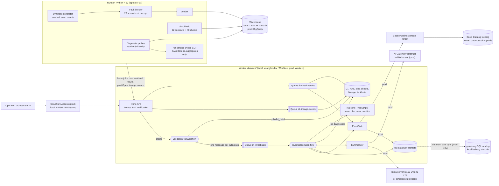

# DataTrust

Lineage-aware data quality and root-cause analysis for workforce data (HR, recruiting, compensation, payroll).

DataTrust builds a synthetic workforce warehouse with dbt, guards it with schema contracts and 40 data checks, captures column-level lineage as OpenLineage events, and when checks or metrics fail it traces the failure upstream, runs read-only diagnostic SQL probes, ranks the likely root cause, and writes an incident summary from sanitized evidence. Validation and investigation are coordinated by Cloudflare Queues and Workflows; summaries come from Workers AI in production.

> **Status: in progress.** v1 is being built from scratch against [SPEC.md](SPEC.md). Nothing below is implemented yet unless the status table says so. This README is updated with every milestone and never claims more than the repo contains.

All data is synthetic. No real employee or candidate data is used anywhere; emails use the reserved `example.com` domain.

## Status

Every component carries exactly one label (SPEC section 4.1). A label changes only with a dated command.

| Component | Status |
|---|---|
| Synthetic data generator (exact, seeded counts) | implemented; tests pass locally (`uv run pytest`), CI configured |
| dbt models, 22 enforced contracts, 40 checks | in progress: 13 staging models with enforced contracts build on DuckDB (stand-in); intermediate, marts, metrics and checks planned |
| OpenLineage capture and column-level lineage graph | planned |
| Diagnostic probes, root-cause ranker, baselines | planned |
| Fault-injection benchmark (20 scenarios) | planned |
| Worker API, D1, R2, Queues, ValidationRunWorkflow, InvestigationWorkflow | planned |
| Access JWT verification | planned |
| Workers AI summaries, AI Gateway | planned |
| Basin Pipelines, Basin Catalog (Iceberg) | planned |
| BigQuery path, policy tags, masking, authorized view, time travel | planned |
| `setup:prod` and `doctor` | planned |

## Synthetic dataset

`uv run datatrust synth --seed <n>` writes 13 Parquet tables and a `manifest.json` (row counts and SHA-256 of a canonical CSV rendering) to `.data/raw/<n>/`. Counts are fixed by construction; the seed changes values only. Seed 101 hashes are pinned in `pipelines/tests/golden/seed101.sha256.json` and checked on ubuntu-latest in CI, so macOS and Linux must agree byte for byte (integer-only arithmetic, `random.Random.random()` only, tz-aware UTC instants, `tzdata` 2026.5 pinned through `zoneinfo.reset_tzpath([])`).

| Table | Rows | Table | Rows |
|---|---|---|---|
| departments | 12 | applications | 4,800 |
| locations | 8 | stage_events | 13,440 |
| employees | 1,200 | offers | 480 |
| job_assignments | 2,820 | hires | 360 |
| requisitions | 240 | compensation | 1,980 |
| candidates | 3,600 | fx_rates | 2,190 |
| payroll_lines | 12,060 | **total** | **43,190** |

Employees: 780 tenured, 60 leavers (2025-06-30), 360 hired in 2025 (30 per month). Eight locations in six currencies; FX rates are a bounded daily random walk that never repeats on consecutive days. People are synthetic: names are drawn from fixed word lists and emails use `example.com`.

## Architecture



The Worker never holds warehouse credentials and never sends free-form SQL. A Python runner (on a laptop or in CI) leases jobs from the Worker over HTTPS, runs dbt and the diagnostic probes against the warehouse, sanitizes the probe output, and posts results back. The root-cause logic is one TypeScript package used by both the Worker and the offline benchmark.

## What runs where

Local stand-ins are labelled as stand-ins. They are never presented as the production service.

| Concern | Local and CI (offline) | Production |
|---|---|---|
| HTTP API, queue consumers, workflows | `wrangler dev --local` (Miniflare, workerd) on 127.0.0.1:8792 | Cloudflare Workers, Queues, Workflows |
| Metadata store | D1 (Miniflare) | D1 `datatrust` |
| Artifacts | R2 (Miniflare) bucket `datatrust-artifacts` | R2 `datatrust-artifacts` |
| Warehouse | **DuckDB 1.5.6 via dbt-duckdb 1.11.0 (stand-in for BigQuery)**, session pinned to UTC | BigQuery via dbt-bigquery 1.12.1 |
| BigQuery SQL validity | BigQuery macro branches rendered and checked for banned constructs; nothing executes on BigQuery | `datatrust prod validate`: compile, `dbt build --empty`, dry runs of every probe |
| Restricted / authorized views | plain DuckDB views (stand-in) | BigQuery authorized view over an untagged aggregate table |
| Column masking | none (stand-in: sanitizer and tests) | BigQuery policy tags and data masking policies |
| Time travel / recovery | per-run Parquet snapshots of marts (stand-in) | `FOR SYSTEM_TIME AS OF`, 7-day window, `bq cp table@<ms>` restore |
| Iceberg lake | **pyiceberg SqlCatalog on SQLite (stand-in for Basin Catalog)** | Basin Pipelines stream to a Basin Catalog Iceberg table |
| LLM summaries | **llama-server (Qwen3-1.7B Q4_0) on 127.0.0.1:8160 (stand-in)** or a deterministic template (CI) | Workers AI `@cf/meta/llama-3.3-70b-instruct-fp8-fast` through AI Gateway `datatrust` |
| Auth | locally generated RS256 keypair and JWKS | Cloudflare Access (team JWKS) |
| Runner identity | local dev JWT (role `runner`) | Access service token `datatrust-runner` |
| Probe identity | DuckDB connection opened read-only | impersonated service account `datatrust-prober`, dry run plus byte cap |
| Lineage | `dbt-ol` file transport, uploaded by the runner | same |

## Local setup

Prerequisites: Node 22 or newer (CI uses Node 24 from `.nvmrc`), npm, [uv](https://docs.astral.sh/uv/) and Python 3.12 (uv installs it if missing). No cloud account is needed for the local path.

```sh
npm run setup        # npm ci && uv sync --locked
npm run typecheck    # TypeScript strict, all workspaces
npm test             # vitest (packages/rca, apps/worker) and pytest
```

Generate, load and build one seed locally (DuckDB is the local stand-in for BigQuery):

```sh
uv run datatrust synth --seed 101   # .data/raw/101/*.parquet + manifest.json
uv run datatrust load --seed 101    # raw.* tables in .data/warehouse.duckdb (session pinned to UTC)
uv run datatrust build              # dbt build (profile in dbt/profiles.yml, target duckdb)
```

More commands are added here as the components land.

## Production setup

Planned. Production needs a Cloudflare account (Workers Paid plan, R2, Zero Trust) and a Google Cloud project with billing. The full ordered checklist with costs is SPEC.md section 21; it will be copied here together with `npm run setup:prod` and `npm run doctor -- --prod` when those scripts exist.

## Results

No results yet. This section will quote only numbers produced by this repo's scripts, each with the command and date that produced it. Benchmark numbers will come from DuckDB 1.5.6 as the local stand-in for BigQuery.

## License

MIT. See [LICENSE](LICENSE).
