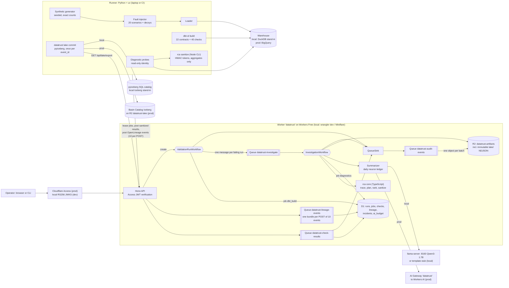

# DataTrust

Lineage-aware data quality and root-cause analysis for workforce data (HR, recruiting, compensation, payroll).

DataTrust builds a synthetic workforce warehouse with dbt, guards it with schema contracts and 40 data checks, captures column-level lineage as OpenLineage events, and when checks or metrics fail it traces the failure upstream, runs read-only diagnostic SQL probes, ranks the likely root cause, and writes an incident summary from sanitized evidence. Validation and investigation are coordinated by Cloudflare Queues and Workflows; summaries come from Workers AI in production.

> **Status: v1 core implemented; production not yet executed.** Built against [SPEC.md](SPEC.md). Everything runs locally on stand-ins (DuckDB for BigQuery, Miniflare for Cloudflare, a local LLM or template for Workers AI), and CI is configured to run the same checks once the repo is pushed (a scripted rehearsal of all four CI jobs passed in a Linux container on 2026-10-10; the first GitHub Actions run has not happened yet). The production path is implemented and waits for the account setup below. The status table never claims more than the repo has run.

All data is synthetic. No real employee or candidate data is used anywhere; emails use the reserved `example.com` domain.

## Status

Every component carries exactly one label (SPEC section 4.1). A label changes only with a dated command.

| Component | Status |
|---|---|
| Synthetic data generator (exact, seeded counts) | executed locally, 2026-10-10 (`uv run pytest`); CI workflow configured, runs once the repo is pushed |
| dbt models, 22 enforced contracts, 40 checks | executed locally on DuckDB (stand-in), 2026-10-10: 29 models, 22 contracts, 40 checks pass on clean seeds 1-3, 7, 42, 101-105; CI configured to repeat this under `TZ=UTC` and `TZ=America/Los_Angeles` |
| OpenLineage capture and column-level lineage graph | executed locally on DuckDB (stand-in): `dbt-ol build` (openlineage-dbt 1.53.0) and the TypeScript graph |
| Diagnostic probes, root-cause ranker, baselines | executed locally on DuckDB (stand-in): 14 read-only probe templates, trace, planner, ranker, ablations, baselines, HMAC sanitizer. BigQuery probe SQL rendered and parsed only |
| Fault-injection benchmark (20 scenarios) | executed locally on DuckDB (stand-in), 2026-10-10, `uv run datatrust bench --seeds 101-105` (see Results); CI gate on seed 101 configured |
| Worker API, D1, R2, Queues, ValidationRunWorkflow, InvestigationWorkflow | executed in Miniflare (`wrangler dev --local` and `@cloudflare/vitest-plugin`) only; 2026-10-10 `npm run bench:e2e` (seed 101, 20 scenarios) |
| Access JWT verification | executed against local RS256 keys only (`npm run dev:keys`, `npm run dev:token`) |
| Workers AI summaries, AI Gateway | implemented, not executed (tests mock the AI binding; the local stand-ins are llama-server with Qwen3-1.7B and a deterministic template) |
| Audit lake: Queue to R2 objects, Basin Catalog commit | implemented, not executed in production. Local path executed in Miniflare on 2026-10-10: queue `datatrust-audit-events`, immutable R2 `lake/` objects, `/api/lake/export`, then `uv run datatrust lake commit` (exactly once per `event_id`) into the pyiceberg SQL catalog (stand-in for Basin Catalog) |
| BigQuery path, policy tags, masking, authorized view, time travel | implemented, not executed (CI renders the BigQuery macro branches, runs `dbt parse --target bigquery` and tests the governance logic against fakes; `npm run prod:validate` is the first real check) |
| Incident dashboard (stretch) | executed locally under `wrangler dev` (Miniflare) as Worker static assets, 2026-10-10 |
| `setup:prod`, `setup:wizard` and `doctor` | implemented; `npm run doctor` (local) executed; `npm run doctor -- --prod` and `setup:prod` executed only up to their local preconditions (no Cloudflare or Google Cloud account connected); the wizard has not been run end to end |

## Synthetic dataset

`uv run datatrust synth --seed <n>` writes 13 Parquet tables and a `manifest.json` (row counts and SHA-256 of a canonical CSV rendering) to `.data/raw/<n>/`. Counts are fixed by construction; the seed changes values only. Seed 101 hashes are pinned in `pipelines/tests/golden/seed101.sha256.json` and checked on ubuntu-latest in CI, so macOS and Linux must agree byte for byte (integer-only arithmetic, `random.Random.random()` only, tz-aware UTC instants, `tzdata` 2026.5 pinned through `zoneinfo.reset_tzpath([])`).

| Table | Rows | Table | Rows |
|---|---|---|---|
| departments | 12 | applications | 4,800 |
| locations | 8 | stage_events | 13,440 |
| employees | 1,200 | offers | 480 |
| job_assignments | 2,820 | hires | 360 |
| requisitions | 240 | compensation | 1,980 |
| candidates | 3,600 | fx_rates | 2,190 |
| payroll_lines | 12,060 | **total** | **43,190** |

Employees: 780 tenured, 60 leavers (2025-06-30), 360 hired in 2025 (30 per month). Eight locations in six currencies; FX rates are a bounded daily random walk that never repeats on consecutive days. People are synthetic: names are drawn from fixed word lists and emails use `example.com`.

## Checks

40 dbt test nodes, all named `dq_*` and listed in [`checks/registry.yml`](checks/registry.yml): 18 generic tests and 22 singular SQL tests. No dbt packages are used.

| Category | Count | Examples |
|---|---|---|
| Record uniqueness | 8 | unique employee, hire and application keys; one compensation row per employee; one FX rate per currency-day |
| Referential integrity | 8 | assignments, applications, hires, offers and payroll lines point at existing parents; every hire has an accepted offer |
| Historical intervals | 7 | no overlapping or gapped assignment and compensation history; first assignment starts at hire; no payroll after termination |
| Recruiting-stage transitions | 7 | allowed stage pairs, monotonic timestamps, terminal stage last, recruiter events in local business hours, hired event on the local hire date |
| Compensation and FX | 6 | USD salary recomputes from staging and the daily rate, FX not stale, complete 2025 calendar, within 15% of the trailing 30-day median |
| SQL reconciliation | 4 | payroll actual vs expected, headcount, payroll cost and a three-way hires reconciliation across metric, fact and HRIS events |

Separately, 22 enforced dbt model contracts (13 staging, 5 marts, 4 metrics) are the schema contracts. Staging passes raw integer money columns through uncast, so a source that starts delivering salary as text fails the `stg_compensation` contract at build time; the runner classifies that as `schema_contract` with the column name.

## Root-cause analysis

When checks fail, the TypeScript RCA core (`packages/rca`, the same code in the Worker and in the offline benchmark CLI) does four things:

1. **Trace.** From each failing check's tested columns, walk upstream through OpenLineage column lineage (falling back to dataset edges for columns the SQL parser could not trace). Candidates are the union of the closures.
2. **Plan.** Pick diagnostic probes from each candidate's dbt meta (grain, unique keys, foreign keys, intervals, time zones, FX, recomputable columns, casts) and probe the candidates' parents too. Planning is metadata-driven and the same for every incident.
3. **Probe.** The Python runner renders each probe from its own SQL templates (the Worker never sends SQL), checks it with a sqlglot read-only guard, runs it on a read-only connection and returns aggregates plus at most five sample keys, which `rca sanitize` turns into HMAC tokens (pseudonymization) before upload.
4. **Rank.** `score = 0.40 coverage + 0.30 own_anomaly + 0.15 changed - 0.10 unexplained_pass`, with weights tuned on dev seeds 1-3 only and frozen before the test seeds ran (ADR-0004, `packages/rca/src/rca/weights.ts`). `own_anomaly` subtracts the same probe's anomaly on the lineage-mapped parent columns, so the first anomalous node along the column path wins; row-multiplicity anomalies are discounted against any dataset parent.

Ablations (`coverage_only`, `dataset_lineage_only`, `no_probes`, `no_change_signal`) and naive baselines (`change_only`, `nearest_upstream_source`, `random_in_closure`) are computed from the same probe results.

## Fault-injection benchmark

20 scenarios (`pipelines/datatrust/bench/scenarios.py`): 13 source-data defects injected into the generated tables before loading, and 7 transformation bugs applied as patches to a temporary copy of the dbt project. The named resume defects are duplicate hires (S01), join fan-out (T14, T15), stale exchange rates (S03) and timezone mismatches (S04, T16). Every trial also applies 0 to 4 decoy patches (12 benign refactors across staging, intermediate, marts and metrics, half the time including one on the failing lineage path), so "the model that changed" is often innocent. Severities are drawn per seed and include low ones on purpose.

Protocol: weights are tuned only on dev seeds 1-3 and frozen (ADR-0004) before the test seeds 101-105 run (100 injected trials plus 5 clean trials). Detection recall and top-3 root-cause accuracy are reported with Wilson intervals and scenario-clustered bootstrap intervals, next to ablations, naive baselines and a leave-one-scenario-out figure.

## Incident summaries

Summaries are written from sanitized evidence only. The model never writes numbers: it cites `{ev:<key>.<field>}` placeholders and the Worker substitutes the values. A draft is accepted only if it matches the schema, every placeholder resolves, no digit appears outside placeholders and known identifiers, the root cause is a top-five candidate, its references exist, and nothing looks like PII. A failed draft gets one repair request that quotes the violations; after that the deterministic template is used and the fallback is recorded on the incident. Each model call is its own Workflow step (`summarize-draft`, `summarize-repair`, then `summarize-finalize` without a call), so a later failure replays the stored answer instead of calling the model again. On the Workers Free plan every Workers AI call first reserves its worst case in a daily neuron ledger in D1 (`AI_DAILY_NEURON_CAP`, 2,000 per UTC day, a fifth of the account's free 10,000); when the reservation is refused no call is made and the incident gets the template with reason `daily_neuron_cap`. `GET /api/ai/budget` shows the day's ledger. Recovery commands (BigQuery time-travel `bq cp`, or the local snapshot restore) are attached by the server, never written by the model.

| Provider | Where | Status |
|---|---|---|
| Workers AI `@cf/meta/llama-3.3-70b-instruct-fp8-fast` through AI Gateway `datatrust` | production only (the AI binding does not run in `wrangler dev --local`) | implemented, not executed |
| OpenAI-compatible llama-server, Qwen3-1.7B Q4_0 on 127.0.0.1:8160 | local stand-in (`npm run dev:up -- --llm`) | executed locally |
| Deterministic template | CI and fallback | executed locally and in tests |

Summary faithfulness eval (stretch, `npm run eval:summaries`, 2026-10-10, commit `bbb8e65`): the 20 seed-101 incidents (one per scenario, offline trials on DuckDB) through the same grounded loop the Worker runs. Reports: [`results/summaries-2026-10-10-local-llm.md`](results/summaries-2026-10-10-local-llm.md), [`results/summaries-2026-10-10-template.md`](results/summaries-2026-10-10-template.md).

| Summarizer | Incidents | First draft is JSON | First draft grounded | Accepted after repair | Template fallback | Accepted drafts naming a top-3 root cause | PII leaks |
|---|---|---|---|---|---|---|---|
| Qwen3-1.7B Q4_0 via llama-server (local stand-in for Workers AI) | 20 | 100% | 15% | 5% | 80% | 4/4 | 0 |
| template-v1 | 20 | 100% | 100% | 0% | 0% | 20/20 | 0 |

The small local model mostly fails grounding (violations by rule on the final attempt: unknown diagnostic SQL id (17), unknown evidence ref (11), number outside a placeholder (8), root cause not in top five (2), schema (1)), so most of its incidents carry the template summary and say so. Decoding uses temperature 0 and a fixed seed, but an earlier run in the same session differed by one incident, so treat the local figures as approximate. Workers AI (`llama-3.3-70b-instruct-fp8-fast`) has not run yet; `npm run prod:smoke` measures its grounding pass rate and fallback rate in production.

## Architecture



The Worker never holds warehouse credentials and never sends free-form SQL. A Python runner (on a laptop or in CI) leases jobs from the Worker over HTTPS, runs dbt and the diagnostic probes against the warehouse, sanitizes the probe output, and posts results back. The root-cause logic is one TypeScript package used by both the Worker and the offline benchmark.

## What runs where

Local stand-ins are labelled as stand-ins. They are never presented as the production service.

| Concern | Local and CI (offline) | Production |
|---|---|---|
| HTTP API, queue consumers, workflows | `wrangler dev --local` (Miniflare, workerd) on 127.0.0.1:8792 | Cloudflare Workers, Queues (five `datatrust-*` queues), Workflows, on the Workers Free plan |
| Metadata store | D1 (Miniflare) | D1 `datatrust` |
| Artifacts | R2 (Miniflare) bucket `datatrust-artifacts` | R2 `datatrust-artifacts` |
| Warehouse | **DuckDB 1.5.6 via dbt-duckdb 1.11.0 (stand-in for BigQuery)**, session pinned to UTC | BigQuery via dbt-bigquery 1.12.1 |
| BigQuery SQL validity | BigQuery macro branches rendered and checked for banned constructs; nothing executes on BigQuery | `datatrust prod validate`: compile, `dbt build --empty`, dry runs of every probe |
| Restricted / authorized views | plain DuckDB views (stand-in) | BigQuery authorized view over an untagged aggregate table |
| Column masking | none (stand-in: sanitizer and tests) | BigQuery policy tags and data masking policies |
| Time travel / recovery | per-run Parquet snapshots of marts (stand-in) | `FOR SYSTEM_TIME AS OF`, 7-day window, `bq cp table@<ms>` restore |
| Iceberg lake | the same Queue, consumer and R2 `lake/` objects as production, then **pyiceberg SqlCatalog on SQLite (stand-in for Basin Catalog)** | Queue `datatrust-audit-events` to immutable NDJSON objects in R2, added to the Basin Catalog Iceberg table `datatrust.audit_events` on R2 `datatrust-lake` by `datatrust lake commit --catalog basin` (pyiceberg REST catalog; the production runner runs it every 15 minutes and on exit). Basin Pipelines is Workers Paid only and is not used |
| LLM summaries | **llama-server (Qwen3-1.7B Q4_0) on 127.0.0.1:8160 (stand-in)** or a deterministic template (CI) | Workers AI `@cf/meta/llama-3.3-70b-instruct-fp8-fast` through AI Gateway `datatrust`, at most 2,000 neurons per UTC day by a D1 ledger (beyond it the template, with reason `daily_neuron_cap`) |
| Auth | locally generated RS256 keypair and JWKS | Cloudflare Access (team JWKS) |
| Runner identity | local dev JWT (role `runner`) | Access service token `datatrust-runner` (role `runner` only) |
| Operator identity (start runs, read incidents) | local dev JWT (role `operator`) | your Access login in the browser, or Access service token `datatrust-operator` for the CLI and the smoke |
| Probe identity | DuckDB connection opened read-only | impersonated service account `datatrust-prober`, dry run plus byte cap |
| Lineage | `dbt-ol` file transport, uploaded by the runner in POSTs of at most 10 events and 256 KB, one queue message per POST | same |

## Local setup

Prerequisites: Node 22 or newer (CI uses Node 24 from `.nvmrc`), npm, [uv](https://docs.astral.sh/uv/) and Python 3.12 (uv installs it if missing). No cloud account is needed for the local path.

```sh
npm run setup        # npm ci && uv sync --locked
npm run doctor       # checks the local prerequisites and prints the fix for anything missing
npm run typecheck    # TypeScript strict, all workspaces
npm run build        # RCA CLI bundle (used by the Python runner) and the dashboard
npm test             # vitest (packages/rca, apps/worker, apps/web) and pytest
```

Generate, load and build one seed locally (DuckDB is the local stand-in for BigQuery):

```sh
uv run datatrust synth --seed 101   # .data/raw/101/*.parquet + manifest.json
uv run datatrust load --seed 101    # raw.* tables in .data/warehouse.duckdb (session pinned to UTC)
uv run datatrust build              # dbt-ol build: 29 models, 22 contracts, 40 checks, OpenLineage events in dbt/target/
```

Run the offline fault-injection benchmark (DuckDB stand-in; about 30 seconds per seed with 6 workers on a laptop):

```sh
npm run build -w @datatrust/rca                          # bundle the TypeScript RCA CLI the runner calls
uv run datatrust bench --seeds 1 --workers 6 --out /tmp/dt # 20 injected trials + 1 clean trial
```

Full local loop through Queues and Workflows (Miniflare, local Access stand-in, DuckDB stand-in):

```sh
npm run dev:up                                       # dev keys if missing, D1 migrations, wrangler dev on 127.0.0.1:8792 (inspector 9242)
OP=$(npm run -s dev:token -- --role operator)
curl -s -X POST -H "Cf-Access-Jwt-Assertion: $OP" -H 'content-type: application/json' \
  -d '{"target":"duckdb","seed":101,"scenario":"S01"}' http://127.0.0.1:8792/api/runs
uv run datatrust runner --watch --idle-exit 30       # leases the dbt_build job, then the diagnostics job
curl -s -H "Cf-Access-Jwt-Assertion: $OP" http://127.0.0.1:8792/api/runs/<runId>          # status, failing checks, incidentId
curl -s -H "Cf-Access-Jwt-Assertion: $OP" http://127.0.0.1:8792/api/incidents/<incidentId>
npm run dev:down                                     # stops everything dev:up started and confirms the ports are free
```

The same in two commands: `uv run datatrust runner --watch --idle-exit 60` in one terminal, and `uv run datatrust run --scenario S01 --wait` in another (it posts the run as operator with a local dev token and prints the run status, failing checks, top three candidates and summary title once the incident exists).

`npm run bench:e2e` runs the seed-101 benchmark through all of the above (20 scenarios, each through Queues and both Workflows) and checks that the incident top-3 lists equal the offline mode's; `npm run bench:e2e -- --pytest` is the CI subset (S01, T14, S04). Both stop everything they started.

The Worker also serves a read-only incident dashboard (`apps/web`, React 19 and Vite 8, built with `npm run build`) at http://127.0.0.1:8792/: the incident list, then per incident the summary, failing checks, ranked candidates with their features, the column-level lineage path, the supporting diagnostic SQL, recovery commands and the provenance with every local stand-in labelled. Locally, paste a token from `npm run -s dev:token -- --role viewer` into the "Local dev token" box; in production Cloudflare Access signs the browser in.

Audit events (check results, completed runs, incidents) go to the lake the same way locally and in production: the Worker sends them to queue `datatrust-audit-events`, whose consumer writes each batch as one immutable NDJSON object under `lake/` in R2, and `GET /api/lake/export` serves objects once they have settled (5 s locally, 120 s in production). `uv run datatrust lake commit` (alias `npm run lake:sync`) adds them to a pyiceberg SQL catalog under `.data/lake/` (stand-in for Basin Catalog): it drops events whose `event_id` is already in the table and moves its cursor, the table property `datatrust.lake.after`, in the same Iceberg commit as the rows, so every event lands exactly once. In production the same command with `--catalog basin` writes the Basin Catalog table. `uv run datatrust lake query` reads the local Iceberg table through DuckDB.

`npm run dev:up -- --llm` also starts llama-server (Qwen3-1.7B) on 127.0.0.1:8160; set `DATATRUST_LLM_MODEL_PATH` if the GGUF lives elsewhere.

`npm run doctor` and `npm run doctor -- --prod` print one line per prerequisite and the exact fix; `make` offers the same entry points (`make setup|test|bench|bench-e2e|doctor|bootstrap|dev-up|dev-down`).

## Production setup

Production runs on the **Cloudflare Workers Free plan** (no Workers Paid feature anywhere: [SPEC section 28](SPEC.md), [ADR-0008](docs/adr/0008-workers-free-plan.md)) and on a Google Cloud project shared with three other repos, so every resource DataTrust creates is named `datatrust*`, and the bootstrap's grants are scoped to DataTrust's own datasets, policy tags, data policies and service accounts (plus BigQuery Job User for its two service accounts). Everything below is implemented and tested locally against stand-ins, and has **not yet run on Cloudflare or Google Cloud**. These are the steps only the account owner can do; the scripts do the rest. `npm run doctor -- --prod` prints one line per prerequisite with the exact fix, so run it whenever you are unsure what is left.

The quickest path is the guided wizard, which opens each dashboard page, says what to click and copy, pre-fills the values already known, writes them into `.env.prod`, and runs the bootstrap and the doctor between phases (re-run it any time; it keeps values already saved):

```sh
npm run setup:wizard
```

The tables below are the same steps by hand (SPEC section 21). "Done" reflects read-only checks of the account on 2026-10-10. Start with the values file (gitignored; never put `CLOUDFLARE_API_TOKEN` in it, because wrangler would use it instead of your `wrangler login`):

```sh
cp .env.example .env.prod && chmod 600 .env.prod
```

### Cloudflare

| # | Step | Command or URL | Cost | Done (2026-10-10) |
|---|---|---|---|---|
| 1 | Cloudflare account `dc93c3bc8aa4f9e09a0d7e7354a80873` | https://dash.cloudflare.com/ | free | yes |
| 2 | Stay on the Workers Free plan; do not subscribe to Workers Paid | dashboard: Workers & Pages, Plans shows Free | free | yes |
| 3 | R2 activated with a payment card | https://dash.cloudflare.com/?to=/:account/r2 | free tier: 10 GB-month, 1M Class A, 10M Class B operations per month | yes |
| 4 | wrangler logged in with OAuth, no Cloudflare token exported in the shell | `cd apps/worker && unset CLOUDFLARE_API_TOKEN CLOUDFLARE_API_KEY CLOUDFLARE_EMAIL && npx wrangler whoami` | free | yes |
| 5 | workers.dev subdomain `nitish-ratakonda` | dashboard: Workers & Pages, Account details | free | yes |
| 6 | Zero Trust organization `old-truth-a7dc` on the Free plan (50 seats, shared by four repos) | https://one.dash.cloudflare.com/ | $0 | yes |
| 7 | Add the One-time PIN login method (new organizations no longer get it automatically) | Zero Trust, Integrations, Identity providers, Add new identity provider, One-time PIN | free | in progress |
| 8 | Fill `.env.prod`: `CLOUDFLARE_ACCOUNT_ID=dc93c3bc8aa4f9e09a0d7e7354a80873`, `ACCESS_TEAM_DOMAIN=https://old-truth-a7dc.cloudflareaccess.com`, `DATATRUST_OPERATOR_EMAIL=<your Access login email>`, plus the Google values of step 4 below | edit `.env.prod` | free | no |
| 9 | R2 API token for Basin Catalog (R2, Manage API tokens, Create Account API token, Admin Read & Write), saved as `BASIN_CATALOG_TOKEN` | https://dash.cloudflare.com/?to=/:account/r2/api-tokens | free | no |
| 10 | Optional: narrow AI Gateway token (account permissions AI Gateway Read and Edit) saved as `DATATRUST_CF_API_TOKEN`; or create gateway `datatrust` in the dashboard (AI, AI Gateway, Create Gateway) | https://dash.cloudflare.com/profile/api-tokens | free (1 of 10 gateways) | no |
| 11 | Run the Cloudflare bootstrap: D1 `datatrust`, R2 `datatrust-artifacts` and `datatrust-lake`, Basin Catalog on `datatrust-lake`, the five `datatrust-*` queues, the AI Gateway, the D1 migrations (confirm the prompt), and a fail-closed first deploy (every API call answers 401); the Worker URL is saved as `DATATRUST_API_URL` | `npm run setup:prod -- --cloudflare-only` | free | no |
| 12 | Protect the Worker with Access: Workers & Pages, datatrust, Settings, Domains & Routes, **Enable Cloudflare Access** on the workers.dev entry, then **Manage Cloudflare Access** to allow your email (each distinct email, plus-addresses included, takes one of the 50 shared seats) | https://dash.cloudflare.com/?to=/:account/workers-and-pages | free | no |
| 13 | Copy the Application Audience (AUD) tag of the datatrust Access application into `ACCESS_AUD` | https://one.dash.cloudflare.com/ (Access, Applications) | free | no |
| 14 | Create two service tokens (1 year each; each secret is shown once): `datatrust-runner`, saved as `CF_ACCESS_CLIENT_ID` and `CF_ACCESS_CLIENT_SECRET` (the runner; it can only lease jobs, post results and export the lake), and `datatrust-operator`, saved as `CF_ACCESS_OPERATOR_CLIENT_ID` and `CF_ACCESS_OPERATOR_CLIENT_SECRET` (starts runs and reads incidents from the CLI and the smoke test). Then add one policy on the datatrust Access app with action **Service Auth** that includes both | Zero Trust, Access, Service credentials, Service Tokens | free (tokens take no seat) | no |
| 15 | Rerun the bootstrap to set the real secrets and redeploy | `npm run setup:prod -- --cloudflare-only` | free | no |
| 16 | Optional: Basin Catalog snapshot expiration (leave compaction off) | `cd apps/worker && npx wrangler basin catalog snapshot-expiration --help` | free | no |
| 17 | Check (it also confirms each service token reaches the Worker with exactly its roles) | `npm run doctor -- --prod` | free | no |

Workers AI needs no setup beyond the binding. On the Free plan the account gets 10,000 neurons per day with no overage, shared by four repos, so DataTrust caps itself at 2,000 per UTC day with a ledger in D1: a summary reserves at most 388 neurons (187 for the draft, 201 for a repair), and once the cap or the account allowance is reached the summarizer falls back to the deterministic template and records why. The smoke test first checks for 1,940 neurons of headroom. AI Gateway's core features are free. Queues, Workflows, D1 and R2 usage stays inside the Free amounts (SPEC section 28.6). There is no cron trigger, so nothing runs unless you start a run.

### Google Cloud (shared project `master-magnet-444903-u4`)

| # | Step | Command or URL | Cost | Done (2026-10-10) |
|---|---|---|---|---|
| 1 | Use the shared project `master-magnet-444903-u4` (BigQuery location US); `gcloud` and `bq` installed and logged in, application default credentials created | `gcloud config list` | free | yes |
| 2 | Enable billing on the project (a billing account is linked but billing is off: reactivate or relink it) and add a $5 budget alert scoped to the project. The BigQuery sandbox rejects INSERT, MERGE and DELETE and expires tables after 60 days, and policy tags and masking need billing | https://console.cloud.google.com/billing?project=master-magnet-444903-u4 | expected $0: 1 TiB of queries per month is free and every DataTrust query is capped | no |
| 3 | Set the ADC quota project | `gcloud auth application-default set-quota-project master-magnet-444903-u4` | free | unknown |
| 4 | `.env.prod`: `DATATRUST_GCP_PROJECT=master-magnet-444903-u4`, `DATATRUST_BQ_LOCATION=US` | edit `.env.prod` | free | no |
| 5 | Run the Google Cloud bootstrap: enables `datacatalog`, `iam` and `iamcredentials` (`bigquery` and `bigquerydatapolicy` are already on); creates only `datatrust_raw`, `datatrust_staging`, `datatrust_marts` and `datatrust_restricted` (7-day time travel), the `datatrust-analyst` and `datatrust-prober` service accounts, the `datatrust-classification` taxonomy and its masking policies; then `prod validate` (compile, `dbt build --empty`, probe dry runs), the real build and the masking verification as the analyst | `npm run setup:prod -- --gcp-only` | about $0, every query capped | no |
| 6 | Check, then run the production smoke test (one clean run and five fault runs through the deployed Queues and Workflows on BigQuery, Workers AI summaries, the Iceberg rows committed and read back, Access checks) | `npm run doctor -- --prod`, then `npm run prod:smoke` | about $0 | no |
| 7 | Optional: run the production runner on GitHub Actions with Workload Identity Federation | [`docs/prod-runner-wif.md`](docs/prod-runner-wif.md) | free | no |

Your Google identity needs Owner on the project (or BigQuery Admin, Data Catalog Policy Tag Admin, Data Policy Admin and Service Account Admin). Owner does not include Fine-Grained Reader, which the bootstrap grants explicitly on the DataTrust policy tags only, to your active `gcloud` account (set `DATATRUST_GCP_USER` to use another) so dbt tests can read real values, together with Service Account Token Creator on the two DataTrust service accounts (never on the project). The only project-level grant DataTrust adds is BigQuery Job User for its two service accounts, which lets them run jobs but reads no data. The masking rules are v1 data policies bound to the three policy tags.

Once both parts are done, production runs work like the local loop, with the runner on your machine:

```sh
uv run datatrust runner --env prod --target bigquery --watch             # terminal 1: BigQuery, service token datatrust-runner
uv run datatrust run --env prod --seed 101 --scenario S01 --wait         # terminal 2: start a run as operator, wait for the incident
```

The production runner also commits the audit lake to Basin Catalog every 15 minutes and when it stops (`uv run datatrust lake commit --catalog basin` does the same by hand). The dashboard is the Worker URL in a browser; Access signs you in with your email.

Only `npm run prod:smoke` may move a status label above to "executed in production"; it writes `results/prod-smoke-<date>.*` with the commands, run ids, the Workers AI grounding pass rate and fallback rate, the Iceberg row count and BigQuery bytes billed.

## Results

All numbers below were produced by this repo's scripts on 2026-10-10 on the local warehouse stand-in, **DuckDB 1.5.6 via dbt-duckdb 1.11.0, not BigQuery**. Nothing in this section ran on Cloudflare or Google Cloud.

Command (test seeds 101-105, weights frozen beforehand from dev seeds 1-3, ADR-0004):

```sh
uv run datatrust bench --mode offline --seeds 101-105 --workers 6 --dev-results results/bench-2026-10-10-offline-dev.json
```

Full report: [`results/bench-2026-10-10-offline.md`](results/bench-2026-10-10-offline.md) (data in the matching `.json`; gate numbers in `results/baseline.json`). The same command rerun at commit `019714f` on 2026-10-10 reproduced every one of the 105 per-trial rankings exactly ([`results/bench-2026-10-10-offline-recheck.md`](results/bench-2026-10-10-offline-recheck.md)).

| Metric (100 injected trials: 20 scenarios x 5 seeds) | Measured | Wilson 95% | Scenario-clustered bootstrap 95% |
|---|---|---|---|
| Detection recall (target 95%) | 100% (100/100) | 96.3% to 100% | 100% to 100% |
| Top-3 root-cause accuracy (target 90%) | 100% (100/100) | 96.3% to 100% | 100% to 100% |
| Top-1 root-cause accuracy | 90% (90/100) | 82.6% to 94.5% | 75% to 100% |

- Clean false positives over the 5 clean trials (decoys applied): 0.
- Leave-one-scenario-out top-3 (weights re-tuned without the held-out scenario): 100% over 100 trials.
- Naive baselines on the same candidate sets: `change_only` top-3 77%, `nearest_upstream_source` 60%, `random_in_closure` 73.4% expected. The ranker's top-3 gain over the best baseline is 23 percentage points.
- Ablations: `coverage_only` top-3 85%, `no_probes` 95%, `dataset_lineage_only` 98%, `no_change_signal` 100%.
- Median candidate-set size 4 (IQR 2 to 6), so top-3 is a short list; top-1 (90%) is the more demanding number. The 10 top-1 misses are S10 (currency mismatch) and S11 (payroll after termination), where the ground truth ranked second in every trial.

End-to-end check through the local Worker (Miniflare via `wrangler dev --local`, which stands in for Cloudflare Workers, Queues, Workflows, D1 and R2): `npm run bench:e2e` on 2026-10-10 sent all 20 seed-101 scenarios through `POST /api/runs`, ValidationRunWorkflow, the runner, the queues and InvestigationWorkflow. 20/20 detected, ground truth in the incident's top 3 in 20/20, rank 1 in 18/20, 0 clean false positives, and every top-3 list identical to the offline mode ([`results/bench-2026-10-10-e2e.md`](results/bench-2026-10-10-e2e.md)).

A nightly GitHub Actions job (`.github/workflows/nightly.yml`) reruns the five-seed benchmark and fails if clean false positives appear or detection or top-3 drop more than 0.05 below `results/baseline.json`.

How to read this honestly: the scenarios, checks and probes were written by the same author, and the weights were tuned on dev seeds over the same 20 scenarios, so the test seeds hold out values and severities, not defect types. The benchmark is in-distribution; it shows the mechanism works on these defect classes, not that it generalizes to unseen ones.

## License

MIT. See [LICENSE](LICENSE).
