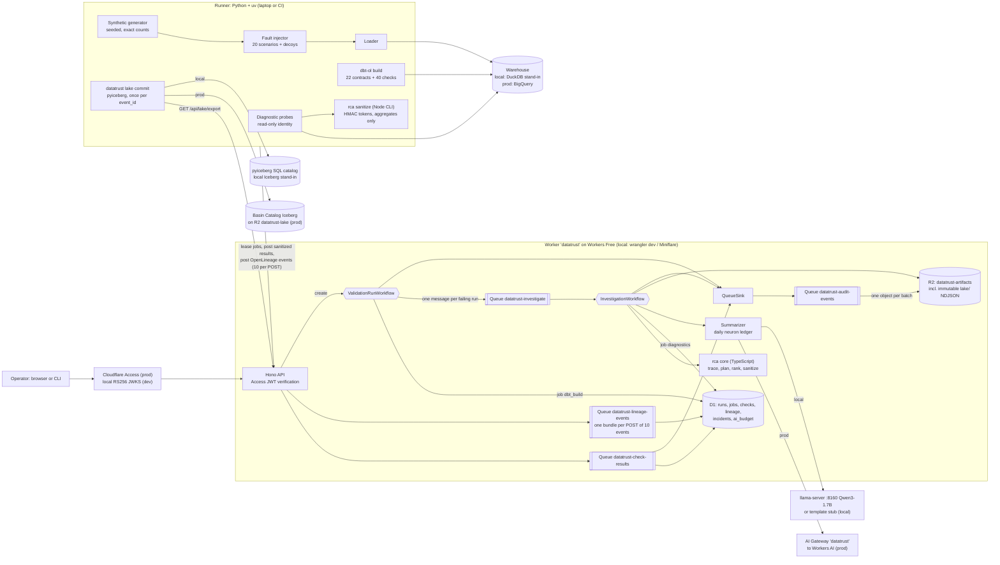
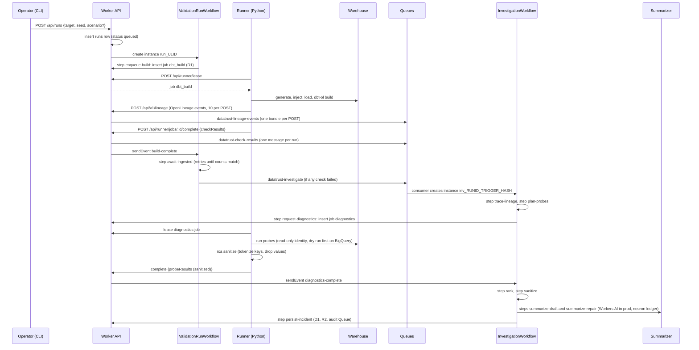

# DataTrust v1 Specification

Lineage-aware data quality and root-cause analysis for workforce (HR, recruiting, compensation) data.

- Spec version: 1.2, 2026-10-10. Version 1.0 was written by the architect pass; 1.1 resolves the review findings (section 27, Review log); 1.2 moves production onto the Cloudflare Workers Free plan (section 28, ADR-0008), and section 28 wins over any older sentence that still conflicts with it. v1 is implemented locally (see PROGRESS.md); the Free plan changes are the commits of section 23.1.
- Repository: `~/Developer/projects/datatrust`, published as `github.com/nitishsjsucs/datatrust` (public, empty, default branch `main`, confirmed with `gh api` on 2026-10-10).
- v1 is built from scratch. No earlier implementation is reused.
- Every version, command and product fact in this document is either verified (see section 25, Verification log) or explicitly marked **UNVERIFIED**.

---

## 1. Acceptance criteria (the resume text)

The build is done when every number and mechanism below is implemented, testable, and reproducible from this repo:

> DataTrust -- Lineage-Aware Data Quality and Root-Cause Analysis
> Built a workforce data-quality system that combined schema contracts, SQL reconciliation, and column-level lineage to identify record inconsistencies and calculation discrepancies. Used Cloudflare Queues and Workflows to coordinate validation, with Workers AI generating incident summaries from sanitized diagnostic evidence.
> * Built a validation framework with approximately 40 dbt and SQL checks covering record uniqueness, referential integrity, historical intervals, recruiting-stage transitions, and compensation calculations.
> * Built a fault-injection benchmark covering 20 defect scenarios, including duplicate hires, join fan-out, stale exchange rates, and timezone mismatches, targeting 95% detection recall and 90% top-three root-cause accuracy.
> * Built automated investigation workflows using Cloudflare Queues, Workflows, and OpenLineage, tracing failed metrics to upstream transformations and generating Workers AI summaries with supporting diagnostic SQL.

Hard numbers v1 must make exactly true:

| Claim | v1 implementation | Proven by |
|---|---|---|
| ~40 dbt and SQL checks | exactly 40 dbt test nodes (18 generic + 22 singular SQL) | `pipelines/tests/test_check_registry.py` |
| five check categories named in the bullet | 8 uniqueness, 8 referential, 7 historical-interval, 7 stage-transition, 6 compensation/FX, plus 4 SQL reconciliation | same test, category counts asserted |
| 20 defect scenarios incl. duplicate hires, join fan-out, stale FX, timezone mismatch | exactly 20 registered scenarios (13 source-data, 7 transformation) | `pipelines/tests/test_scenarios.py` |
| 95% detection recall (target) | measured by the benchmark, reported with a Wilson 95% interval and a scenario-clustered bootstrap interval | `datatrust bench` output in `results/` |
| 90% top-three root-cause accuracy (target) | measured by the benchmark, same intervals, plus baselines and a leave-one-scenario-out figure (section 12.3) | same |

"Targeting" means the eval measures the real number and the README reports it as measured, even if it misses the target. Benchmark numbers come from the local warehouse stand-in (DuckDB 1.5.6), and the README Results section says so.

---

## 2. Goals and non-goals

### Goals

1. A deterministic, seeded synthetic workforce dataset with exact, asserted row counts.
2. A dbt project that builds on DuckDB (local, CI) and BigQuery (production) from the same models, with dialect differences isolated in dispatched macros.
3. Schema contracts (dbt enforced model contracts), 40 data checks, and SQL reconciliation checks.
4. Column-level lineage captured as OpenLineage events (`dbt-ol`), ingested into a lineage graph.
5. A root-cause ranker that traces failing checks and failed metrics upstream through column-level lineage, runs metadata-driven diagnostic SQL probes, and ranks candidate nodes.
6. A fault-injection benchmark (20 scenarios, held-out seeds, 0 to 4 decoy code changes per trial, naive baselines) measuring detection recall and top-1/top-3 root-cause accuracy.
7. A Cloudflare Worker that coordinates validation and investigation with Queues and Workflows, sanitizes evidence, and generates incident summaries with Workers AI (production) through AI Gateway.
8. Cloudflare Access protection with in-Worker JWT verification (fail closed).
9. A local path that works fully offline and in CI, and a production path that runs as soon as credentials exist, with an idempotent `setup:prod` and a `doctor` that names every missing prerequisite.
10. Production on the Cloudflare Workers Free plan only, inside DataTrust's share of the account's daily allowances (section 28).

### Non-goals (v1)

- Real employee data of any kind. All people are synthetic; emails use the reserved `example.com` domain.
- Multi-tenant SaaS, user management beyond Access, or a write-capable UI.
- Grouping several independent defects in one run into separate incidents (v1 creates one incident per run with failures; see section 13.4).
- Automatic remediation. v1 generates recovery commands (BigQuery time travel `bq cp`, local snapshot restore) for a human to run.
- MetricFlow / dbt Semantic Layer (`dbt-metricflow 0.15.0` resolves with this stack, verified, but is excluded to keep dependencies small; metrics are plain dbt models).
- The Cloudflare Agents SDK (`agents`, now 0.28.0 on npm, verified). Workflows are the orchestrator.
- Streaming ingestion of HR source systems. Sources are batch-loaded.
- Running the benchmark against BigQuery at full scale (prod gets a smoke subset).
- Scheduled validation runs. v1 has no cron trigger: the runner lives on Nitish's laptop, and a daily run would wait hours for a runner that is usually offline (review finding I6). Runs start from the CLI or `POST /api/runs`.

---

## 3. Architecture

### 3.1 Component diagram



Basin Pipelines, the v1.1 production lake sink, is Workers Paid only and is no longer part of the design (section 28.5.1).

### 3.2 One validation run, end to end



### 3.3 Key design decisions (each becomes an ADR in `docs/adr/`)

1. **ADR-0001 Runner pull model.** Workers cannot run dbt or reach a laptop DuckDB file, so a Python runner leases jobs from the Worker over HTTPS (outbound only). The Worker never holds warehouse credentials and never sends free-form SQL: it sends probe invocations (probe id, node id, columns), and the runner renders SQL from its own templates and its own manifest. Same protocol locally and in production; no extra listening port.
2. **ADR-0002 One RCA implementation, in TypeScript.** Lineage graph building, upstream tracing, probe planning, ranking, sanitization and summary validation live in `packages/rca` (pure functions, no I/O). Workflow steps call it in the Worker; the offline benchmark calls the same code through a bundled Node CLI. A parity test asserts identical rankings from both paths.
3. **ADR-0003 Local stand-ins are labelled, never presented as the production service.** Every persisted incident records `provenance` (warehouse, summarizer provider and model, lake sink). The README table in section 4 is normative.
4. **ADR-0004 Frozen ranking weights.** Weights are tuned only on dev seeds 1-3 and frozen in `packages/rca/src/rca/weights.ts` with this ADR before the test-seed run (seeds 101-105). Test-seed results are reported whatever they are.
5. **ADR-0005 Raw data are dbt sources, not seeds.** Verified: `dbt-ol` omits `ref()`-ed seeds from dataset-level `inputs` (they still appear in `columnLineage`), while sources appear in both. Loading raw tables as sources keeps the lineage graph complete.
6. **ADR-0006 Deterministic warehouse semantics.** Every DuckDB session runs in UTC (`settings: {TimeZone: UTC}` in the profile), every stored instant is a time-zone-aware UTC timestamp, and every money and rate value is `decimal(38,9)` on DuckDB and `NUMERIC` (38,9) on BigQuery. Plain `numeric` in DuckDB is DECIMAL(18,3) and is banned. Local time is derived only through the `tz_local_*` dialect macros. Reason: without these rules the same seed gives different answers on the Mac, on ubuntu-latest and on BigQuery (review findings B1, B2).
7. **ADR-0007 Least-privilege probes and runner-side sanitization.** Probes run on a read-only DuckDB connection locally and as the impersonated `datatrust-prober` service account on BigQuery, with a dry run and `maximum_bytes_billed` on every query. The runner sanitizes probe output with the same TypeScript code (`rca sanitize`) before anything is uploaded, so no raw identifier reaches R2 or D1. The Worker re-checks and rejects unsanitized payloads (review finding I9).
8. **ADR-0008 Production on the Workers Free plan.** No Workers Paid feature anywhere: the audit lake goes through a Queue into immutable R2 objects that a pyiceberg committer adds to Basin Catalog once per event id, lineage arrives in bundles of ten, D1 writes are set-based, Workers AI spend is capped by a daily ledger, and every account-wide allowance is budgeted at a 25% share because four repos share the account (section 28).

---

## 4. What runs where (normative; copied into the README)

| Concern | Local and CI (offline) | Production | Notes |
|---|---|---|---|
| HTTP API, queue consumers, workflows | `wrangler dev --local` (Miniflare, workerd) on 127.0.0.1:8792, inspector 9242 | Cloudflare Workers, Queues, Workflows on the **Workers Free plan** (no Paid feature anywhere, section 28) | Verified locally: Workflows incl. `waitForEvent`/`sendEvent`, Queue producer+consumer, D1, R2 all run in local mode. Miniflare enforces no plan limits, so `npm run budget:cpu` and `test_free_budget.py` check them offline |
| Metadata store | D1 (Miniflare, `.wrangler/state`) | D1 `datatrust` | Same migrations |
| Artifacts | R2 (Miniflare) bucket `datatrust-artifacts` | R2 `datatrust-artifacts` | |
| Warehouse | **DuckDB 1.5.6 via dbt-duckdb 1.11.0 (stand-in for BigQuery)**, session pinned to UTC by the profile | BigQuery via dbt-bigquery 1.12.1 | Dialect macros in `dbt/macros/dialect/` (section 7.3) |
| BigQuery SQL validity | macro branches rendered and checked for banned constructs in CI; nothing executes on BigQuery | `datatrust prod validate`: `dbt compile`, `dbt build --empty`, free dry runs of every test and probe, before any real build | `dbt parse` and sqlglot accept invalid BigQuery SQL (verified), so CI cannot prove BigQuery semantics |
| Restricted / authorized views | plain DuckDB views in schema `restricted` (stand-in) | BigQuery authorized view in `datatrust_restricted` over the untagged aggregate table `int_comp_by_dept_month` (`grant_access_to` the staging dataset) | Authorized views do not bypass column-level security (docs), so the view never reads tagged columns |
| Column masking | none (stand-in: sanitizer + tests) | BigQuery policy tags + data masking policies on per-person mart columns | Billing must be enabled (verified) |
| Time travel / recovery | per-run Parquet snapshots of marts under `DATATRUST_SNAPSHOT_DIR` (absolute path, stand-in) | `FOR SYSTEM_TIME AS OF` on sources and table materializations only, 7-day window, `bq cp table@<ms>` restore, 7-day fail-safe via Customer Care only | |
| Iceberg lake | **pyiceberg 0.12.0 SqlCatalog on SQLite (stand-in for Basin Catalog)**, fed by `datatrust lake commit --catalog local` from the same Queue, consumer and `lake/` R2 objects as production | Queue `datatrust-audit-events` to immutable NDJSON objects in R2 `datatrust-artifacts`, added to the Basin Catalog Iceberg table `datatrust.audit_events` on `datatrust-lake` by `datatrust lake commit --catalog basin` (pyiceberg REST catalog, once per `event_id`) | Basin Pipelines is Workers Paid only (error 1021 on Nitish's account) and is not used (ADR-0008) |
| LLM summaries | **llama-server (Qwen3-1.7B Q4_0) on 127.0.0.1:8160, OpenAI-compatible (stand-in)** or deterministic template stub (CI) | Workers AI `@cf/meta/llama-3.3-70b-instruct-fp8-fast` through AI Gateway `datatrust`, at most 2,000 neurons per UTC day by a D1 ledger (template fallback with reason `daily_neuron_cap` beyond it, section 28.5.5) | Verified: AI binding is "not supported" in `wrangler dev --local` |
| Auth | locally generated RS256 keypair; JWKS injected via `.dev.vars`; tokens minted by `npm run dev:token` | Cloudflare Access, JWKS from `https://<team>.cloudflareaccess.com/cdn-cgi/access/certs`; `preview_urls: false` so only the Access-protected workers.dev hostname serves | Same verifier code path, different key source |
| Runner identity | local dev JWT (role `runner`) | Access service token `datatrust-runner` (Service Auth policy) | |
| Probe identity | DuckDB connection opened with `read_only=True` | impersonated service account `datatrust-prober` (read-only roles), dry run plus `maximum_bytes_billed` per probe | ADR-0007 |
| Scheduling | none (CLI or `POST /api/runs`) | none in v1 (no cron trigger) | |
| Lineage | `dbt-ol` file transport, uploaded by runner; dataset identity normalized to `(schema, table)` | same | OpenLineage namespaces embed the absolute DuckDB path (verified), so they are never used as identity |
| Cloudflare plan and account | none | Workers Free on an account shared by four repos; DataTrust budgets 25% of every daily allowance and names every resource `datatrust*` | section 28.6 |
| Google Cloud project | none | shared project `master-magnet-444903-u4` (US), billing enabled, only `datatrust_*` datasets and `datatrust-*` identities, dataset- or resource-scoped grants, every query capped with `maximum_bytes_billed` | section 28.5.10 |

### 4.1 Execution status labels (normative for the README status table)

The README status table gives every component exactly one of these labels, and changes a label only with a dated command:

| Component | Label until `npm run prod:smoke` passes | Label after |
|---|---|---|
| Synthetic data, dbt models, 40 checks, contracts, lineage capture, probes, ranker, benchmark | executed locally and in CI (DuckDB stand-in) | unchanged; plus "BigQuery smoke subset executed (date, command)" |
| Worker API, D1, R2, Queues, ValidationRunWorkflow, InvestigationWorkflow | executed in Miniflare (`wrangler dev --local`) only | executed in production (date, command) |
| Access JWT verification | executed against local RS256 keys only | executed against Cloudflare Access (date, command) |
| Workers AI summaries, AI Gateway | implemented, not executed | executed in production, with the grounding pass rate and fallback rate |
| Audit lake: Queue to R2 objects, Basin Catalog commit | implemented, not executed (local pyiceberg stand-in executed) | executed in production, Iceberg row read back (date, command) |
| BigQuery path, policy tags, masking, authorized view, time travel | implemented, not executed | executed in production (date, command) |

---

## 5. Repository file tree (exact)

Files marked `(stretch)` are below the core cut line (section 23). Everything else is core.

```
datatrust/
  README.md
  SPEC.md
  LICENSE                                  # MIT unless Nitish says otherwise (section 22)
  .gitignore                               # .data/ .dev/ .prod/ .env.prod .dev.vars wrangler.prod.jsonc node_modules/ .venv/ target/ logs/ .wrangler/ dist/
  .editorconfig
  .nvmrc                                   # 24
  .python-version                          # 3.12
  .env.example                             # every variable from section 13.9 and 14.4, no values
  Makefile                                 # make setup|test|bench|bench-e2e|doctor|bootstrap|dev-up|dev-down
  package.json                             # npm workspaces: packages/rca, apps/worker, apps/web; root scripts (section 18.3)
  package-lock.json
  tsconfig.base.json                       # strict, noUncheckedIndexedAccess, lib esnext (no exactOptionalPropertyTypes: it fights zod 4 inferred optional types)
  pyproject.toml                           # uv project "datatrust", package in pipelines/datatrust
  uv.lock
  checks/
    registry.yml                           # the 40 checks: id, dbt test name, category, node, columns
  schemas/
    lake/audit_event.stream.json           # audit event schema: QueueSink validation and the Iceberg schema (historical file name)
    api/                                   # JSON Schemas shared by Worker (zod mirrors) and runner tests
      check_result.json
      runner_job.json
      probe_result.json
      incident_summary.json
  docs/
    adr/0001-runner-pull-model.md
    adr/0002-rca-in-typescript.md
    adr/0003-local-stand-ins.md
    adr/0004-frozen-ranking-weights.md
    adr/0005-raw-as-sources.md
    adr/0006-deterministic-warehouse-semantics.md
    adr/0007-least-privilege-probes.md
    adr/0008-workers-free-plan.md
  packages/rca/
    package.json
    tsconfig.json
    vitest.config.ts                       # node environment
    src/index.ts
    src/types.ts                           # NodeId, ColumnRef, CheckResult, Candidate, ProbeRequest, ProbeResult, ...
    src/order.ts                           # module-scope Intl.Collator and compareIds (section 28.5.4)
    src/lineage/openlineage.ts             # zod schemas for RunEvent + columnLineage facet; event -> edges
    src/lineage/graph.ts                   # LineageGraph build, upstream closure (column and dataset level)
    src/rca/trace.ts                       # failing checks / failed metrics -> candidates
    src/rca/plan.ts                        # candidates + node meta -> ProbeRequest[]
    src/rca/rank.ts                        # scoring and ordering, ablation switches
    src/rca/weights.ts                     # FROZEN_WEIGHTS (ADR-0004)
    src/evidence/sanitize.ts               # classification-driven redaction, HMAC tokenization
    src/summary/schema.ts                  # IncidentSummary schema, JSON Schema export for Workers AI JSON mode
    src/summary/validate.ts                # grounding validator (placeholder rules, section 13.7)
    src/summary/render.ts                  # server-side rendering of {probe:...} placeholders
    src/summary/template.ts                # deterministic template summarizer
    src/summary/prompt.ts                  # prompt builder (shared by all providers)
    src/rca/baselines.ts                   # change_only, nearest_upstream_source, random_in_closure
    src/cli.ts                             # `rca trace|plan|rank|sanitize|prompt` JSON stdin -> JSON stdout
    test/lineage.test.ts                   # includes the /home/runner path-rewrite fixture test
    test/trace.test.ts
    test/rank.test.ts
    test/baselines.test.ts
    test/sanitize.test.ts
    test/summary-validate.test.ts
    test/fixtures/                         # recorded OL events + relations from a DuckDB build, namespaces scrubbed
  apps/worker/
    package.json
    tsconfig.json
    wrangler.jsonc                         # local config (no AI, no account ids), vars ENVIRONMENT=local
    wrangler.prod.template.jsonc           # production template; setup:prod renders wrangler.prod.jsonc (gitignored)
    vitest.config.ts                       # cloudflareTest({ wrangler: { configPath: './wrangler.test.jsonc' } }), D1 migrations via readD1Migrations
    test/apply-migrations.ts               # setup file: applyD1Migrations(env.DB, env.TEST_MIGRATIONS)
    wrangler.test.jsonc                    # local config minus remote-only bindings
    worker-configuration.d.ts              # generated by `wrangler types --strict-vars=false` (includes runtime types)
    migrations/0001_init.sql
    migrations/0002_ai_budget.sql          # daily Workers AI neuron ledger (section 28.5.5)
    src/index.ts                           # export default { fetch, queue }; export workflow classes (no scheduled handler in v1)
    src/app.ts                             # Hono app and routes
    src/env.ts                             # AppEnv: generated Env plus union-typed vars and optional AI
    src/auth/access.ts                     # JWT verification (remote JWKS or local JWKS)
    src/auth/roles.ts                      # role map, route guards
    src/api/runs.ts
    src/api/runner.ts
    src/api/lineage.ts
    src/api/incidents.ts
    src/api/alerts.ts
    src/api/lake.ts                        # /api/lake/export for the committer (runner, both environments)
    src/api/dev.ts                         # /api/dev/* only when ENVIRONMENT=local
    src/queues/router.ts                   # dispatch by batch.queue
    src/queues/check-results.ts
    src/queues/lineage-events.ts
    src/queues/investigate.ts
    src/queues/dlq.ts
    src/queues/audit-events.ts             # batches audit events into immutable lake/ objects
    src/workflows/validation-run.ts
    src/workflows/investigation.ts
    src/llm/summarizer.ts                  # interface + factory
    src/llm/workers-ai.ts
    src/llm/openai-compatible.ts
    src/llm/template.ts
    src/llm/budget.ts                      # neuron rates and the D1 ledger
    src/sinks/event-sink.ts                # interface + QueueSink (datatrust-audit-events)
    src/store/repo.ts                      # D1 repositories
    test/access.test.ts
    test/api.test.ts
    test/queues.test.ts
    test/validation-run.test.ts
    test/investigation.test.ts
    test/summarizer.test.ts
    test/event-sink.test.ts
    test/free-plan.test.ts
    test/d1-statements.test.ts
    test/budget.test.ts
    test/helpers/keys.ts                   # in-test RS256 keypair via jose.generateKeyPair
  apps/web/                                # (stretch) React 19 + Vite 8 dashboard served as Worker static assets
    package.json
    tsconfig.json
    vite.config.ts
    index.html
    src/main.tsx
    src/App.tsx
    src/api.ts
    src/pages/Incidents.tsx
    src/pages/Incident.tsx
    src/components/LineagePath.tsx
    src/components/Provenance.tsx
  dbt/
    dbt_project.yml
    profiles.yml                           # targets: duckdb (default, TimeZone UTC), bigquery (oauth), bigquery_sa; every env_var has a default
    macros/generate_schema_name.sql
    macros/dialect/tz_local_date.sql       # adapter.dispatch, section 7.3
    macros/dialect/tz_local_hour.sql
    macros/dialect/date_spine.sql          # duckdb range() cast to date, bigquery UNNEST(GENERATE_DATE_ARRAY())
    macros/dialect/safe_divide.sql
    macros/dialect/int_div.sql             # duckdb //, bigquery DIV()
    macros/dialect/trailing_median.sql     # duckdb windowed median(), bigquery ARRAY_AGG window + UNNEST median
    macros/dialect/ordered_path.sql        # STRING_AGG(... ORDER BY ...), valid in both dialects
    macros/dialect/time_travel.sql         # bigquery FOR SYSTEM_TIME AS OF; duckdb snapshot parquet under var snapshot_dir
    macros/dialect/types.sql               # dt_type()/dt_cast(): money and rate decimal(38,9) vs NUMERIC, bigint vs INT64, ...
    macros/print_dialect_macros.sql        # run-operation that renders each macro's bigquery__ and duckdb__ branch for CI
    macros/generic_tests/unique_combination.sql
    macros/generic_tests/expression_is_true.sql
    models/sources.yml
    models/staging/_staging.yml            # 13 contracts, generic tests
    models/staging/stg_departments.sql
    models/staging/stg_locations.sql
    models/staging/stg_employees.sql
    models/staging/stg_job_assignments.sql
    models/staging/stg_requisitions.sql
    models/staging/stg_candidates.sql
    models/staging/stg_applications.sql
    models/staging/stg_stage_events.sql
    models/staging/stg_offers.sql
    models/staging/stg_hires.sql
    models/staging/stg_compensation.sql
    models/staging/stg_fx_rates.sql
    models/staging/stg_payroll_lines.sql
    models/intermediate/_intermediate.yml
    models/intermediate/int_fx_daily.sql
    models/intermediate/int_assignment_current.sql
    models/intermediate/int_compensation_usd.sql
    models/intermediate/int_application_stage_path.sql
    models/intermediate/int_employee_month.sql
    models/intermediate/int_comp_by_dept_month.sql   # untagged aggregate behind the authorized view
    models/marts/_marts.yml                # 5 contracts, column meta.classification, policy_tags
    models/marts/dim_employee.sql
    models/marts/fct_hires.sql
    models/marts/fct_recruiting_funnel.sql
    models/marts/fct_compensation_usd.sql
    models/marts/fct_payroll_reconciliation.sql
    models/metrics/_metrics.yml            # 4 contracts
    models/metrics/metric_headcount_monthly.sql
    models/metrics/metric_hires_monthly.sql
    models/metrics/metric_time_to_hire.sql
    models/metrics/metric_payroll_cost_usd_monthly.sql
    models/restricted/_restricted.yml
    models/restricted/rpt_compensation_by_dept.sql
    tests/referential/dq_r08_hire_has_accepted_offer.sql
    tests/intervals/dq_h01_no_overlapping_assignments.sql
    tests/intervals/dq_h02_assignment_history_contiguous.sql
    tests/intervals/dq_h04_one_current_assignment_per_active_employee.sql
    tests/intervals/dq_h05_no_overlapping_compensation.sql
    tests/intervals/dq_h06_first_assignment_starts_at_hire.sql
    tests/intervals/dq_h07_no_payroll_after_termination.sql
    tests/stages/dq_s02_allowed_stage_transitions.sql
    tests/stages/dq_s03_stage_timestamps_monotonic.sql
    tests/stages/dq_s04_terminal_stage_is_last.sql
    tests/stages/dq_s05_recruiter_events_in_local_business_hours.sql
    tests/stages/dq_s06_offer_precedes_hire.sql
    tests/stages/dq_s07_hired_event_matches_hire_date.sql
    tests/compensation/dq_c02_comp_usd_recomputes.sql
    tests/compensation/dq_c03_fx_not_stale.sql
    tests/compensation/dq_c04_fx_complete_calendar.sql
    tests/compensation/dq_c05_fx_within_band.sql
    tests/compensation/dq_c06_comp_currency_matches_location.sql
    tests/reconciliation/dq_x01_payroll_matches_expected.sql
    tests/reconciliation/dq_x02_headcount_metric_reconciles.sql
    tests/reconciliation/dq_x03_payroll_cost_metric_reconciles.sql
    tests/reconciliation/dq_x04_hires_three_way.sql
  pipelines/
    datatrust/
      __init__.py
      cli.py                               # `datatrust` entry point (argparse)
      config.py                            # env loading, paths, targets
      synth/spec.py                        # counts, cohorts, locations, currencies (single source of truth)
      synth/wordlists.py                   # fixed first/last name lists (synthetic)
      synth/rng.py                         # helpers built only on random.Random.random() and integer arithmetic (no math.exp/log/pow)
      synth/generator.py
      load/duckdb_loader.py
      load/bigquery_loader.py
      warehouse/base.py                    # Warehouse protocol
      warehouse/duckdb_wh.py
      warehouse/bigquery_wh.py
      warehouse/readonly.py                # sqlglot guard: single SELECT/WITH only
      dbt/build.py                         # dbt-ol subprocess, artifact collection, relations map
      dbt/overlay.py                       # temp project copy + patch application
      checks/registry.py
      checks/results.py                    # run_results.json + manifest -> CheckResult[]
      diagnostics/probes.py                # registry + Jinja rendering per dialect
      diagnostics/templates/*.sql.j2       # one file per probe (section 10)
      runner/client.py                     # Worker API client (dev JWT or Access service token headers)
      runner/loop.py                       # lease, execute, complete
      bench/scenarios.py                   # the 20 scenarios
      bench/patches/T14_fx_join_on_currency_only.patch ... T20_metric_drops_termination_filter.patch
      bench/decoys/D01_rename_cte.patch ... D12_reorder_select_columns.patch   # spread over staging, intermediate, marts, metrics
      bench/harness.py                     # offline and e2e modes
      bench/metrics.py                     # recall, top-k, MRR, Wilson interval, scenario-clustered bootstrap, LOSO
      bench/report.py                      # results/*.json and results/*.md
      lake/iceberg_local.py                # SqlCatalog (SQLite) writer and reader
      lake/iceberg_basin.py                # RestCatalog for Basin Catalog (prod): commit and read-back
      lake/commit.py                       # /api/lake/export -> Iceberg once per event_id (local SqlCatalog or Basin Catalog)
      lake/sync.py                         # alias: lake commit --catalog local
      prod/governance.py                   # taxonomy, policy tags, data policies, IAM (idempotent), verify with retry
      prod/validate.py                     # compile, build --empty, dry runs of tests and probes (section 18.1)
      prod/smoke.py
      prod/free_budget.py                  # Free plan allowances, 25% share, per-run model (section 28.6)
      doctor.py                            # Python-side checks called by scripts/doctor.sh
    tests/
      conftest.py
      golden/seed101.sha256.json
      fixtures/run_results_contract_failure.json   # recorded from a real dbt-duckdb contract failure
      test_generator_counts.py
      test_generator_golden.py
      test_check_registry.py
      test_session_timezone.py             # current_setting('TimeZone') = 'UTC' inside a dbt model
      test_warehouse_types.py              # staging and mart money/rate columns are DECIMAL(38,9), instants TIMESTAMPTZ
      test_clean_baseline.py               # dbt build seed 101 clean -> 0 failing checks, 0 errors, 0 null USD, 1,200 comp rows
      test_contract_failure_classified.py  # fixture -> runner classifies as schema_contract
      test_dialect_macros.py               # rendered bigquery__ branches: no banned constructs; sqlglot parses both
      test_probes_render.py                # every probe renders for duckdb and bigquery; sqlglot parses both
      test_readonly_guard.py
      test_scenarios.py
      test_patch_combinations.py           # every (scenario, decoy set) drawn for seeds 1-3, 101-105 applies cleanly
      test_injection_detected_smoke.py     # 3 scenarios end-to-end through dbt, offline
      test_metrics.py
      test_no_pii_in_prompts.py
      test_restricted_views.py
      test_lake_local.py
      test_lake_commit.py
      test_free_budget.py
      test_bigquery_parse.py               # dbt parse --target bigquery without credentials or .prod files
  scripts/
    dev-keys.mjs                           # RS256 keypair -> .dev/keys/, JWKS -> apps/worker/.dev.vars
    dev-token.mjs                          # mint local Access-style JWT for a role
    dev-up.sh                              # wrangler dev 8792/9242 (+ llama-server 8160 with --llm), pid files in .dev/pids
    dev-down.sh                            # kill pids, verify ports free
    setup-prod.sh                          # idempotent Cloudflare + GCP bootstrap (section 18)
    doctor.sh                              # prerequisite checks (section 18)
    cpu-budget.mjs                         # cold CPU per Worker code path, CI gate (section 28.7)
  results/                                 # committed benchmark outputs produced in-session (json + md)
    baseline-seed101.json                  # CI gate for the seed-101 bench-offline job
    baseline.json                          # five-seed test run, reported in the README
  .github/workflows/ci.yml
```

---

## 6. Data model and synthetic generator

### 6.1 Determinism rules

- Entry point: `uv run datatrust synth --seed <int> --out .data/raw/<seed>/` writes one Parquet file per table plus `manifest.json` (row counts and SHA-256 of a canonical CSV rendering per table).
- Randomness only through `random.Random(seed)` and helpers in `synth/rng.py` that call `.random()` and nothing else (Python documents `random()` output as stable across versions; other methods are not guaranteed). Draws become integers with `lo + int(r * (hi - lo + 1))`. No `math.exp`, `math.log`, `math.pow` or Box-Muller anywhere in the generator: macOS libm and glibc may differ in the last ulp, which would flip 6-decimal rounding and break the golden hashes.
- Money is integer minor units end to end in the generator (`base_salary_local_minor`, `gross_pay_local_minor`, Parquet `int64`). Staging passes these columns through unchanged (so type drift fails the contract, section 7.2) and derives decimal columns with `dt_cast(..., 'money')`.
- FX rates are integer micro-units (`rate_to_usd_micros`, 1e-6 USD) inside the generator, so the random walk is pure integer arithmetic, and they are written to Parquet as `decimal128(18, 6)` (`rate_to_usd`). Staging casts to `dt_type('rate')`: `decimal(38,9)` on DuckDB, `NUMERIC` on BigQuery. Never plain `numeric` on DuckDB, which is DECIMAL(18,3) and would round INR (about 0.0117) to 0.012 (verified, ADR-0006).
- Every instant is time-zone aware: Python `datetime` with `tzinfo=UTC`, written as pyarrow `timestamp('us', tz='UTC')`, read by DuckDB as `TIMESTAMP WITH TIME ZONE` (verified). Naive timestamps are never written. The BigQuery loader asserts after each load that every `*_at` column has type `TIMESTAMP`, so a `DATETIME` column fails the load step instead of failing later in `DATE(ts, tz)`.
- Time zones via `zoneinfo` with the `tzdata` package pinned (2026.5, IANA 2026e). The generator calls `zoneinfo.reset_tzpath([])` before building any `ZoneInfo`, and asserts `tzdata.IANA_VERSION == '2026e'`, because by default `zoneinfo` searches `/usr/share/zoneinfo` first (macOS ships IANA 2026c, verified) and the pin would have no effect.
- `test_generator_golden.py` compares seed 101 hashes against `pipelines/tests/golden/seed101.sha256.json`; CI runs it on ubuntu-latest, so cross-platform determinism is enforced.
- Counts are fixed by construction (cohorts below), not by sampling. The seed changes values (names, dates within ranges, salaries, FX paths), never counts.

### 6.2 Reference entities

- 8 locations, each with an IANA timezone and currency: San Jose (USD, America/Los_Angeles), New York (USD, America/New_York), Toronto (CAD, America/Toronto), London (GBP, Europe/London), Dublin (EUR, Europe/Dublin), Berlin (EUR, Europe/Berlin), Bengaluru (INR, Asia/Kolkata), Singapore (SGD, Asia/Singapore). That is 6 currencies.
- 12 departments.
- Calendar: payroll, FX and metrics cover 2025-01-01 to 2025-12-31 (365 days, 12 months).

### 6.3 Employee cohorts (1,200 employees)

| Cohort | Employees | Hire date | Termination | Job assignments each | Comp intervals each | Payroll months each |
|---|---|---|---|---|---|---|
| A tenured | 780 | 1st of a month, 2015-01 to 2024-12 | none | 3 (last one open) | 2 (merit change 2025-04-01) | 12 |
| B leavers | 60 | 1st of a month, 2015-01 to 2024-12 | 2025-06-30 | 2 (last closes 2025-07-01) | 1 | 6 |
| C 2025 hires | 360 | 1st of each month of 2025, 30 per month | none | 1 (open) | 1 | 13 - hire month (sum 30 x 78) |

Intervals are half open `[valid_from, valid_to)`, `valid_to` null for the current row, contiguous by construction. `termination_date` is the last day employed (2025-06-30 for cohort B), so a leaver's last intervals close at 2025-07-01.

FX coverage rule: `fx_rates` covers 2025 only, while cohort A first intervals and all cohort B intervals start between 2015 and 2024. Every conversion therefore uses an explicit conversion date inside the calendar: `fx_date = least(greatest(valid_from, date '2025-01-01'), date '2025-12-31')` for compensation intervals and the 1st of the pay month for payroll lines. No conversion ever looks up a date outside 2025, so no USD value can be null on clean data.

### 6.4 Recruiting

- 240 requisitions, each with exactly 20 applications (4,800). 120 requisitions have 2 hires, 120 have 1 (360 hires).
- 3,600 candidates; candidates 1-1,200 apply twice, the rest once (2,400 + 2,400 = 4,800 applications).
- Every application follows one fixed stage path. Path counts are fixed:

| Path | Stages | Applications | Events |
|---|---|---|---|
| P1 | applied, rejected | 2,400 | 4,800 |
| P2 | applied, screen, rejected | 1,200 | 3,600 |
| P3 | applied, screen, onsite, rejected | 600 | 2,400 |
| P4 | applied, screen, onsite, offer, declined | 120 | 600 |
| P5 | applied, screen, onsite, offer, hired | 360 | 1,800 |
| P6 | applied, withdrawn | 120 | 240 |
| Total | | 4,800 | 13,440 |

- 480 offers (120 declined from P4, 360 accepted from P5). 360 hires, one per P5 application, each linked to one cohort C employee.
- `stage_events.source_system`: `careers_site` (applied, withdrawn), `recruiter_tool` (screen, onsite, offer, rejected, declined), `hris` (hired). Recruiter-tool events are generated uniformly inside 09:00-18:00 local time of the requisition's location. HRIS `hired` events are stamped at 00:05 local time on the hire date (a batch job), which places them on the previous UTC date for Europe (summer), Bengaluru and Singapore. Both choices make timezone defects observable. Because hire dates are the 1st of a month, a UTC bucket would move those hires into the previous month, so X04, S07 and `metric_hires_monthly` always bucket `hired` events by local date (`tz_local_date(entered_at, location_tz)`), never by UTC date. Doing it in UTC would be a clean false positive.

### 6.5 Compensation, FX, payroll

- `fx_rates`: 6 currencies x 365 days = 2,190 rows (`rate_to_usd`, USD fixed at 1.0). Non-USD rates follow a bounded random walk in integer micro-units: `step_ppm = int(r * 10001) - 5000` (at most 0.5%), `next = prev + prev * step_ppm // 1_000_000`, clamped to plus or minus 10% of the currency's base rate, and if `next == prev` it moves by 1 micro-unit in the step's direction. So no rate repeats on consecutive days at 6 decimals, and since staging keeps 9 decimals the staleness check (C03) has zero false positives on clean data.
- `compensation`: base salary per interval in integer minor units, local currency equals the employee's location currency.
- `payroll_lines`: one row per employee per active month; `gross_pay_local_minor = (base_salary_local_minor + 6) // 12` (round half up on non-negative integers) of the interval active on the 1st of the month. X01 and `fct_payroll_reconciliation.expected_gross_local` use the same rule through the `int_div` macro. Python `round()` on floats (banker's rounding) and SQL `ROUND` (half away from zero) are never used for this (verified that they differ on 2.5). No proration is needed because hires start, terminations end, and comp changes take effect on month boundaries.

### 6.6 Exact row counts (asserted by `test_generator_counts.py` for every seed)

| Table (`raw` schema / `datatrust_raw` dataset) | Rows |
|---|---|
| departments | 12 |
| locations | 8 |
| employees | 1,200 |
| job_assignments | 2,820 (780x3 + 60x2 + 360x1) |
| requisitions | 240 |
| candidates | 3,600 |
| applications | 4,800 |
| stage_events | 13,440 |
| offers | 480 |
| hires | 360 |
| compensation | 1,980 (780x2 + 60 + 360) |
| fx_rates | 2,190 |
| payroll_lines | 12,060 (780x12 + 60x6 + 2,340) |
| **Total** | **43,190** |

### 6.7 Column classification (drives sanitizer, masking and policy tags)

Every mart column carries `meta.classification` in dbt YAML, one of `pii`, `identifier`, `compensation`, `internal`, `public`. PII columns: employee `first_name`, `last_name`, `work_email`, `birth_date`; candidate `first_name`, `last_name`, `email`, `phone`. Compensation: `base_salary_local`, `base_salary_usd`, `gross_pay_local`, `gross_pay_usd`. Identifiers: `employee_id`, `candidate_id`, `application_id`, `hire_id`. Names come from fixed word lists combined at random; emails are `first.last.<n>@example.com`.

Wording rule: SHA-256 masking (BigQuery) and HMAC tokens (sanitizer) are **pseudonymization**, not anonymization. Names from fixed word lists can be recovered from an unsalted SHA-256 hash by dictionary. The README and docs never say "anonymized".

---

## 7. dbt project

### 7.1 Layers (29 models)

- **Sources (13):** the raw tables in section 6.6, declared in `models/sources.yml` (schema `raw` on DuckDB, dataset `datatrust_raw` on BigQuery).
- **Staging (13 views, enforced contracts):** `stg_<table>` for each source: renames, typed casts through `dt_cast`, location join for local timezone on stage events. Raw integer money columns pass through uncast (section 7.2). Instants stay TIMESTAMPTZ (DuckDB) / TIMESTAMP (BigQuery); no naive timestamp is ever cast to a zoned one.
- **Intermediate (6 tables):** `int_fx_daily`; `int_assignment_current`; `int_compensation_usd` (grain: one row per compensation interval, 1,980 rows; `fx_date = least(greatest(valid_from, date '2025-01-01'), date '2025-12-31')`, `base_salary_usd = dt_cast(base_salary_local * rate_to_usd on fx_date, 'money')`); `int_application_stage_path` (one row per application, `ordered_path` stage string and timestamps); `int_employee_month` (employee x month active flag with comp as-of the 1st); `int_comp_by_dept_month` (department x month aggregates of compensation, no per-person rows, groups under 5 employees suppressed, untagged; it feeds the authorized view, section 7.4).
- **Marts (5 tables, enforced contracts):** `dim_employee`, `fct_hires`, `fct_recruiting_funnel`, `fct_compensation_usd` (grain: **one row per employee**, 1,200 rows: the compensation interval active on `as_of = least(date '2025-12-31', coalesce(termination_date, date '2025-12-31'))`, with its USD value from `int_compensation_usd`), `fct_payroll_reconciliation` (employee x month: actual vs expected gross, delta pct, USD at the rate on the 1st of the pay month).
- **Metrics (4 tables, enforced contracts):** `metric_headcount_monthly`, `metric_hires_monthly` (hires bucketed by local hire date), `metric_time_to_hire`, `metric_payroll_cost_usd_monthly` (all by department x month). "Failed metrics" in the resume are checks on these models (X02-X04) or alerts posted to `/api/alerts` naming one of them.
- **Restricted (1 view):** `rpt_compensation_by_dept` selects from `int_comp_by_dept_month` only, exposes no PII or per-person compensation.

Clean-seed invariants asserted by `test_clean_baseline.py`: `int_compensation_usd` has 1,980 rows and `fct_compensation_usd` has 1,200 rows, both with 0 null `base_salary_usd`; U02 (`unique(fct_compensation_usd.employee_id)`) therefore holds by the stated grain.

### 7.2 Schema contracts

- 22 enforced model contracts (13 staging + 5 marts + 4 metrics) with `contract: {enforced: true}`, column `data_type`, and `not_null` constraints on keys in mart tables.
- Contract types are adapter-specific. Verified on 2026-10-10: dbt renders Jinja inside `data_type`, so every contract column uses `"{{ dt_type('money') }}"`, `"{{ dt_type('rate') }}"`, `"{{ dt_type('int') }}"`, `"{{ dt_type('ts') }}"` and so on from `macros/dialect/types.sql`:

| Kind | DuckDB | BigQuery |
|---|---|---|
| `money`, `rate` | `decimal(38,9)` | `numeric` (38,9) |
| `int` | `bigint` | `int64` |
| `string` | `varchar` | `string` |
| `ts` | `timestamptz` (DuckDB reports `TIMESTAMP WITH TIME ZONE`; both spellings pass the contract, verified) | `timestamp` |
| `date` | `date` | `date` |

- `dt_cast(expr, kind)` wraps **every** money and rate output expression, not just inputs. Verified in DuckDB 1.5.6: `decimal / integer` yields DOUBLE and `decimal(38,9) * decimal(38,9)` yields DECIMAL(38,18), so an unwrapped expression fails its own contract (observed: "DOUBLE vs DECIMAL(38,9) data type mismatch"). `test_warehouse_types.py` asserts the information-schema types of staging and mart columns.
- **How schema drift reaches a contract (S13).** Verified with dbt-duckdb 1.11.0: a staging *view* that casts a text column (`cast('85,000' as ...)`) still builds, because the contract check only inspects the empty query's column types, and the conversion error surfaces later in a downstream table build. So staging never casts raw money: `stg_compensation` passes `base_salary_local_minor` through with contract type `dt_type('int')` and derives `base_salary_local = dt_cast(cast(base_salary_local_minor as dt_type('money')) * 0.01, 'money')`. When the raw column arrives as text, the staging build fails with dbt's contract table (`base_salary_local_minor | VARCHAR | BIGINT | data type mismatch`, observed). The runner classifies any node error whose message contains "This model has an enforced contract that failed" as `schema_contract` and parses the column rows from the table. `pipelines/tests/fixtures/run_results_contract_failure.json` is recorded from a real run and `test_contract_failure_classified.py` asserts the classification and the column name.
- Contracts are not counted among the 40 checks; they are the "schema contracts" in the resume summary sentence.

### 7.3 Dialect macros (BigQuery semantics that differ)

Session rule (ADR-0006): the `duckdb` profile sets `settings: {TimeZone: UTC}`. Verified with dbt-duckdb 1.11.0 and duckdb 1.5.6: without it the dbt session inherits the machine zone (America/Los_Angeles on the Mac, UTC on ubuntu-latest), and `cast(TIMESTAMPTZ '2025-06-30 03:00:00+00:00' as date)` returns 2025-06-29 on the Mac and 2025-06-30 in CI. With the setting, a model reading `current_setting('TimeZone')` returns `UTC` even when the process runs with `TZ=America/Los_Angeles`. `test_session_timezone.py` asserts this inside a dbt model, and CI runs `test_clean_baseline.py` under both `TZ=UTC` and `TZ=America/Los_Angeles`.

All macros take instants as TIMESTAMPTZ (DuckDB) / TIMESTAMP (BigQuery) and never cast a naive value to a zoned one. `timezone(tz, timestamptz)` returns a naive local wall-clock TIMESTAMP that does not depend on the session zone (verified: hour 8 for 03:00 UTC in Asia/Kolkata under both LA and UTC sessions).

| Macro | DuckDB (local stand-in) | BigQuery (production) |
|---|---|---|
| `tz_local_date(ts, tz)` | `cast(timezone(tz, ts) as date)` (ICU is statically linked in the DuckDB wheel, verified, so this works offline) | `DATE(ts, tz)` |
| `tz_local_hour(ts, tz)` | `extract(hour from timezone(tz, ts))` | `EXTRACT(HOUR FROM ts AT TIME ZONE tz)` |
| `date_spine(start, end)` (returns a subquery with one DATE column `d`) | `(select cast(unnest(range(start, end + 1, interval 1 day)) as date) as d)` (`range` over dates returns TIMESTAMP, verified, hence the cast) | `(select d from UNNEST(GENERATE_DATE_ARRAY(start, end)) as d)` |
| `safe_divide(a, b)` | `case when b = 0 then null else a / b end` | `SAFE_DIVIDE(a, b)` |
| `int_div(a, b)` | `a // b` | `DIV(a, b)` |
| `trailing_median(x, part, ord, n)` | `median(x) over (partition by part order by ord rows between n preceding and current row)` | `ARRAY_AGG(x IGNORE NULLS) OVER (PARTITION BY part ORDER BY ord ROWS BETWEEN n PRECEDING AND CURRENT ROW)` in a CTE, then an exact median from `UNNEST` with `ROW_NUMBER`/`COUNT` (average of the middle one or two values) |
| `ordered_path(col, ord)` | `string_agg(col, '>' order by ord)` | `STRING_AGG(col, '>' ORDER BY ord)` (same text; arrays are not compared because BigQuery arrays are not comparable with `=`) |
| `time_travel(relation, as_of)` | `read_parquet('{{ var("snapshot_dir") }}/<run>/<node>.parquet')`, `snapshot_dir` an absolute path from `DATATRUST_SNAPSHOT_DIR` (a relative path breaks inside the bench overlay copy) | `relation FOR SYSTEM_TIME AS OF TIMESTAMP_MILLIS(as_of)` (constant expression, as the docs require) |
| `dt_type(kind)`, `dt_cast(expr, kind)` | section 7.2 | section 7.2 |

Why the median needs a macro: BigQuery `PERCENTILE_CONT`/`PERCENTILE_DISC` accept only `PARTITION BY` in `OVER` (no `ORDER BY`, no frame; docs syntax fetched), while `ARRAY_AGG` as a window function accepts a frame but not its own `ORDER BY`/`LIMIT` clauses (docs). The two median forms were checked for equality on DuckDB with a 59-day series (windowed `median` equals the self-join `ROW_NUMBER` median on every row).

**Checking the BigQuery branch without credentials.** Verified: both `dbt parse --target bigquery` and sqlglot 30.22 `read='bigquery'` accept `percentile_cont(x, 0.5) over (partition by g order by d rows between 29 preceding and current row)`, which BigQuery rejects. So CI does not claim BigQuery validity from parsing. Instead `dbt run-operation print_dialect_macros --args '{dialect: bigquery}'` renders every `bigquery__` macro branch under the DuckDB target (verified: dispatch implementations are callable by name and render text without a BigQuery connection), and `test_dialect_macros.py` fails on banned constructs in the rendered BigQuery text: `percentile_cont`/`percentile_disc` with `order by` or `rows`/`range` inside `over`, `::`, `median(`, `list(`, `range(`, `timezone(`, `//`, `decimal(` and `timestamptz`. Real BigQuery validation is `datatrust prod validate` (section 18.1), which runs before any real build.

### 7.4 BigQuery-only configuration

- `persist_docs: {relation: true, columns: true}` and column `policy_tags` on **per-person** mart PII and compensation columns only (dbt docs: policy tags only take effect with column-level `persist_docs`). Policy tag resource names come from vars written by `setup:prod` into `.prod/dbt_vars.yml`; every policy-tag var has a placeholder default in `dbt_project.yml` (`var('pt_pii_string', 'projects/placeholder/locations/us/taxonomies/0/policyTags/0')`), so parse and the DuckDB target never need `.prod/`. `prod validate` refuses to build if any placeholder value is still in effect. Verified that `policy_tags` and `meta` parse and land in the manifest on the DuckDB target too, where they are inert.
- **Authorized view design.** Docs (column-level security, fetched): for an authorized view "only the column-level security on the columns in the view's underlying tables controls the access", and masking "takes precedence to any other operations". An authorized view over tagged mart columns would therefore show the analyst NULL compensation aggregates. So `rpt_compensation_by_dept` reads only `int_comp_by_dept_month`, an untagged aggregate table in `datatrust_staging` (a dataset the analyst cannot read), and uses `grant_access_to: [{project: <project>, dataset: datatrust_staging}]` (dbt applies `grant_access_to` only to view materializations, verified in dbt-bigquery 1.12.1 macros). Policy tags stay on per-person mart columns. `governance verify` asserts that the analyst gets **non-null** aggregates from the view. Rule since the 2026-10-11 review: every compensation-derived column the analyst can read (in `datatrust_marts` or `datatrust_restricted`) is tagged unless k >= 5 suppression sits on its lineage. The payroll cost metric (`metric_payroll_cost_usd_monthly.payroll_cost_usd`, department x month with no suppression) and the per-person `fct_payroll_reconciliation.delta_pct` were untagged and are now tagged compensation; `governance verify` asserts both are NULL for the analyst, and `test_restricted_views.py` walks the build's column lineage to fail on any untagged compensation-derived analyst column.
- Datasets: `datatrust_raw`, `datatrust_staging` (staging + intermediate), `datatrust_marts` (marts + metrics), `datatrust_restricted`. `generate_schema_name` maps layers to these on BigQuery and to schemas `raw`, `staging`, `marts`, `restricted` on DuckDB.
- Profile `duckdb`: `path: "{{ env_var('DATATRUST_DUCKDB_PATH', '.data/warehouse.duckdb') }}"`, `threads: 4`, `settings: {TimeZone: UTC}`.
- Profile `bigquery`: `method: oauth`, `project: "{{ env_var('DATATRUST_GCP_PROJECT', 'datatrust-ci-placeholder') }}"`, `dataset: datatrust_staging`, `location: "{{ env_var('DATATRUST_BQ_LOCATION', 'US') }}"`, `threads: 4`, `job_execution_timeout_seconds: 300`, `maximum_bytes_billed: 1000000000`. Profile `bigquery_sa` is identical with `method: service-account` and `keyfile: "{{ env_var('DATATRUST_BQ_KEYFILE', '/nonexistent/keyfile.json') }}"`. Field names verified against `BigQueryCredentials` in dbt-bigquery 1.12.1. Verified: without the default, `dbt parse --target bigquery` fails with "Env var required but not provided: 'DATATRUST_GCP_PROJECT'"; with it, parse succeeds with no credentials. `prod validate` and `setup:prod` refuse to run while the project id is the placeholder.
- CI runs `dbt parse --target bigquery` with no credentials and no `.prod/` files. `dbt compile` on BigQuery needs ADC (re-verified: "Your default credentials were not found"), so BigQuery compile and execution are proven only by `datatrust prod validate` and `datatrust prod smoke`.

---

## 8. The 40 checks

All 40 are dbt test nodes whose names start with `dq_`. `checks/registry.yml` lists each with category, node, columns and severity. `test_check_registry.py` asserts: exactly 40 test nodes in the manifest, all prefixed `dq_`, a 1:1 match with the registry, and the category counts below. Generic tests use explicit `name:` so IDs are stable. No dbt packages are used (custom generic tests `unique_combination` and `expression_is_true` live in `macros/generic_tests/`), so no network is needed for `dbt deps`.

### 8.1 Record uniqueness (8, all generic)

| ID | Test | Node.columns |
|---|---|---|
| U01 | unique | stg_employees.employee_id |
| U02 | unique | fct_compensation_usd.employee_id |
| U03 | unique | stg_applications.application_id |
| U04 | unique | stg_hires.hire_id |
| U05 | unique | fct_hires.application_id |
| U06 | unique | dim_employee.employee_id |
| U07 | unique_combination | stg_fx_rates(currency, rate_date) |
| U08 | unique_combination | fct_payroll_reconciliation(employee_id, pay_month) |

### 8.2 Referential integrity (8: 7 generic, 1 singular)

| ID | Test | Check |
|---|---|---|
| R01 | relationships | stg_job_assignments.employee_id to stg_employees |
| R02 | relationships | stg_job_assignments.department_id to stg_departments |
| R03 | relationships | stg_applications.candidate_id to stg_candidates |
| R04 | relationships | stg_applications.requisition_id to stg_requisitions |
| R05 | relationships | stg_hires.employee_id to stg_employees |
| R06 | relationships | stg_offers.application_id to stg_applications |
| R07 | relationships | stg_payroll_lines.employee_id to stg_employees |
| R08 | singular | every hire has an accepted offer |

### 8.3 Historical intervals (7: 1 generic, 6 singular)

| ID | Check |
|---|---|
| H01 | no overlapping job assignment intervals per employee |
| H02 | assignment history contiguous from hire to termination (no gaps) |
| H03 | `expression_is_true`: `valid_to is null or valid_to > valid_from` on stg_job_assignments |
| H04 | exactly one current assignment per active employee |
| H05 | no overlapping compensation intervals per employee |
| H06 | first assignment starts on hire date |
| H07 | no payroll lines after the termination month |

### 8.4 Recruiting-stage transitions (7: 1 generic, 6 singular)

| ID | Check |
|---|---|
| S01 | `accepted_values` on stg_stage_events.stage: applied, screen, onsite, offer, hired, rejected, withdrawn, declined |
| S02 | consecutive stage pairs are in the allowed transition set |
| S03 | stage timestamps are non-decreasing in canonical order per application |
| S04 | terminal stage (hired, rejected, withdrawn, declined) is the last event |
| S05 | per location, at least 98% of `recruiter_tool` events fall between 07:00 and 21:00 local time (`tz_local_hour`) |
| S06 | offer stage local date is on or before the hire date |
| S07 | `hired` event local date (`tz_local_date`) equals stg_hires.hire_date |

### 8.5 Compensation and FX (6: 1 generic, 5 singular)

| ID | Check |
|---|---|
| C01 | `expression_is_true`: base_salary_usd > 0 on fct_compensation_usd |
| C02 | base_salary_usd recomputes from stg_compensation x int_fx_daily on the conversion date `fx_date` (section 6.3 rule, recomputed independently in the test) within 0.01 |
| C03 | no non-USD currency repeats the same rate on more than 3 consecutive days |
| C04 | every currency has a rate for every day of 2025 (`date_spine`) |
| C05 | every rate is within 15% of its trailing 30-day median (`trailing_median`) |
| C06 | current comp currency equals the location currency of the current assignment |

### 8.6 SQL reconciliation (4 singular)

| ID | Check |
|---|---|
| X01 | per employee-month, actual payroll gross within 0.5% of expected (`int_div(base_minor + 6, 12)`, section 6.5) |
| X02 | metric_headcount_monthly totals equal active employees in int_employee_month per month |
| X03 | metric_payroll_cost_usd_monthly equals stg_payroll_lines x int_fx_daily at the rate on the 1st of the pay month, computed independently |
| X04 | three-way: metric_hires_monthly = count(fct_hires) = count of `hired` events, per month, every side bucketed by **local** hire date (section 6.4) |

Totals: 18 generic + 22 singular = 40. On every clean seed the expected result is 40 pass, 0 fail, 0 error (`test_clean_baseline.py`, run in CI under `TZ=UTC` and `TZ=America/Los_Angeles`).

---

## 9. OpenLineage capture and the lineage graph

- The runner invokes `dbt-ol build` (openlineage-dbt 1.53.0) with `OPENLINEAGE_CONFIG` pointing at a generated file transport (`target/openlineage.jsonl`). Verified on DuckDB: model COMPLETE events carry `columnLineage` output facets, test events carry `dataQualityAssertions` input facets with `success` and `actual`, and sources appear in dataset `inputs`.
- The runner also writes `relations.json`: dbt `relation_name` to `unique_id`, model `checksum` (sha256, present in the manifest), materialization, columns with `meta.classification`, and registry metadata (grain keys, foreign keys, interval columns, timezone columns from `meta`).
- Upload: `POST /api/v1/lineage` accepts one OpenLineage RunEvent or an array (so the endpoint also works as an OpenLineage HTTP transport target; openlineage-python 1.53.0 `HttpConfig` supports `custom_headers`, verified, which is how Access service-token headers would be added). The Worker stores each event in R2 (`lineage/<runId>/<eventId>.json`) and enqueues one bundle message per POST (at most 10 events) on `datatrust-lineage-events` (section 28.5.2).
- Graph model (`packages/rca/src/types.ts`):

```ts
type NodeId = string; // dbt unique_id, e.g. "model.datatrust.dim_employee", "source.datatrust.raw.hires"
interface ColumnRef { node: NodeId; column: string | null }
interface LineageGraph {
  nodes: Record<NodeId, { kind: 'source' | 'model'; relation: string; columns: string[];
                          checksum: string | null; classification: Record<string, Classification> }>;
  columnEdges: Array<{ from: ColumnRef; to: ColumnRef }>;   // from columnLineage facets
  datasetEdges: Array<{ from: NodeId; to: NodeId }>;        // from inputs/outputs plus columnLineage inputFields
}
function buildLineageGraph(events: RunEvent[], relations: RelationsMap): LineageGraph;
function upstreamClosure(g: LineageGraph, start: ColumnRef[], mode: 'column' | 'dataset'): Map<NodeId, { distance: number; columns: Set<string> }>;
```

- Node identity is the dbt `unique_id`, resolved through `relations.json`, so DuckDB and BigQuery runs produce isomorphic graphs. Dataset edges are the union of `inputs` and `columnLineage.inputFields` (the seed omission above shows why).
- **OpenLineage dataset names are not identities.** Verified with dbt-ol 1.53.0 on DuckDB: namespace is `duckdb:///<absolute path to the .duckdb file>` and name is `<file stem>.<schema>.<table>` (for example `wh2.raw.compensation`). Every machine, bench trial and CI run therefore produces a different namespace. The resolver ignores the namespace, drops the leading database part of the name, and matches `(schema, table)` (case-folded) against `relations.json`; on BigQuery it matches `(dataset, table)` the same way. Recorded fixtures in `packages/rca/test/fixtures/` have namespaces scrubbed to `duckdb:///<scrubbed>` at record time, and `lineage.test.ts` also resolves a copy of the fixture rewritten to `duckdb:///home/runner/work/datatrust/.data/bench/t1/warehouse.duckdb` and asserts an identical graph.
- Where the OpenLineage SQL parser yields no column lineage for a column (complex window or macro SQL), the trace falls back to dataset-level edges for that column. The benchmark report prints column-lineage coverage (share of model columns with at least one column edge).

---

## 10. Diagnostic probes

Probes are read-only SQL templates in `pipelines/datatrust/diagnostics/templates/`, one Jinja file per probe with a `` branch where syntax differs (the trailing median and local-hour logic reuse the same SQL fragments as the dbt dialect macros). The runner renders them with identifiers taken from its own manifest (never from the request), validates the result with `warehouse/readonly.py` (sqlglot: exactly one statement, a SELECT or WITH, no DDL or DML), executes, and returns aggregates only.

Probe safety does not rest on the sqlglot guard alone (ADR-0007):
- **Local:** probes use a separate DuckDB connection opened with `read_only=True`.
- **BigQuery:** the runner builds `google.auth.impersonated_credentials.Credentials` for `datatrust-prober@<project>.iam.gserviceaccount.com` from Nitish's ADC. The prober holds BigQuery Data Viewer on `datatrust_raw`, `datatrust_staging` and `datatrust_marts`, BigQuery Job User on the project, and Fine-Grained Reader on the policy tags (probes need real values to compute rates), and nothing else. So even a guard bypass cannot write. Every probe first runs as a dry run (free, verified in docs), and the real query sets `maximum_bytes_billed = 100 MB` (a query over the limit fails without charge, docs).
- **Sanitized before upload:** the runner pipes probe results through `node packages/rca/dist/cli.mjs sanitize` (the same TypeScript sanitizer the Worker uses) with `EVIDENCE_HMAC_KEY` from the runner environment, so sample keys leave the runner only as HMAC tokens. `run_results` and `relations` artifacts never contain row values (no `store_failures`). OpenLineage events carry schema and assertion results only. The Worker re-runs the identifier detectors on every payload and returns 422 on anything untokenized.

| Probe | Output metric | Anomaly score (0 to 1) |
|---|---|---|
| `dup_key_rate(node, keys)` | duplicate rows / rows | min(1, rate / 0.001) |
| `null_rate(node, col)` | null share | min(1, rate / 0.01) |
| `orphan_rate(child, fk, parent, pk)` | orphan share | min(1, rate / 0.001) |
| `fanout_ratio(node, grain)` | rows / distinct grain | min(1, (ratio - 1) / 0.01) |
| `rowcount_ratio(node, parent)` | rows vs primary parent | deviation from the ratio recorded in node meta |
| `fx_stale_run(node)` | longest identical-rate run per currency | min(1, (run - 1) / 3) |
| `date_gaps(node, key, date)` | missing days per key | min(1, gaps / 1) |
| `fx_band_violation(node)` | share of rates outside 15% of trailing 30-day median (same median SQL as `trailing_median`) | min(1, share / 0.001) |
| `tz_hour_profile(node, ts, tz)` | share of recruiter events outside 07:00-21:00 local (same SQL as `tz_local_hour`) | min(1, share / 0.02) |
| `interval_overlap(node, key, from, to)` | overlapping pairs / keys | min(1, rate / 0.001) |
| `transition_violation(node)` | disallowed or non-monotonic transitions / applications | min(1, rate / 0.001) |
| `recompute_delta(node, col, expr)` | mean absolute pct error vs recomputation | min(1, mape / 0.005) |
| `cast_failure(node, col, type)` | share of values failing a cast to the contract type | min(1, share / 0.001) |
| `delta_vs_last_green(node)` | row count now vs last green run (time travel) | evidence only, never used in ranking |

`delta_vs_last_green` limits. BigQuery documents `FOR SYSTEM_TIME AS OF` for tables, requires a constant timestamp that is not in the future and not more than 7 days back, and says "a single query statement can't reference a single table at more than one point in time" (docs fetched). So on BigQuery the probe runs only on sources and table materializations (never on the 13 staging views), clamps `as_of` to `[now - 7 days + 1 hour, now]` in the runner and inlines it as a `TIMESTAMP_MILLIS(<int>)` literal, and issues two statements (current count, historical count). Locally it reads the Parquet snapshot, and snapshots exist only for marts. Each incident records which nodes have time-travel evidence.

```python
class Warehouse(Protocol):
    dialect: Literal["duckdb", "bigquery"]
    def query(self, sql: str, params: Mapping[str, object] | None = None, *, max_rows: int = 1000) -> list[dict]: ...

@dataclass(frozen=True)
class ProbeRequest: probe_id: str; node: str; columns: tuple[str, ...]; params: Mapping[str, object]
@dataclass(frozen=True)
class ProbeResult: probe_id: str; node: str; columns: tuple[str, ...]; metric: str; value: float
                   anomaly: float; sql: str; dialect: str; sample_keys: tuple[str, ...]  # keys only, max 5
def run_probes(requests: Sequence[ProbeRequest], wh: Warehouse, relations: RelationsMap) -> list[ProbeResult]: ...
```

---

## 11. Root-cause ranking

Inputs (JSON Schema with `additionalProperties: false`; it has no scenario field, so the ranker cannot see ground truth): failing checks (and model build errors), passing checks, lineage graph, baseline checksums (the last green run's manifest), probe results.

1. **Trace.** For each failing check, start at its tested node and columns (registry metadata for singular tests). Upstream closure in column mode, falling back to dataset mode per column. A contract failure starts at the failed model with the columns named in the dbt error table; any other model build error starts at that model with all of its columns. Candidates are the union of closures, including the tested nodes.
2. **Plan.** For each candidate, choose probes from node metadata (grain keys, foreign keys, intervals, timezone columns, FX tables, computed columns). Planning is metadata-driven and identical for every scenario.
3. **Score.** For candidate v:
   - `coverage(v)`: share of failing checks whose column-level closure contains v.
   - `own_anomaly(v)`: max over v's probes of `anomaly(v) - max anomaly of the same probe on the lineage-mapped columns of v's parents`, clipped to [0, 1]. An anomaly inherited from a parent is discounted, so the first anomalous node along the column path wins. This is where column-level lineage does the work.
   - `changed(v)`: 1 if v is a model whose checksum differs from the baseline manifest, else 0.
   - `unexplained_pass(v)`: share of checks downstream of v on the same lineage-mapped columns that pass (a broken v should have broken them).
   - `score = w_cov*coverage + w_anom*own_anomaly + w_chg*changed - w_pass*unexplained_pass`. Initial weights 0.40, 0.35, 0.15, 0.10; tuned on dev seeds only, then frozen (ADR-0004).
   - Ties break by smaller distance to the failing check, then by NodeId (deterministic).
4. **Output:** ranked candidates with features, contributing probes and their SQL.

Ablations computed from the same probe results at no extra dbt cost: `coverage_only`, `dataset_lineage_only` (column edges ignored), `no_probes`, `no_change_signal`.

Naive baselines (`src/rca/baselines.ts`), reported in the same table so the ranker's gain is visible:
- `change_only`: candidates ordered by `changed(v)` then distance then NodeId (what a "blame the last change" heuristic gets).
- `nearest_upstream_source`: the source nodes in the closure, nearest first (13 of 20 ground truths are sources, so this baseline is strong by construction).
- `random_in_closure`: the expected top-3 hit rate `min(1, 3 / |C|)`, averaged over trials, where `|C|` is the candidate-set size.

The report prints the median and interquartile range of `|C|` and states the ranker's top-3 gain over the best baseline in percentage points. The README repeats that sentence.

---

## 12. Fault-injection benchmark

### 12.1 Scenarios (exactly 20)

Source-data scenarios mutate generated Parquet before loading. Transformation scenarios apply a patch from `bench/patches/` to a temporary copy of `dbt/` (`dbt/overlay.py`). Every trial, source or transformation, also applies **0 to 4** decoy patches drawn by `random.Random(seed * 1000 + scenario_index)` (never Python `hash()`, which is salted per process) from 12 decoys in `bench/decoys/` (benign refactors that change model checksums without changing output, spread over staging, intermediate, marts and metrics). With probability 0.5 per trial, at least one decoy is drawn from models on the failing lineage path between the ground-truth node and its designed detectors, so a changed model near the failure is often innocent. With a fixed count of 2 decoys, the `changed` feature alone put the ground truth in the top 3 for every transformation trial; the variable count and on-path decoys remove that giveaway, and the `change_only` baseline (section 11) measures what is left of it. `test_patch_combinations.py` applies every (scenario, decoy set) drawn for seeds 1-3 and 101-105 to a fresh overlay and asserts that each applies cleanly with no hunk conflicts.

| ID | Kind | Defect | Severity range (per seed) | Ground-truth node (column) | Designed detectors |
|---|---|---|---|---|---|
| S01 | source | duplicate hires (new hire_id, same application) | 1-20 rows | source raw.hires (application_id) | U05, X04 |
| S02 | source | orphan applications (unknown requisition) | 1-30 rows | source raw.applications (requisition_id) | R04 |
| S03 | source | stale exchange rates (one currency frozen) | 3-45 days | source raw.fx_rates (rate_to_usd) | C03 |
| S04 | source | timezone mismatch: Bengaluru or Singapore recruiter events written in local time labelled UTC | 1 location | source raw.stage_events (entered_at) | S05 |
| S05 | source | overlapping assignment intervals | 1-25 employees | source raw.job_assignments (valid_to) | H01 |
| S06 | source | missing FX days | 1-14 days, 1 currency | source raw.fx_rates (rate_date) | C04 |
| S07 | source | inverted FX rate (USD-per-unit stored as units-per-USD) | 1-10 days, INR | source raw.fx_rates (rate_to_usd) | C05 |
| S08 | source | out-of-order stage transitions | 1-25 applications | source raw.stage_events (stage) | S02, S03 |
| S09 | source | payroll double posting for one department-month | 1 dept-month | source raw.payroll_lines (row-level) | X01 |
| S10 | source | comp currency mismatched to location | 1-20 employees | source raw.compensation (currency) | C06 |
| S11 | source | payroll after termination | 1-10 employees | source raw.payroll_lines (pay_month) | H07 |
| S12 | source | hires linked to unknown employees | 1-10 rows | source raw.hires (employee_id) | R05 |
| S13 | source | schema drift: salary delivered as text with separators | whole column | source raw.compensation (base_salary_local_minor) | stg_compensation contract (pass-through column, section 7.2) |
| T14 | transformation | join fan-out: FX joined on currency only in int_compensation_usd | n/a | model int_compensation_usd | U02, C02 |
| T15 | transformation | join fan-out: dim_employee joins all assignments, not current | n/a | model dim_employee | U06 |
| T16 | transformation | timezone bug: stg_stage_events local date computed in UTC | n/a | model stg_stage_events (event_local_date) | S07 |
| T17 | transformation | interval predicate inclusive at both ends in int_employee_month comp as-of join | n/a | model int_employee_month | U08 |
| T18 | transformation | annualization bug: expected gross divides by 26 | n/a | model fct_payroll_reconciliation (expected_gross_local) | X01 |
| T19 | transformation | stage code mapping swaps screen and onsite | n/a | model stg_stage_events (stage) | S02 |
| T20 | transformation | headcount metric drops the termination filter | n/a | model metric_headcount_monthly | X02 |

Named resume scenarios: duplicate hires (S01), join fan-out (T14, T15), stale exchange rates (S03), timezone mismatches (S04, T16).

"Designed detectors" document intent only; the harness does not use them. Severity ranges are frozen in `scenarios.py` before the test-seed run. Low severities are kept in range on purpose, so recall is measured, not guaranteed.

### 12.2 Protocol

- Dev seeds 1, 2, 3 (60 trials) are the only seeds used while building and tuning.
- Test seeds 101-105: 20 scenarios x 5 seeds = **100 injected trials**, plus **5 clean trials** (one per seed, decoys applied).
- Each trial: generate (seed), inject, overlay dbt project (patches + decoys), load into a fresh DuckDB file `.data/bench/<trial>/warehouse.duckdb` (absolute path, `DATATRUST_SNAPSHOT_DIR` per trial), `dbt-ol build`, collect checks and lineage, trace and plan (TS), run probes (Python, read-only connection), sanitize (TS), rank (TS).
- Modes: `offline` (Python harness + `node packages/rca/dist/cli.mjs`; deterministic; CI) and `e2e` (runner against `wrangler dev`, so every trial goes through Queues and both Workflows, template summarizer). `test_e2e_parity` (in the e2e job) asserts both modes produce identical top-3 lists for seed 101.

### 12.3 Metrics (all from `bench/metrics.py`, unit-tested)

- **Detection recall** = injected trials with at least one failing check or contract/model error / 100. Target 0.95.
- **Clean false-positive count** = failing checks summed over the 5 clean trials. Required 0; the run is invalid otherwise.
- **Top-1 and top-3 root-cause accuracy (node level)** = trials whose ground-truth node is rank 1 / in ranks 1-3, over detected trials, and also reported over all 100 trials (undetected counts as a miss). Target top-3 0.90 (over all trials, the stricter reading).
- **MRR** and **column-level top-3** (only for scenarios with a column label).
- Intervals: Wilson 95% intervals for recall and top-3, and next to them a **scenario-clustered bootstrap** 95% interval (resample the 20 scenarios with replacement, keep each scenario's 5 trials together, 10,000 replicates, fixed seed), because the 100 trials are 20 scenarios repeated 5 times, not 100 independent draws. The README quotes the bootstrap interval as the honest one.
- **Leave-one-scenario-out (LOSO) top-3:** for each scenario, re-tune the weights on dev seeds over the other 19 scenarios (same grid as the frozen tuning), then score that scenario's test trials; report the pooled figure. Weights are tuned on dev seeds over the same 20 scenarios, so the main test-seed result holds out values and severities but not defect types; the report and README state this next to the result.
- Per-scenario and per-kind tables. Ablation and baseline table (section 11), median candidate-set size. Column-lineage coverage.
- Output: `results/bench-<YYYY-MM-DD>-<mode>.json` and `.md`, including the exact command, git commit, seeds, wall time, package versions, and the warehouse (`DuckDB 1.5.6, local stand-in for BigQuery`). The README Results section quotes only these files and names the warehouse.

### 12.4 Summary faithfulness eval (stretch)

`datatrust bench summaries --provider template|local-llm|workers-ai` runs the 20 seed-101 incidents through a summarizer and reports: JSON validity, grounding pass rate (validator in section 13.7), repair rate, template fallback rate, root cause named within the top 3, and PII leak count (must be 0). Workers AI numbers exist only after Nitish runs it in production, resumably under the daily neuron cap (`--checkpoint`, section 28.5.5); every Workers AI number names `@cf/meta/llama-3.3-70b-instruct-fp8-fast`. (`prod smoke` collects the core Workers AI figures without this stretch item, section 18.4.)

---

## 13. Cloudflare components

### 13.1 Worker HTTP API (Hono 4.13, zod 4 validation)

All routes except `/healthz` require a verified Access JWT (section 15). Roles: `viewer`, `operator`, `runner`.

| Method and path | Role | Body / result |
|---|---|---|
| `GET /healthz` | none | `{ok, environment, version}`; no data |
| `POST /api/runs` | operator | `{target: 'duckdb'\|'bigquery', seed?: number, scenario?: string}` inserts the `runs` row (status `queued`) in the handler, then creates ValidationRunWorkflow `run_<ulid>`; returns `{runId}`, so an immediate GET never 404s. If the workflow cannot be created the row is closed as `error` (500). BigQuery runs go one at a time (2026-10-11 review): every one loads and builds the same `datatrust_*` datasets, so while another BigQuery run is queued or running (at most 8 hours), failed without its incident yet (at most 2 hours), or has an open diagnostics job, the insert is refused in the same statement and the answer is 409 `{error: 'bigquery_run_in_flight', runId, status}` |
| `GET /api/runs/:runId` | viewer | run status, check counts, incident id |
| `POST /api/runner/lease` | runner | `{runnerId, kinds: ('dbt_build'\|'diagnostics')[], target}` returns 200 `{job}` or 204 |
| `POST /api/runner/jobs/:jobId/artifacts` | runner | `{kind: 'run_results'\|'relations'\|'probe_results', data}` stored in R2 `runs/<runId>/<kind>.json` |
| `POST /api/runner/jobs/:jobId/complete` | runner | `{status, checkResults?, probeResults?, expectedLineageEvents?, error?}`; enqueues and sends the matching workflow event. Safe to retry (2026-10-11 review): the same lease token and status after a completion that landed re-sends the event without enqueueing again (409 for another status); an instance that is gone or finished is logged, not an error |
| `POST /api/v1/lineage` | runner | one OpenLineage RunEvent or an array of at most 10 events and 256 KB (413 otherwise, section 28.5.2); headers `X-DataTrust-Job-Id` and `X-DataTrust-Lease-Token` required (openlineage-python `HttpConfig.custom_headers` can send them); 403 unless that job is `dbt_build`, currently `leased` with that token; the event is filed under the job's `run_id`; 202 |
| `POST /api/alerts` | runner, operator | `{runId, metricNode, column?, observed, expected}`; 404 unless the run exists; enqueues on datatrust-investigate with `trigger: 'alert'` |
| `GET /api/incidents` | viewer | list, filter by runId |
| `GET /api/incidents/:id` | viewer | failing checks, lineage path, ranked candidates, sanitized evidence, diagnostic SQL, summary, provenance |
| `GET /api/lineage/:runId/upstream?node=&column=` | viewer | upstream subgraph |
| `GET /api/lake/export?after=` | runner (both environments) | settled `lake/` NDJSON objects after a key, at most 100 objects and 1 MB, for `datatrust lake commit` (replaces `/api/dev/lake-export`, section 28.5.1) |
| `GET /api/ai/budget` | operator | today's (UTC) reserved and used neurons and the cap (section 28.5.5) |
| `POST /api/eval/summary` | operator, production only (stretch) | one evidence bundle through the grounded Workers AI loop under the ledger (section 28.5.5) |

### 13.2 D1 schema (`migrations/0001_init.sql`)

- `runs(run_id PK, workflow_instance_id, target, seed, scenario, status, created_at, finished_at, n_pass, n_fail, n_error, n_skip, incident_id)`
- `jobs(job_id PK, run_id, kind, payload_json, status, lease_token, lease_owner, lease_expires_at, attempts, workflow_instance_id, event_type, created_at, updated_at)`
- `check_results(run_id, check_id, test_name, category, status, failures, node, columns_json, message, PK(run_id, check_id))`
- `lineage_events(run_id, event_id, r2_key, processed_at, PK(run_id, event_id))`
- `lineage_nodes(run_id, node_id, kind, relation, checksum, columns_json, meta_json, PK(run_id, node_id))`
- `lineage_edges(run_id, src_node, src_column, dst_node, dst_column, PK(run_id, src_node, src_column, dst_node, dst_column))` (`'*'` column for dataset edges)
- `incidents(incident_id PK, run_id, trigger, status, failing_checks_json, ranked_json, evidence_r2_key, summary_draft_json, summary_json, summary_provider, summary_model, summary_attempts, summary_fallback, summary_fallback_reason, provenance_json, created_at)`
- `dead_letters(id PK, queue, body_json, error, created_at)`; `queue` is the origin queue (check-results, lineage-events, investigate or audit-events), read from the message shape because a DLQ batch only names the DLQ (2026-10-11 review), `unknown` when no shape matches
- `ai_budget(day PK, reserved, used, calls)` (migration `0002_ai_budget.sql`, section 28.5.5). Since spec 1.2 `lineage_events` rows are written by the lineage consumer only, already processed, and every multi-row write is one set-based statement (section 28.5.3).

Lease in one statement: `UPDATE jobs SET status='leased', lease_token=?, lease_owner=?, lease_expires_at=?, attempts=attempts+1 WHERE job_id = (SELECT job_id FROM jobs WHERE kind IN (...) AND attempts < 3 AND (status='queued' OR (status='leased' AND lease_expires_at < ?now)) ORDER BY created_at LIMIT 1) RETURNING *` (verified in local D1: `UPDATE ... RETURNING` with the `attempts < 3` guard leased the eligible row and skipped the exhausted one). Lease TTL 15 minutes. A separate sweep in the lease handler marks `failed` any job with `attempts >= 3` whose lease expired, and sends the workflow its event with `status: 'failed'` so the run ends instead of waiting for its timeout.

### 13.3 Queues

| Queue | Producer | Message (zod) | Consumer | Batch / retries |
|---|---|---|---|---|
| `datatrust-check-results` | `/complete` for dbt_build | `{runId, checkResults: CheckResult[]}` (one message of at most 50 results per run) | one set-based upsert of check_results, audit `check_result` events through QueueSink | max_batch_size 10, timeout 1 s, 3 retries, DLQ `datatrust-dlq` |
| `datatrust-lineage-events` | `/api/v1/lineage` (one message per POST) | `{runId, events: [{eventId, r2Key}]}` (1 to 10) | read relations and the events from R2, insert edges and `lineage_events` rows with two set-based statements | 1, 1 s, 3 retries, DLQ |
| `datatrust-investigate` | ValidationRunWorkflow, `/api/alerts` | `{runId, incidentId, trigger: 'checks'\|'alert', alert?}` | create InvestigationWorkflow with id `inv_<runId>_<trigger>_<hash8>`, where `hash8` is the first 8 hex characters of SHA-256 over the canonical alert JSON (`00000000` for `checks`). That is at most 50 characters and matches the documented `^[a-zA-Z0-9_][a-zA-Z0-9-_]*$`, max 100 (verified in docs). So an alert never collides with the checks-triggered investigation of the same run, while a redelivered message maps to the same id. Docs: `create()` throws if the id is already used by an instance inside its retention, so the consumer catches that error and acks (idempotent redelivery). It also acks without creating when the incident row already exists, which covers an id reused after the 3-day Free retention (section 28.5.7) | 5, 1 s, 3 retries, DLQ |
| `datatrust-audit-events` | QueueSink (check-results consumer, ValidationRunWorkflow `finalize`, InvestigationWorkflow `persist-incident`) | `{events: AuditEvent[]}` (at most 50, deterministic `event_id`) | write the batch as one immutable `lake/<date>/<ulid>.ndjson` object in R2 | 10, 30 s, 3 retries, DLQ |
| `datatrust-dlq` | Queues | any | write `dead_letters` (one statement) | 10 |

Messages carry IDs and pointers; payloads live in R2 or D1. Since spec 1.2 a failing run sends 19 messages (57 queue operations) and a clean run 17 (section 28.6); queue names carry the `datatrust-` prefix because four repos share the account.

### 13.4 ValidationRunWorkflow (`params: {runId, target, seed, scenario}`)

1. `register-run`: mark the runs row (already inserted by the API handler) `running` and record the instance id; an idempotent update.
2. `enqueue-build`: insert `dbt_build` job with the workflow instance id and event type `build-complete`.
3. `waitForEvent('wait-build', {type: 'build-complete', timeout: '6 hours'})`. Verified: events sent before the wait is reached are buffered; default timeout is 24 hours, range 1 second to 365 days; timeout throws, caught here and the run is marked `stale`.
4. `await-ingested`: compare D1 counts with `checkResults.length` and `expectedLineageEvents`; throw if short so the step retries (`retries: {limit: 10, delay: '5 seconds', backoff: 'exponential'}`).
5. `summarize-run`: counts by status and category.
6. `dispatch-investigation`: if any failure or error, send one `datatrust-investigate` message (v1: one incident per failing run).
7. `finalize`: status `passed` or `failed`, EventSink `run_completed`.

### 13.5 InvestigationWorkflow (`params: {runId, incidentId, trigger, alert?}`)

1. `load-context`: failing and passing checks, lineage graph for the run, baseline checksums, node meta (kept well under the 1 MiB step result limit; a 28-model graph is about 100 KB).
2. `trace-lineage`: `rca.traceUpstream`.
3. `plan-probes`: `rca.planProbes`.
4. `request-diagnostics`: insert `diagnostics` job; `waitForEvent('wait-diagnostics', {type: 'diagnostics-complete', timeout: '1 hour'})`.
5. `rank`: `rca.rankCandidates` with `FROZEN_WEIGHTS`.
6. `sanitize`: `rca.sanitizeEvidence` (section 13.8).
7. `summarize-draft`, `summarize-repair`, `summarize-finalize` (section 28.5.5): the first step reserves neurons and asks the Summarizer for a placeholder draft (one AI call); grounding validation (section 13.7); only if it fails, the second step makes one repair call that quotes the exact violations; the third step validates, falls back to the template (`summary_fallback=true`, reason stored, including `daily_neuron_cap`) and renders placeholders server-side (`render.ts`). AI steps retry at most once, and completed steps replay from storage, so no AI call is repeated. The incident stores the raw draft, the rendered summary, `summary_attempts` and `summary_fallback`.
8. `persist-incident`: D1 incident row, full incident JSON and prompt to R2 (`incidents/<id>.json`, `prompts/<id>.json`), EventSink `incident_created`.

### 13.6 Summarizer

```ts
interface Summarizer {
  readonly provider: 'workers-ai' | 'openai-compatible-local' | 'template';
  readonly model: string;
  summarize(evidence: SanitizedEvidence): Promise<IncidentSummary>;
}
interface IncidentSummary {
  title: string; impact: string;
  suspectedRootCause: { node: string; column: string | null; confidence: 'high' | 'medium' | 'low' };
  reasoning: string[];        // at most 5
  evidenceRefs: string[];     // evidence keys present in the evidence
  diagnosticSqlIds: string[]; // ids of SQL shown with the incident
  nextSteps: string[];        // free text; recovery commands are attached server-side, never written by the model
}
```

- The model never writes numbers. Every number it wants to cite is a placeholder `{ev:<evidenceKey>.<field>}`, for example `{ev:dup_key_rate.int_compensation_usd.value}` or `{ev:check.dq_u02.failures}`. The prompt lists every available key with its field names but **without values**, so the model cannot copy a wrong value. `render.ts` substitutes the formatted evidence value server-side (integers as is, rates as percentages to 1 decimal, ratios to 3 decimals). Grounding of numbers therefore holds by construction.

- **WorkersAISummarizer (production only):** `env.AI.run(env.WORKERS_AI_MODEL, {messages, response_format: {type: 'json_schema', json_schema}, temperature: 0.1, max_tokens: 700}, {gateway: {id: env.AI_GATEWAY_ID, skipCache: false}})`. Default model `@cf/meta/llama-3.3-70b-instruct-fp8-fast` (listed as JSON-mode capable, verified). JSON mode can fail with "JSON Mode couldn't be met" and does not support streaming (verified), so failures go to the repair-then-template path. `cacheTtl` in the gateway options is **UNVERIFIED** and not used. On the Free plan every call first reserves its worst-case neurons in the D1 ledger (`AI_DAILY_NEURON_CAP`, section 28.5.5).
- **OpenAICompatSummarizer (local stand-in):** `POST ${LOCAL_LLM_URL}/v1/chat/completions` with `response_format: {type: 'json_object'}`, `chat_template_kwargs: {enable_thinking: false}`, `temperature: 0`, `seed: 7`. Verified against llama-server 0.5.0 with the Qwen3-1.7B GGUF, including a call from a Worker running in `wrangler dev`.
- **TemplateSummarizer (CI, fallback):** deterministic text from the top-ranked candidate and probe values.
- Factory chooses by `SUMMARIZER` var; production config refuses any value other than `workers-ai` (test).

### 13.7 Grounding validator (`rca/summary/validate.ts`)

A draft passes only if: it matches the schema; every placeholder resolves to an existing evidence key and field; after removing placeholders and known identifiers (node ids, check ids, probe ids and column names present in the evidence), no text field contains a digit; `suspectedRootCause.node` is one of the top 5 ranked candidates; `evidenceRefs` and `diagnosticSqlIds` exist in the evidence; and no string matches the PII detectors (email pattern, any HMAC-untokenized identifier format). Spelled-out small quantities ("top three", "one hour") are allowed, so ordinary wording no longer fails the check, which was the problem with the 1.0 rule ("every number must appear in the evidence"). `summary-validate.test.ts` covers each rule, including a draft with a bare digit (fails), a draft with an unknown placeholder (fails), and a draft that renders to text containing evidence numbers (passes).

### 13.8 Sanitizer (`rca/evidence/sanitize.ts`)

Driven by `meta.classification` from `relations.json`. It runs twice with the same code: first in the runner (`rca sanitize`, before any upload, ADR-0007), then in the Worker as a check that rejects payloads that still contain raw identifiers.
- `pii`: values never leave the runner; only column names and aggregate rates.
- `identifier`: sample keys replaced by `HMAC-SHA256(EVIDENCE_HMAC_KEY, entity + ':' + value)` truncated to 10 hex characters with an entity prefix (`emp_3fa09c1b2e`). WebCrypto HMAC works in Workers and Node.
- `compensation`: only ratios, percentage errors and counts; absolute amounts are removed.
- Free-text fields are dropped. Diagnostic SQL text contains identifiers and bound parameters only.
- `test_no_pii_in_prompts.py` (runs in the offline and e2e benchmark jobs) builds every seed-101 prompt and asserts that none of the generated names, emails, phone numbers, birth dates or salary amounts appear in it.

### 13.9 EventSink and the lake

```ts
type JsonValue = string | number | boolean | null | JsonValue[] | { [k: string]: JsonValue };
interface EventSink { send(events: AuditEvent[]): Promise<void> }
interface AuditEvent { event_id: string; event_type: 'check_result' | 'run_completed' | 'incident_created';
  environment: 'local' | 'production'; run_id: string;
  occurred_at: string;   // RFC 3339 UTC, e.g. 2026-10-10T17:00:00.000Z (new Date().toISOString())
  check_id: string | null; status: string | null; node: string | null;
  payload: { [k: string]: JsonValue } }  // a JSON object, matching the schema's `json` field type
```

- **Both environments (section 28.5.1, ADR-0008):** `QueueSink` validates every event against `schemas/lake/audit_event.stream.json` (types `string`, `timestamp`, `json`; `payload` must be a JSON object and `occurred_at` must parse as RFC 3339; `event-sink.test.ts` covers both) and sends one message of at most 50 events to `datatrust-audit-events`. Event ids are deterministic (`evt_<runId>_check_<checkId>`, `evt_<runId>_run_completed`, `evt_<incidentId>_created`), so a redelivery or a retried step repeats the same id. The consumer (batch 10, wait 30 s) writes each batch as one immutable object `lake/<date>/<ulid>.ndjson` in `datatrust-artifacts`. Basin Pipelines, the v1.1 production sink, is Workers Paid only and is not used.
- **Committer:** `uv run datatrust lake commit --catalog local|basin` reads settled objects through `GET /api/lake/export`, drops events whose `event_id` is already in the table, and appends the rest together with the cursor (table property `datatrust.lake.after`) in one Iceberg commit, retrying on a commit conflict. `local` is a pyiceberg `SqlCatalog` (SQLite at `.data/lake/catalog.db`, warehouse given as an absolute `file://` URI of `.data/lake/warehouse`; verified: a relative warehouse records cwd-relative metadata locations, which break when the command runs from another directory); `basin` is the Basin Catalog REST catalog. Table `datatrust.audit_events`, schema derived from the same JSON file (`json` fields stored as serialized strings). Verified: pyiceberg 0.12.0 SqlCatalog append plus snapshot time travel works locally. `datatrust lake query` reads via pyiceberg into DuckDB (the DuckDB iceberg extension is not bundled, verified, so it is not used). `datatrust lake sync` stays as an alias for `lake commit --catalog local`.
- **Production catalog:** `lake/iceberg_basin.py` uses `RestCatalog(name=..., warehouse=BASIN_WAREHOUSE, uri=BASIN_CATALOG_URI, token=BASIN_CATALOG_TOKEN)` (verified snippet from Basin Catalog docs) for the commit and for the smoke's read-back. Compaction stays off (billed beyond the included 10 GB per month); snapshot expiration is free and optional.

### 13.10 Worker configuration

- `wrangler.jsonc` (local, committed): `name: datatrust`, `main: src/index.ts`, `compatibility_date: 2026-09-30`, `compatibility_flags: ["nodejs_compat"]`, D1 `DB` (placeholder id; local only), R2 `ARTIFACTS`, queues (producers `CHECK_RESULTS_Q`, `LINEAGE_Q`, `INVESTIGATE_Q`, `AUDIT_Q`; consumers for all five `datatrust-*` queues with the settings of section 28.5), workflows `VALIDATION_RUN` (class `ValidationRunWorkflow`) and `INVESTIGATION` (class `InvestigationWorkflow`), vars `ENVIRONMENT=local`, `ACCESS_MODE=local-jwks`, `SUMMARIZER=template`, `LOCAL_LLM_URL=http://127.0.0.1:8160`. No `ai` binding locally.
- `wrangler.prod.template.jsonc`: same plus `ai: {binding: "AI"}`, real D1 id, `workers_dev: true`, `preview_urls: false` (both keys exist in the wrangler 4.149 config schema, verified), **no `triggers.crons`** (review finding I6), vars `ENVIRONMENT=production`, `ACCESS_MODE=cloudflare`, `SUMMARIZER=workers-ai`, `WORKERS_AI_MODEL`, `AI_GATEWAY_ID=datatrust`, `AI_DAILY_NEURON_CAP=2000`, `ACCESS_TEAM_DOMAIN`. Secrets: `ACCESS_AUD`, `ROLE_MAP_JSON`, `EVIDENCE_HMAC_KEY`. No `pipelines` binding, no `limits`, no Durable Objects, no cron: the Workers Free plan (section 28, pinned by `free-plan.test.ts`).
- **Types.** Verified with wrangler 4.149.0 and TypeScript 5.9.3: `wrangler types` defaults to `--strict-vars=true`, which types `ENVIRONMENT` as the literal `"local"`, and then `env.ENVIRONMENT === 'production'` fails with TS2367 ("no overlap"); the local config has no `ai` binding, so the generated `Env` has no `AI`. Fix (verified to compile with `tsc --noEmit`): generate with `wrangler types --strict-vars=false`, and type the app against `src/env.ts`:

```ts
export type Environment = 'local' | 'production';
export type SummarizerKind = 'template' | 'openai-compatible-local' | 'workers-ai';
export interface AppEnv extends Omit<Env, 'ENVIRONMENT' | 'SUMMARIZER' | 'ACCESS_MODE'> {
  ENVIRONMENT: Environment;
  SUMMARIZER: SummarizerKind;
  ACCESS_MODE: 'local-jwks' | 'cloudflare';
  AI?: Ai;                                              // present only in production
}
```

  The generated file includes runtime types (`--include-runtime` defaults to true, and it declares `Ai`), so the worker tsconfig does **not** list `@cloudflare/workers-types` (it would duplicate them). CI runs `npx wrangler types --strict-vars=false --check`.
- Startup guard: if `ENVIRONMENT=production` and (`ACCESS_MODE` is not `cloudflare`, `SUMMARIZER` is not `workers-ai`, `AI` is missing, `AUDIT_Q` is missing, `WORKERS_AI_MODEL` has no pinned neuron rate, or `AI_DAILY_NEURON_CAP` is not a number), every route returns 500 `misconfigured` (tested).

---

## 14. Runner

### 14.1 Commands (`uv run datatrust ...`)

`synth`, `load`, `build`, `runner [--watch|--once] [--env local|prod]`, `bench [--mode offline|e2e] [--seeds 101-105] [--scenarios ...]`, `bench summaries`, `lake commit|sync|query`, `restore --from-snapshot <run> <node>` (local), `prod governance apply|verify`, `prod validate`, `prod smoke`, `prod reset`, `doctor [--local|--prod]`.

### 14.2 Job handling

- `dbt_build`: synthesize (seed), apply scenario if given (the runner is the only component that knows scenario definitions), overlay project, load, `dbt-ol build`, snapshot marts to `$DATATRUST_SNAPSHOT_DIR/<runId>/` on green runs (local), upload `relations` and `run_results`, post OpenLineage events in POSTs of at most 10 events and 256 KB with the job id and lease token headers, then `complete` with `checkResults` and `expectedLineageEvents`.
- `diagnostics`: render and run probes (read-only identity, section 10), sanitize with `rca sanitize`, upload sanitized `probe_results`, `complete`.
- Every request carries auth headers (section 15). Retries with exponential backoff on 5xx and network errors; 4xx are fatal and logged.
- Idle `--watch` polling starts at 2 s and doubles to a 30 s cap until a job arrives (at most 2,880 requests per idle day); with `--env prod` the runner also runs `lake commit --catalog basin` every 15 minutes and before it exits (sections 28.5.1, 28.5.6).

### 14.3 Where it runs

Locally and in CI against `wrangler dev`. In production, on Nitish's machine (ADC for BigQuery, Access service token for the Worker). A scheduled GitHub Actions runner with Workload Identity Federation is stretch.

### 14.4 Runner environment

`DATATRUST_API_URL`, `DATATRUST_TARGET`, `DATATRUST_DUCKDB_PATH`, `DATATRUST_SNAPSHOT_DIR` (absolute), `DATATRUST_GCP_PROJECT`, `DATATRUST_BQ_LOCATION`, `DATATRUST_PROBER_SA` (prod), `EVIDENCE_HMAC_KEY` (the runner tokenizes before upload; since the 2026-10-11 review the key lives only with the runners, in `.env.prod` and the CI runner's secret, never as a Worker secret, because the Worker's re-check needs only the token format), `DATATRUST_DEV_TOKEN` (local), `CF_ACCESS_CLIENT_ID` and `CF_ACCESS_CLIENT_SECRET` (prod), `BASIN_CATALOG_URI`, `BASIN_WAREHOUSE`, `BASIN_CATALOG_TOKEN`.

`.env.prod` (gitignored, mode 600) additionally holds `CLOUDFLARE_ACCOUNT_ID` and `DATATRUST_CF_API_TOKEN` (narrow token for the AI Gateway API only). It never holds `CLOUDFLARE_API_TOKEN`: wrangler reads `CLOUDFLARE_API_TOKEN` (and the global key pair) from the environment before its stored OAuth login (verified in wrangler 4.149.0 `getAuthFromEnv`/`getAPIToken`), so a narrow token under that name would make every `d1`, `r2`, `queues`, `basin`, `secret` and `deploy` call fail authorization.

---

## 15. Auth model

- **Edge (production):** Cloudflare Access application covering the Worker hostname. Humans authenticate with the identity provider (one-time PIN to email is enough). The runner authenticates with service token `datatrust-runner` sending `CF-Access-Client-Id` and `CF-Access-Client-Secret` (verified header names); the Access policy for it uses action **Service Auth** (verified; otherwise Access prompts for login).
- **In the Worker (both environments, fail closed):** read `Cf-Access-Jwt-Assertion` (verified as the header to validate; the cookie is not guaranteed). Verify with jose 6.2.12 `jwtVerify(token, keySet, {issuer, audience, algorithms: ['RS256']})`. Production key set: `createRemoteJWKSet(new URL(ACCESS_TEAM_DOMAIN + '/cdn-cgi/access/certs'))`; issuer is the team domain; audience is the application AUD tag (verified). Keys rotate every 6 weeks with the previous key valid 7 days (verified), so keys are never hard-coded. Missing or invalid token returns 401 with no detail.
- **Roles:** `ROLE_MAP_JSON = {"emails": {"<nitish email>": ["operator","viewer"]}, "serviceTokens": {"<client id>": ["runner"]}}`. Principal resolution: if the token has a non-empty `common_name` it is a service token, matched on `common_name`; otherwise it is a human, matched on `email`. Verified in the Access application-token docs (fetched 2026-10-10): a service-token JWT carries `common_name` = the Client ID (`CF-Access-Client-Id`), `sub` is the empty string, and there is no `email` claim. The verifier therefore never requires `sub` or `email` to be present. `doctor --prod` still prints the decoded claims of a live service-token JWT. Unknown principals get 403.
- **Local:** `npm run dev:keys` generates an RS256 keypair under `.dev/keys/` (gitignored) and writes `ACCESS_JWKS_JSON`, `ACCESS_ISSUER=http://127.0.0.1:8792/dev-access`, `ACCESS_AUD=datatrust-local` into `apps/worker/.dev.vars`. `npm run dev:token -- --role runner` mints a 1-hour JWT. Same verifier, local JWKS. Vitest generates its own keypair per run with `jose.generateKeyPair('RS256')`, so no private key is ever committed.
- **Tests (`access.test.ts`):** valid human token; valid service token shaped like the documented payload (`common_name` set, `sub: ""`, no `email`); wrong audience; wrong issuer; expired; unknown `kid`; signed by a different key; `alg: none`; HS256 token signed with the public key as secret (algorithm confusion); missing header; role enforcement per route; production guard.
- **Cross-site request forgery (2026-10-11 review):** in production Access turns the browser's `CF_Authorization` cookie into the verified header, so a form a logged-in operator is tricked into posting from another site would arrive authenticated. Every non-GET `/api/*` call therefore needs `content-type: application/json` (415 otherwise; a cross-site form cannot send it without a CORS preflight, which the Worker never answers) and is refused with 403 when `Sec-Fetch-Site` is `cross-site`; the runner, the CLI and the smoke always send JSON. The Access app's cookie is set to SameSite Lax with HttpOnly (21.1 step 12). Tested in `api.test.ts`.
- `ctx.access` (Workers' built-in Access identity, documented) is not used for authorization in v1 because explicit verification is portable to local dev and testable; it may be logged as a cross-check in production.

---

## 16. Local implementations (offline, CI)

- `npm run setup` = `npm ci && uv sync --locked`.
- `npm run dev:up` starts `wrangler dev --local --ip 127.0.0.1 --port 8792 --inspector-port 9242 --show-interactive-dev-session=false` in `apps/worker`; with `--llm` also `llama-server -m ~/Developer/projects/_models/Qwen3-1.7B-Q4_0-rtn.gguf --host 127.0.0.1 --port 8160 -np 1 -c 8192 -ngl 99` (model path overridable with `DATATRUST_LLM_MODEL_PATH`). PIDs go to `.dev/pids/`; `npm run dev:down` kills them and confirms ports 8792, 9242 and 8160 are free. Bench e2e uses `trap` to always clean up.
- Local state: `apps/worker/.wrangler/state` (D1, R2, Queues, Workflows), `.data/` (raw Parquet, DuckDB files, snapshots, lake). `npm run dev:reset` deletes both.
- Known local quirk (observed 2026-10-10): after a `sendEvent`, wrangler 4.149 logged one "Worker's code had hung" error although the request returned 200 and the workflow completed. The e2e harness polls status instead of trusting single responses.

---

## 17. Production implementations

Covered in sections 7.4 (BigQuery), 13.6 (Workers AI via AI Gateway), 13.9 and 28.5.1 (audit lake and Basin Catalog), 13.10 (Worker config) and 15 (Access). BigQuery governance (`prod/governance.py`, idempotent, Python clients `google-cloud-datacatalog 3.32.0` and `google-cloud-bigquery-datapolicies 0.10.1`, both verified to import their `PolicyTagManagerClient` and v2 `DataPolicyServiceClient`):

- Taxonomy `datatrust-classification` in the dataset location with policy tags `pii_string`, `pii_date`, `compensation`.
- Data masking policies (v2 API, `DATA_MASKING_POLICY`, predefined expressions `SHA256`, `DATE_YEAR_MASK`, `ALWAYS_NULL`, enum names verified in `bigquery_datapolicies_v2`): `pii_string` hashes, `pii_date` keeps the year, `compensation` returns NULL. Column-level access control enforced on the taxonomy.
- IAM (all grants idempotent, read-modify-write with etags):
  - Nitish's user: Fine-Grained Reader (`roles/datacatalog.categoryFineGrainedReader`) on each policy tag (dbt tests must read real values), Service Account Token Creator on `datatrust-analyst` and `datatrust-prober`.
  - `datatrust-prober` (section 10): BigQuery Data Viewer on `datatrust_raw`, `datatrust_staging`, `datatrust_marts`; BigQuery Job User on the project; Fine-Grained Reader on each policy tag.
  - `datatrust-analyst`: Masked Reader (`roles/bigquerydatapolicy.maskedReader`) granted **on each data policy** through `DataPolicyServiceClient.set_iam_policy` (the client exposes `get_iam_policy`/`set_iam_policy`, verified). The masking docs recommend the data-policy level and warn that a project-level grant covers every data policy in the project. Note that the same page also says the role "can only be granted on Resource Manager resources", which conflicts with that recommendation, so `governance verify` tests the effect instead of trusting either sentence. The analyst also gets BigQuery Data Viewer on `datatrust_marts` and `datatrust_restricted` and BigQuery Job User on the project (needed to run any query), and nothing on `datatrust_staging` or `datatrust_raw`.
- `prod governance verify` impersonates `datatrust-analyst` and asserts: hashed values in `dim_employee` PII string columns, year-only dates, NULL in per-person compensation columns, **non-null** aggregates from the authorized view `rpt_compensation_by_dept`, and access denied on `datatrust_staging`. IAM and policy-tag grants take minutes to propagate, so verify retries each assertion with exponential backoff (10 s doubling, up to 10 minutes in total) and reports which assertion was still failing. `setup:prod` runs verify last, never right after apply without the retry.
- Time travel: every dataset set to `max_time_travel_hours=168` (allowed values 48 to 168 in multiples of 24, verified). Incidents include `delta_vs_last_green` evidence (section 10 limits: sources and tables only, clamped `as_of`, two statements) and a recovery command `bq cp <dataset>.<table>@<epoch_ms> <dataset>.<table>_restored_<ts>` (verified form). Restores copy into a new table, not partitions; fail-safe data (7 days after the window) is not queryable and needs Cloud Customer Care (verified). Masking is compatible with time travel but not with copy jobs or snapshots for masked readers (re-verified 2026-10-10: copy jobs and snapshots need full access to every source column), so restores are run by Nitish's own identity.
- Known limitation: policy tags must be reapplied after a restore (`dbt run` with `persist_docs` reapplies them). **UNVERIFIED** whether `bq cp` preserves policy tags.

---

## 18. setup:prod, doctor and smoke

### 18.1 `npm run setup:prod` (`scripts/setup-prod.sh`, also `make bootstrap`)

Idempotent: every step checks existence first and creates only what is missing, recording ids in `.prod/state.json` (gitignored). Existence checks use JSON output wherever wrangler offers it (verified in wrangler 4.149.0 help: `d1 list --json`, `d1 info --json`, `r2 bucket info --json`) and are parsed with `python3 -c 'import json,sys; ...'` (no jq dependency). `--dry-run` prints the plan. `--cloudflare-only` and `--gcp-only` split the work. A rerun after a partial failure continues where it stopped.

Preflight (both parts):
- P1. Load `.env.prod`. Refuse to continue if it defines `CLOUDFLARE_API_TOKEN` and print: rename it to `DATATRUST_CF_API_TOKEN` (section 14.4).
- P2. All wrangler calls go through `wr() { env -u CLOUDFLARE_API_TOKEN -u CLOUDFLARE_API_KEY -u CLOUDFLARE_EMAIL npx wrangler "$@"; }`, so wrangler always uses the OAuth session from `wrangler login`, even if Nitish's shell exports a token (wrangler prefers environment credentials over OAuth, verified). `--use-env-token` turns this off for token-based auth, and doctor then prints the permissions that token needs.
- P3. `wr whoami` succeeds and `CLOUDFLARE_ACCOUNT_ID` is set (wrangler uses it to pick the account).

Cloudflare (requires `npx wrangler login`):
1. D1: find `datatrust` in `wr d1 list --json`, else `wr d1 create datatrust`; record the database id from `wr d1 info datatrust --json`.
2. R2: for `datatrust-artifacts` and `datatrust-lake`, `wr r2 bucket info <b> --json` or `wr r2 bucket create <b>`.
3. Basin Catalog: `wr basin catalog get datatrust-lake` (this command has no `--json`, verified); if it does not report the catalog as enabled, `wr basin catalog enable datatrust-lake`. Record the Warehouse and Catalog URI it prints into `.env.prod` (`BASIN_WAREHOUSE`, `BASIN_CATALOG_URI`). The text format is the one **UNVERIFIED** parse left; if it fails, the script prints the raw output and asks Nitish to paste the two values.
4. Queues: for `datatrust-check-results`, `datatrust-lineage-events`, `datatrust-investigate`, `datatrust-audit-events`, `datatrust-dlq`, `wr queues info <name>` or `wr queues create <name>` (consumers are registered by deploy from the config). Queues are available on the Free plan (a queue was created and deleted on Nitish's account on 2026-10-10).
5. Removed in spec 1.2: the Basin Pipelines stream, sink and pipeline are Workers Paid only (section 28). The audit lake needs nothing in Cloudflare beyond the queue of step 4 and the catalog of step 3; `BASIN_CATALOG_TOKEN` is checked by the first `lake commit`.
6. Removed (see 5).
7. Removed (see 5).
8. AI Gateway `datatrust`, using only `DATATRUST_CF_API_TOKEN` (AI Gateway Read and Edit) in a curl header: `GET https://api.cloudflare.com/client/v4/accounts/$CLOUDFLARE_ACCOUNT_ID/ai-gateway/gateways/datatrust`; if 404, `POST .../ai-gateway/gateways` with `{"id":"datatrust","cache_invalidate_on_update":false,"cache_ttl":0,"collect_logs":true,"rate_limiting_interval":60,"rate_limiting_limit":60,"rate_limiting_technique":"fixed"}` (verified endpoint and required fields). Without the token, print the dashboard path (AI, AI Gateway, Create Gateway, name `datatrust`) and continue; doctor reports it as missing.
9. Render `apps/worker/wrangler.prod.jsonc` from the template (D1 id, `ACCESS_TEAM_DOMAIN` or the fail-closed placeholder `https://unset.cloudflareaccess.com`), then `wr d1 migrations apply datatrust --remote -c apps/worker/wrangler.prod.jsonc`.
10. Generate `EVIDENCE_HMAC_KEY` once (32 random bytes, reused on reruns) into `.env.prod` for the runner only, then write `.prod/secrets.json` (mode 600) with exactly the Worker's two secrets: `ROLE_MAP_JSON` (from `DATATRUST_OPERATOR_EMAIL` and `CF_ACCESS_CLIENT_ID` when present), `ACCESS_AUD` (from `.env.prod`, or the literal `unset`, which makes every authenticated route return 401 until the real value exists).
11. Build and `wr deploy -c apps/worker/wrangler.prod.jsonc --secrets-file .prod/secrets.json`. The flag exists in wrangler 4.149.0 and applies secrets additively with the version (verified in help), so the first deploy creates the Worker and its secrets together and never runs `secret put` against a Worker that does not exist yet. Reruns use the same command; `wr secret bulk .prod/secrets.json -c ...` is the fallback when only secrets change.
12. If `ACCESS_AUD` is still `unset`, print the Worker URL and the Access steps from section 21.1, and exit 0 with "rerun after Access is configured". After Nitish fills `ACCESS_AUD`, `ACCESS_TEAM_DOMAIN`, `CF_ACCESS_CLIENT_ID` and `CF_ACCESS_CLIENT_SECRET`, rerunning `--cloudflare-only` re-renders and redeploys.

Google Cloud (requires `gcloud auth login`, `gcloud auth application-default login`, a project with billing):
13. Preflight: `DATATRUST_GCP_PROJECT` is set and is not `datatrust-ci-placeholder`; `gcloud config get-value project` equals it; the ADC file exists; `gcloud billing projects describe $P --format='value(billingEnabled)'` prints `True`.
14. `gcloud auth application-default set-quota-project $P` (documented syntax; requires `serviceusage.services.use` on the project, which Owner has). Without a quota project, user ADC calls from the Python clients for `datacatalog` and `bigquerydatapolicy` can fail.
15. `gcloud services enable bigquery.googleapis.com datacatalog.googleapis.com bigquerydatapolicy.googleapis.com iam.googleapis.com iamcredentials.googleapis.com` (the last one serves the access tokens behind service-account impersonation).
16. For each dataset: `bq show --format=prettyjson $P:$D || bq mk --dataset --location=$LOC $P:$D`, then `bq update --dataset=true --max_time_travel_hours=168 $P:$D`.
17. For `datatrust-analyst` and `datatrust-prober`: `gcloud iam service-accounts describe <sa>@$P.iam.gserviceaccount.com || gcloud iam service-accounts create <sa> --display-name=...`.
18. `uv run datatrust prod governance apply` (taxonomy, tags, data policies, all IAM in section 17) and write `.prod/dbt_vars.yml`.
19. `uv run datatrust prod validate`, which stops at the first failure and prints the BigQuery error:
    a. refuse while any project or policy-tag placeholder is in effect;
    b. `datatrust load --target bigquery --seed 101` into `datatrust_raw`, then assert every `*_at` column is `TIMESTAMP` and money columns are `INT64`/`NUMERIC`;
    c. `dbt compile --target bigquery --vars "$(cat .prod/dbt_vars.yml)"`;
    d. `dbt build --target bigquery --empty --vars ...`: every model and every test executes on BigQuery against zero-row inputs (`--empty` limits refs and sources to zero rows; verified in dbt-core 1.12.5, compiled SQL wraps inputs in `where false limit 0`). This, not a dry run, is how models are validated: a dry run of a downstream model fails with "not found" until its upstream relations exist, and `--empty` creates them in dependency order at negligible cost;
    e. a dry run (`QueryJobConfig(dry_run=True)`, free per the BigQuery docs) of every rendered probe template, as `datatrust-prober`, against the now-existing relations;
    f. the banned-construct check from section 7.3 on the compiled `target/compiled` BigQuery SQL.
20. `dbt build --target bigquery --vars "$(cat .prod/dbt_vars.yml)"` (the real build).
21. `uv run datatrust prod governance verify` (with the propagation retry from section 17).

### 18.2 `npm run doctor [-- --local|--prod]` (`scripts/doctor.sh` plus `datatrust doctor`)

Prints one line per check as `[ok]`, `[missing]` or `[warn]` with the exact fix command, and exits non-zero if anything required for the chosen mode is missing.

- Local: Node >= 22 (wrangler engines, verified), npm, uv, Python 3.12, `npm ci` done, `uv sync` done, dev keys present, ports 8792/9242/8160 free or owned by our pids, llama-server binary and model file (warn only), DuckDB ICU loaded, dbt session time zone is UTC.
- Prod Cloudflare: `[warn]` if `CLOUDFLARE_API_TOKEN`, `CLOUDFLARE_API_KEY` or `CLOUDFLARE_EMAIL` is exported while OAuth login is intended (wrangler would use it instead of the login; setup-prod strips it, but ad hoc `npx wrangler` commands would not); `npx wrangler whoami` logged in; account id set; D1, both R2 buckets, the five `datatrust-*` queues exist. Doctor runs `wr r2 bucket list` and `wr basin catalog get datatrust-lake` for real. The wrangler 4.149 OAuth scope list (`wrangler login --scopes-list`, verified) has `d1:write`, `queues:write`, `pipelines:write`, `ai:write` and `workers:write` but nothing named for R2 or the catalog, so if either call fails authorization doctor prints the remedy: rerun `npx wrangler login`, and if it still fails, create an account API token with Workers R2 Storage Edit plus the catalog permissions and run setup with `--use-env-token`. Also: AI Gateway `datatrust` exists (API with `DATATRUST_CF_API_TOKEN`, else `[warn]`); `wrangler.prod.jsonc` rendered with no placeholder left; required secrets listed by `wr secret list`; `ACCESS_AUD` not `unset`; `https://<team>.cloudflareaccess.com/cdn-cgi/access/certs` returns keys; Worker URL reachable; unauthenticated request redirected or denied by Access; request with the service token returns 200; decoded service-token JWT claims printed; `.env.prod` has `CF_ACCESS_CLIENT_ID`/`SECRET`, `BASIN_CATALOG_TOKEN` and `EVIDENCE_HMAC_KEY`; a pyiceberg `RestCatalog` `list_namespaces()` succeeds; `AI_DAILY_NEURON_CAP` is rendered and `GET /api/ai/budget` answers. There is no Workers Paid check: production must not depend on it (section 28).
- Prod Google Cloud: `gcloud` and `bq` on PATH; active account; ADC file present and carrying a `quota_project_id`; project set and not the placeholder; billing enabled (`gcloud billing projects describe $P` shows `billingEnabled: true`); five APIs enabled; four datasets; time travel 168 hours; taxonomy, policy tags and data policies; both service accounts; Nitish can mint a token for each (impersonation check); `.prod/dbt_vars.yml` present with no placeholder.

### 18.3 Root npm scripts

`setup`, `typecheck`, `test` (all workspaces plus `uv run pytest`), `test:worker`, `test:rca`, `build`, `dev:keys`, `dev:token`, `dev:up`, `dev:down`, `dev:reset`, `bench` (offline, test seeds), `bench:e2e`, `lake:sync`, `doctor`, `setup:prod`, `deploy:prod`, `prod:validate`, `prod:smoke`.

### 18.4 `npm run prod:smoke` (`datatrust prod smoke`)

The only command that may flip a README status label from "Miniflare/local only" or "implemented, not executed" to "executed in production" (section 4.1). It needs sections 21.1 and 21.2 complete and doctor green.
1. `prod validate` (skippable with `--skip-validate` when it passed the same day).
2. Start the real runner (`datatrust runner --env prod --watch`, BigQuery target, Access service token) in the background with a `trap` that kills it.
3. One clean run (`POST /api/runs {target: 'bigquery', seed: 101}`): must end `passed` with 40 checks passing and no incident.
4. `GET /api/ai/budget` must show at least 1,940 neurons of headroom for the UTC day, else the smoke stops with "rerun after 00:00 UTC" (section 28.5.5). Then five fault runs, one each for S01, S03, S04, T14 and T20, each through the deployed Queues, ValidationRunWorkflow and InvestigationWorkflow with the real runner on BigQuery. Each must produce an incident with `summary_provider = workers-ai`. The smoke records, per incident, whether the first Workers AI draft passed grounding, whether a repair was needed, and whether the template fallback was used, and reports the pass rate and fallback rate over the five. A fallback does not fail the smoke, but the README reports both rates.
5. Run `datatrust lake commit --catalog basin` and read the table back with pyiceberg `RestCatalog` (Basin Catalog) until the `run_completed` events of all six run ids are in `datatrust.audit_events`, for up to 5 minutes (batches close within 30 s and objects settle after 120 s).
6. Access: an unauthenticated request is redirected or denied, a service-token request returns 200, and the decoded claims are recorded.
7. Write `results/prod-smoke-<YYYY-MM-DD>.json` and `.md`: commands, timestamps, run ids, check counts, the Workers AI model and gateway id, reserved and used neurons, grounding pass rate, fallback rate, Iceberg row count, BigQuery bytes billed, and wrangler and package versions.

Expected cost per smoke: $0. BigQuery under 1 GB billed per run (inside the free tier, every query capped); 5 to 10 Workers AI calls, 432 neurons typical and at most 1,907 (inside the Free allowance and the 2,000 cap); Queues, Workflows, D1, R2 and Basin Catalog usage inside the Free amounts (section 28.6).

---

## 19. Test plan: each resume claim to a test or eval

| Resume phrase | Mechanism | Test / eval | Command |
|---|---|---|---|
| workforce data-quality system | synthetic HR, recruiting, comp data with exact counts | test_generator_counts, test_generator_golden | `uv run pytest pipelines/tests/test_generator_*.py` |
| schema contracts | 22 enforced dbt contracts; staging passes raw money through so type drift fails the contract at the staging build | test_clean_baseline (contracts build), test_warehouse_types, test_contract_failure_classified (recorded real contract failure), S13 benchmark trial detected as `schema_contract` | `uv run pytest -k "clean_baseline or contract or types"`, `npm run bench` |
| SQL reconciliation | X01-X04 | T18, T20, S09 trials detected | `npm run bench` |
| column-level lineage | dbt-ol columnLineage into LineageGraph | lineage.test.ts (fixture from a real DuckDB build), ablation `dataset_lineage_only` | `npm run test:rca`, `npm run bench` |
| record inconsistencies and calculation discrepancies | uniqueness/referential/interval checks; C02, X01, X03 | registry test, benchmark | as above |
| Queues and Workflows coordinate validation | ValidationRunWorkflow + 4 queues + DLQ | validation-run.test.ts (vitest-plugin `introspectWorkflowInstance`, `mockEvent`), queues.test.ts (`createMessageBatch`, `getQueueResult`), e2e job | `npm run test:worker`, `npm run bench:e2e` |
| Workers AI incident summaries | WorkersAISummarizer through AI Gateway, placeholder drafts rendered server-side | summarizer.test.ts (binding mocked), summary-validate.test.ts, `prod smoke` runs 5 incidents with `summary_provider=workers-ai` and records grounding pass rate and fallback rate | `npm run prod:smoke` (needs Nitish's setup) |
| sanitized diagnostic evidence | classification-driven sanitizer, run in the runner before upload and re-checked in the Worker | sanitize.test.ts, test_no_pii_in_prompts, api.test.ts (untokenized payload gets 422) | `npm run test:rca`, `uv run pytest -k pii`, `npm run test:worker` |
| approximately 40 dbt and SQL checks | exactly 40 `dq_` tests | test_check_registry | `uv run pytest -k registry` |
| uniqueness, referential integrity, historical intervals, recruiting-stage transitions, compensation calculations | 8/8/7/7/6 (+4 reconciliation) | same test asserts category counts | same |
| 20 defect scenarios | scenarios.py | test_scenarios (20 ids, 13 source + 7 transformation, the four named defects present, every ground-truth node exists in the manifest) | `uv run pytest -k scenarios` |
| 95% detection recall (target) | benchmark | measured over 100 trials, Wilson and scenario-clustered bootstrap intervals | `npm run bench` |
| 90% top-three root-cause accuracy (target) | benchmark | measured over 100 trials, same intervals, baselines (`change_only`, `nearest_upstream_source`, `random_in_closure`), median candidate-set size, LOSO top-3 | `npm run bench` |
| tracing failed metrics to upstream transformations | trace + rank on metric_* failures and `/api/alerts` | trace.test.ts, T20 and S09 trials, api.test.ts alert path | `npm run test:rca`, `npm run bench` |
| supporting diagnostic SQL | probe SQL attached to incidents | test_probes_render (sqlglot parses DuckDB and BigQuery variants), investigation.test.ts asserts SQL present | `uv run pytest -k probes`, `npm run test:worker` |
| OpenLineage | dbt-ol events ingested via `/api/v1/lineage` (10 per POST) and datatrust-lineage-events | queues.test.ts, e2e | as above |
| Access protection | JWT verification | access.test.ts (12 cases, including the documented service-token payload shape) | `npm run test:worker` |
| Iceberg lake path | QueueSink, batching consumer, exactly-once committer | event-sink.test.ts, queues.test.ts, test_lake_local, test_lake_commit | `npm run test:worker`, `uv run pytest -k lake` |
| Production fits the Workers Free plan (section 28) | no Paid feature in the production config; bundles of ten; set-based D1 writes; request caps; neuron ledger; module-scope collator; runner backoff | free-plan.test.ts, d1-statements.test.ts, queues.test.ts message counts, api.test.ts caps, budget.test.ts, order.test.ts, test_free_budget, test_runner_client (batching, backoff), `budget:cpu` gate (section 28.7) | `npm run test:worker`, `npm run test:rca`, `uv run pytest -k "free_budget or runner_client or lake_commit"`, `npm run budget:cpu -- --gate 8` |
| restricted views | rpt_compensation_by_dept over the untagged aggregate `int_comp_by_dept_month` | test_restricted_views (no PII columns, k >= 5 suppression, reads only the aggregate); in production `governance verify` (analyst sees non-null aggregates, masked per-person columns) | `uv run pytest -k restricted`, `uv run datatrust prod governance verify` |
| deterministic across machines | UTC session, tz-aware timestamps, decimal(38,9), integer generator arithmetic | test_session_timezone, test_warehouse_types, test_generator_golden on ubuntu, clean baseline under two `TZ` values | `uv run pytest` |
| BigQuery path ready | dispatch macros, profile defaults, `prod validate` | test_dialect_macros, test_bigquery_parse in CI; `prod validate` in production | `uv run pytest -k "dialect or bigquery"`, `npm run prod:validate` |

---

## 20. CI (`.github/workflows/ci.yml`, ubuntu-latest, no cloud credentials)

- Triggers: push and pull_request. `concurrency` cancels superseded runs. Env: `WRANGLER_SEND_METRICS=false`, `DBT_SEND_ANONYMOUS_USAGE_STATS=false`, `DBT_PROFILES_DIR=dbt`.
- Actions pinned by major: `actions/checkout@v7`, `actions/setup-node@v7` (node-version-file `.nvmrc`, Node 24 LTS), `astral-sh/setup-uv@v10` (enable-cache), `actions/upload-artifact@v7` (latest majors checked 2026-10-10; setup-node v7.1.0 and setup-uv v10.3.0 were released days earlier, so pin the major and watch for regressions).
- Jobs:
  1. `node`: `npm ci` (on ubuntu from commit 2 onward, so a macOS-generated lockfile missing Linux optional binaries such as workerd or esbuild fails on day one), `npx wrangler types --strict-vars=false --check` in `apps/worker`, `npm run typecheck`, `npm run test:rca`, `npm run test:worker` (workerd via @cloudflare/vitest-plugin; D1 migrations loaded with `readD1Migrations` in the config and `applyD1Migrations` in a setup file, both exported by @cloudflare/vitest-plugin 1.4.0, verified), `npx wrangler deploy --dry-run --outdir dist` for `wrangler.jsonc` and for the prod template rendered with placeholder ids. From spec 1.2 also `npm run budget:cpu -- --gate 8` (section 28.7).
  2. `python`: `uv sync --locked`, `uv run ruff check`, `uv run pytest` (includes golden hashes, registry, session time zone, warehouse types, contract-failure classification, dialect macro check, probe rendering, patch combinations, the Free plan budget model and the lake committer, `dbt parse --target bigquery` with no env vars set), then `TZ=America/Los_Angeles uv run pytest pipelines/tests/test_clean_baseline.py` as a second step, so the clean baseline passes under both zones.
  3. `bench-offline` (needs node and python): seed 101 only, 20 trials + 1 clean, uploads `results/` as an artifact. Gates: clean false positives must be 0; detection and top-3 must not drop more than 0.05 below the committed **`results/baseline-seed101.json`** (a seed-101 baseline, not the five-seed `results/baseline.json`). CI does not gate on 0.95 or 0.90 (those are targets reported by the eval).
  4. `e2e` (added in commit 14 and made a required check only then): start `wrangler dev` on 8792/9242, `npm run dev:token`, runner `--once` over S01, T14, S04 through Queues and Workflows with the template summarizer, assert incidents exist with the expected fields, run the parity test, then kill wrangler (trap).
- Nothing depends on local commit SHAs, macOS paths, llama-server, or network beyond package registries.

---

## 21. Production setup Nitish must do

Production runs on the Cloudflare Workers Free plan and the shared Google Cloud project `master-magnet-444903-u4` (section 28). Nitish's operator runs these steps after the Free plan commits of section 23.1 land; no builder session creates, changes or deploys a cloud resource. Every value goes into `~/Developer/projects/datatrust/.env.prod` (gitignored, created with `cp .env.example .env.prod && chmod 600 .env.prod`). Never put `CLOUDFLARE_API_TOKEN` in it (section 14.4). "Done" reflects the read-only checks of 2026-10-10 (section 28.1). Step order matters.

### 21.1 Cloudflare

| # | Step | Command or URL | Cost | Needed for | Done (2026-10-10) | Verified from |
|---|---|---|---|---|---|---|
| 1 | Cloudflare account `dc93c3bc8aa4f9e09a0d7e7354a80873` | https://dash.cloudflare.com/ | free | everything | yes | `npx wrangler whoami` |
| 2 | Stay on the Workers Free plan; do not subscribe to Workers Paid | none (dashboard: Workers & Pages, Plans shows Free) | free | the whole design | yes (decision) | Nitish's account check: Basin Pipelines creation fails with code 1021 |
| 3 | R2 activated with a payment card | https://dash.cloudflare.com/?to=/:account/r2 | free tier: 10 GB-month, 1M Class A, 10M Class B per month | both buckets; Basin Catalog needs an active R2 subscription | yes | Basin Catalog enable worked on the account (Nitish, 2026-10-10) |
| 4 | wrangler logged in with OAuth, no Cloudflare token exported in the shell | `cd ~/Developer/projects/datatrust/apps/worker && unset CLOUDFLARE_API_TOKEN CLOUDFLARE_API_KEY CLOUDFLARE_EMAIL && npx wrangler whoami` | free | all CLI steps | yes | `npx wrangler whoami`: OAuth token on the account above |
| 5 | workers.dev subdomain `nitish-ratakonda` | dashboard: Workers & Pages, Account details | free | the Worker URL | yes | account settings (brief, 2026-10-10) |
| 6 | Zero Trust organization `old-truth-a7dc` on the Free plan (50 seats) | https://one.dash.cloudflare.com/ | $0 | Access, service tokens | yes | `curl https://old-truth-a7dc.cloudflareaccess.com/cdn-cgi/access/certs`: 200 with 2 keys |
| 7 | Add the One-time PIN login method (new organizations no longer get it automatically) | Zero Trust, Integrations, Identity providers, Add new identity provider, One-time PIN | free | human Access logins | no (in progress) | One-time PIN docs |
| 8 | Fill `.env.prod`: `CLOUDFLARE_ACCOUNT_ID=dc93c3bc8aa4f9e09a0d7e7354a80873`, `ACCESS_TEAM_DOMAIN=https://old-truth-a7dc.cloudflareaccess.com`, `DATATRUST_OPERATOR_EMAIL=<Access owner email>`, plus the Google values of 21.2 step 4 | `cp .env.example .env.prod && chmod 600 .env.prod`, then edit | free | setup-prod, `ROLE_MAP_JSON` | no | n/a |
| 9 | Basin Catalog token `datatrust-lake-committer` scoped to the `datatrust-lake` bucket only (permission groups Workers R2 Data Catalog Write and Workers R2 Storage Bucket Item Write, created through the user tokens API with a short-lived token from the Create Additional Tokens template; the dashboard's Admin Read & Write token would reach every bucket of the shared account, 2026-10-11 review), saved as `BASIN_CATALOG_TOKEN` | `docs/basin-catalog-token.md` | free | `datatrust lake commit` and the smoke's read-back (no Pipelines sink any more) | no | R2 Data Catalog Manage catalogs docs and R2 API tokens docs (2026-10-11) |
| 10 | Optional: narrow AI Gateway token (account permissions AI Gateway Read and AI Gateway Edit) saved as `DATATRUST_CF_API_TOKEN`; or create gateway `datatrust` in the dashboard (AI, AI Gateway, Create Gateway) | https://dash.cloudflare.com/profile/api-tokens | free (1 of 10 gateways per account) | setup-prod step 8 | no | API token permissions page |
| 11 | Run the Cloudflare bootstrap: D1 `datatrust`, R2 `datatrust-artifacts` and `datatrust-lake`, Basin Catalog on `datatrust-lake`, the five `datatrust-*` queues, AI Gateway, migrations `0001` to `0004`, fail-closed first deploy (every API call answers 401), Worker URL saved as `DATATRUST_API_URL` | `cd ~/Developer/projects/datatrust && npm run setup:prod -- --cloudflare-only` | free | 18.1 steps 1 to 12 | no | read-only listings on 2026-10-10: no D1 database, queue, bucket or Workflow exists yet |
| 12 | Protect the Worker with Access: Workers & Pages, datatrust, Settings, Domains & Routes, **Enable Cloudflare Access** on the workers.dev entry, then **Manage Cloudflare Access** to allow the owner email (persona logins use plus-addresses of it; each distinct email takes one of the 50 Free seats, shared by the four repos). Then set the app's cookie (Zero Trust, Access controls, Applications, datatrust, Configure, Advanced settings, Cookie settings): **SameSite Lax** and **HttpOnly** on. The Access docs list SameSite as an admin choice with default None, which would send the login cookie with cross-site requests; the Worker also refuses cross-site and non-JSON writes (415 or 403) (2026-10-11 review; authorization-cookie docs) | https://dash.cloudflare.com/?to=/:account/workers-and-pages | free | auth | no | one-click Access changelog (2025-10-03) |
| 13 | Copy the Application Audience (AUD) tag of the datatrust Access application into `ACCESS_AUD` | https://one.dash.cloudflare.com/ | free | JWT verification | no | Access JWT docs |
| 14 | Service tokens `datatrust-runner` and `datatrust-operator` (1-year duration); copy Client IDs and secrets into `CF_ACCESS_CLIENT_ID`/`CF_ACCESS_CLIENT_SECRET` and `CF_ACCESS_OPERATOR_CLIENT_ID`/`CF_ACCESS_OPERATOR_CLIENT_SECRET` (each secret is shown once); add one policy with action **Service Auth** that includes both | Zero Trust, Access, Service credentials, Service Tokens | free (2 of 50 tokens; tokens take no seat) | runner and operator auth | no | service token docs |
| 15 | Rerun the Cloudflare bootstrap to set the real secrets and redeploy | `npm run setup:prod -- --cloudflare-only` | free | Access verification live | no | `wrangler deploy --secrets-file` in 4.149.0 help |
| 16 | Optional: Basin Catalog snapshot expiration; leave compaction off | `npx wrangler basin catalog snapshot-expiration enable datatrust-lake` with an API token holding R2 storage and Basin Catalog read/write (check the flags with `--help`) | free | bounded snapshot history | no | Basin Catalog table-maintenance docs (needs wrangler 4.56 or later; 4.149 is installed) |
| 17 | Check | `npm run doctor -- --prod` | free | everything | no | n/a |

Workers AI needs no setup beyond the binding. Free gives the account 10,000 neurons per day with no overage, and DataTrust caps itself at 2,000 per UTC day (section 28.5.5). On `@cf/meta/llama-3.3-70b-instruct-fp8-fast` a summary measures about 1,083 input tokens and at most about 330 output tokens, 86 neurons typical and at most 382 with a repair (section 28.3). AI Gateway's core features are free. Workflows, Queues, D1 and R2 usage stays inside the Free amounts (section 28.6). There is no cron trigger, so nothing runs unless Nitish starts it.

### 21.2 Google Cloud (shared project `master-magnet-444903-u4`)

| # | Step | Command or URL | Cost | Needed for | Done (2026-10-10) | Verified from |
|---|---|---|---|---|---|---|
| 1 | Use the shared project `master-magnet-444903-u4` (BigQuery location US, region us-central1); `gcloud` and `bq` installed and logged in, application default credentials created | `gcloud config list` | free | everything | yes | `gcloud config list` (account and project set) |
| 2 | Enable billing on the project (a billing account is linked, but billing is off: reactivate or relink it) and add a budget alert scoped to the project ($5) | https://console.cloud.google.com/billing?project=master-magnet-444903-u4 | expected $0: 1 TiB of queries per month is free; storage free tier **UNVERIFIED** | policy tags and masking; DML (the sandbox rejects INSERT, MERGE and DELETE and expires tables after 60 days) | no | `gcloud billing projects describe master-magnet-444903-u4`: `billingEnabled: false`; sandbox errors seen by Nitish |
| 3 | Set the ADC quota project | `gcloud auth application-default set-quota-project master-magnet-444903-u4` | free | Python clients for Data Catalog and data policies | unknown (checking needs the ADC file, which this pass does not read) | command reference |
| 4 | `.env.prod`: `DATATRUST_GCP_PROJECT=master-magnet-444903-u4`, `DATATRUST_BQ_LOCATION=US` | edit `.env.prod` | free | setup | no | n/a |
| 5 | Run the GCP bootstrap: enables `datacatalog`, `iam` and `iamcredentials` (`bigquery` and `bigquerydatapolicy` are already on); creates only `datatrust_raw`, `datatrust_staging`, `datatrust_marts`, `datatrust_restricted`, service accounts `datatrust-analyst` and `datatrust-prober`, taxonomy `datatrust-classification` and data policies `datatrust_*`; grants are dataset- or resource-scoped (section 28.5.10); then `prod validate`, the real build and governance verify | `npm run setup:prod -- --gcp-only` | about $0, every query capped | 18.1 steps 13 to 21 | no | `gcloud services list --enabled`; `bq ls` (no datasets); `gcloud iam service-accounts list` (only `nitish@...`) |
| 6 | Check and smoke test (the smoke needs 1,940 neurons of Workers AI headroom in the UTC day) | `npm run doctor -- --prod` then `npm run prod:smoke` | about $0 | flips README status labels (section 4.1) | no | n/a |
| 7 | Optional: GitHub Actions production runner with Workload Identity Federation, using the narrowed grants of section 28.5.10 | `docs/prod-runner-wif.md` | free | unattended runs | no | n/a |

Nitish's identity needs Owner (or BigQuery Admin plus Data Catalog Policy Tag Admin plus Data Policy Admin plus Service Account Admin) on the project. Owner does not include Fine-Grained Reader, which governance apply grants explicitly on the DataTrust policy tags only, together with Service Account Token Creator on the two DataTrust service accounts (never on the project). The only project-level grants DataTrust adds are BigQuery Job User for its two service accounts, which lets them run jobs but reads no data.

---

## 22. Claims that need Nitish

1. **Cloudflare services are literally "used" only after `prod smoke` passes.** Until then, Queues, both Workflows, D1, R2 and Access verification have executed only in Miniflare (`wrangler dev --local`, the workerd simulator), and Workers AI, AI Gateway, Basin Pipelines and Basin Catalog have not executed at all. Until `npm run prod:smoke` has written `results/prod-smoke-<date>.*`, accurate wording is "built on Cloudflare Queues and Workflows, tested locally with Miniflare". The resume sentences "Used Cloudflare Queues and Workflows to coordinate validation" and "generating Workers AI summaries" need the smoke run.
2. **Workers AI.** Until the smoke has produced incidents with `summary_provider=workers-ai`, every summary the repo has generated came from llama-server or the template. The README reports the smoke's grounding pass rate and fallback rate. If most summaries fall back to the template, the Workers AI wording needs care.
3. **BigQuery path.** Implemented, its macros checked in CI, and validated only by `prod validate` after Nitish's GCP setup. Until then the README says "BigQuery path implemented, not yet executed against BigQuery".
4. **Benchmark numbers are DuckDB numbers.** They are measured on DuckDB 1.5.6 as the local stand-in for BigQuery, and the README says so.
5. **Measured numbers may miss the targets.** If measured recall or top-3 is below 95% or 90%, decide whether to keep "targeting" or state the measured numbers (recommended: state measured numbers with the scenario count). Also look at the ranker's gain over the naive baselines and the LOSO figure before quoting top-3.
6. **"Approximately 40"** becomes exactly 40; "approximately" can stay or be dropped.
7. **Synthetic data.** Interviews should describe it as a synthetic workforce dataset modelled on HR, ATS and payroll systems, never as company data. Masking and tokens are pseudonymization, not anonymization.
8. **Explainability.** Per Nitish's own rule, commits carry no AI co-author trailer, so he must be able to walk through the ranker, the probes and the Workflows in an interview.
9. **Resume dates** for the project, and **license** (MIT assumed).
10. **Cost acceptance:** no Workers Paid (production fits the Free plan, section 28); a GCP billing account on the shared project, expected $0 with every query capped.
11. **In-distribution caveat:** scenarios and checks are authored by the same person, and weights are tuned on dev seeds over the same 20 scenarios, so the test-seed result holds out values and severities, not defect types. The LOSO figure is the closer estimate for unseen defect types. Worth saying if asked.
12. **Lake and governance are beyond the resume text.** Iceberg (Basin Catalog through the committer) and BigQuery governance are not in the resume bullets. They stay "implemented, not executed" until the smoke, and nothing on the resume depends on them.
13. **Free plan caps.** The Free plan makes no resume phrase untrue: Queues, Workflows, Workers AI (through AI Gateway) and OpenLineage all run on it. Workers AI summaries are capped at 2,000 neurons per UTC day, about 5 incidents in the worst case and 23 typically; beyond that an incident gets the template with reason `daily_neuron_cap`, and the README reports how many of the smoke's summaries came from Workers AI. Item 1 still applies: the wording waits for `prod smoke`.

---

## 23. Commit plan

Git in this repo only: `git config user.name "nitishsjsucs"`, `git config user.email "227862909+nitishsjsucs@users.noreply.github.com"`. No Co-Authored-By trailers. No push (the owner publishes continuously, so README must be accurate after every commit). Each commit leaves `npm test` and `uv run pytest` green for what exists.

| # | Commit | Contents |
|---|---|---|
| 1 | `docs: add v1 spec and README skeleton` | SPEC.md, README (status "in progress", mermaid, what-runs-where table and section 4.1 status labels, all marked planned), LICENSE, .gitignore |
| 2 | `chore: scaffold npm workspaces, uv project and CI` | package.json, lock, tsconfig, pyproject, uv.lock, ci.yml with `npm ci` on ubuntu, typecheck and empty test jobs (catches a macOS lockfile missing Linux optional binaries on day one) |
| 3 | `feat(synth): seeded workforce generator with exact counts` | synth/* (integer arithmetic, tz-aware UTC, `reset_tzpath`), counts and golden tests |
| 4 | `feat(dbt): sources, staging with enforced contracts, DuckDB profile` | dbt project, 13 staging models, loader, UTC session, `dt_type`/`dt_cast`, session time zone and warehouse type tests |
| 5 | `feat(dbt): intermediate, marts, metrics and restricted view with BigQuery dialect macros` | 16 models, dispatch macros, `print_dialect_macros`, bigquery profile with defaults, parse and dialect macro tests |
| 6 | `feat(checks): 40 dbt and SQL checks with category registry` | tests, registry, clean baseline test (two `TZ` values in CI), contract-failure fixture and classifier test |
| 7 | `feat(lineage): capture OpenLineage from dbt-ol and build a column-level graph` | dbt/build.py, rca lineage with `(schema, table)` identity + tests with a scrubbed recorded fixture |
| 8 | `feat(rca): diagnostic probes, planner and ranker` | probes + readonly guard + read-only connection (Python), plan/rank/baselines/sanitize + CLI (TS) |
| 9 | `feat(bench): 20 fault scenarios, decoys and offline harness` | scenarios, patches, 12 decoys, patch-combination test, metrics (bootstrap, LOSO), report, smoke test |
| 10 | `docs: offline benchmark results on test seeds` | run `npm run bench` on seeds 101-105 right away, commit `results/` and `results/baseline-seed101.json`, README Results with command, date and "DuckDB 1.5.6 (local stand-in)". This puts the core resume numbers in the published repo before any Worker code exists |
| 11 | `feat(worker): Hono API, D1 schema and Access JWT verification` | worker scaffold, `env.ts`, `wrangler types --strict-vars=false`, access tests, dev keys/token scripts |
| 12 | `feat(worker): queues and validation and investigation workflows` | consumers, workflows, vitest-plugin tests with D1 migrations |
| 13 | `feat(runner): lease protocol for dbt builds and diagnostics` | runner client and loop, runner-side sanitize, dev-up/down |
| 14 | `feat(llm): sanitizer, grounding validator and summarizers` | placeholder drafts and renderer, Workers AI, OpenAI-compatible, template; PII prompt test |
| 15 | `feat(bench): end-to-end mode through wrangler dev with parity check` | e2e harness, CI e2e job, made a required check from this commit on |
| 16 | `feat(lake): event sink with Basin Pipelines and local pyiceberg catalog` | sinks, schema, lake sync, tests. Time-boxed to one working session; README label "implemented, not executed" for the Basin side |
| 17 | `feat(prod): production wrangler template and BigQuery governance` | template, governance.py, validate.py, smoke. Time-boxed to one working session; README label "implemented, not executed" |
| 18 | `feat(ops): idempotent setup:prod and doctor` | scripts, Makefile |
| 19 | `docs: final benchmark results and README status` | `results/` refreshed from the frozen-weights test-seed run if anything changed since commit 10, README Results and status table with commands and dates |
| | **CORE CUT LINE** | Everything above is v1. Below is stretch. |
| 20 | `feat(web): incident dashboard` | apps/web, static assets binding |
| 21 | `feat(eval): summary faithfulness eval with local Qwen3-1.7B` | bench summaries, results |
| 22 | `ci: nightly full five-seed benchmark` | scheduled workflow |
| 23 | `feat(prod): scheduled GitHub Actions runner with Workload Identity Federation` | workflow, docs |

README is updated in commits 1, 6, 10, 15, 16, 17, 18 and 19 so the published repo never claims more than exists. If time runs out after commit 15, the lake and governance work is cut, not half-shipped: the README then lists them under "not implemented".

### 23.1 Free plan migration (builder 3, spec 1.2)

Before F1, builder 3 resolves the interrupted session's uncommitted `PROGRESS.md` and `pipelines/tests/test_ops_scripts.py` changes. Migration commits (off Paid-only features) come first, then the Free-limit fixes, then the budget gates and docs. Each commit keeps `npm test`, `uv run pytest` and the CI jobs green and the README no more ambitious than the code; no commit runs setup, deploy or any cloud write. Same git identity, no Co-Authored-By trailer.

| # | Commit | Contents and tests |
|---|---|---|
| F1 | `feat(lake): audit events through a Queue into immutable R2 objects` | `QueueSink` (validation, at most 50 events per message), `src/queues/audit-events.ts`, deterministic event ids, `/api/lake/export` (runner, both environments, settled objects only) replacing `/api/dev/lake-export`; remove `PipelinesSink`, `EVENTS`, `cloudflare:pipelines` and `--stream`; `misconfiguration()` requires `AUDIT_Q`; queues renamed to `datatrust-*` in all three wrangler configs, router and tests; first part of `free-plan.test.ts` (no `pipelines`, five queues, settings); README status row and what-runs-where row |
| F2 | `feat(lake): exactly-once pyiceberg committer for Basin Catalog and the local catalog` | `lake/commit.py` (cursor as the table property `datatrust.lake.after`, dedupe by `event_id`, conflict retry), `datatrust lake commit --catalog local\|basin`, `lake sync` alias, runner `--env prod` commits every 15 minutes and on exit, smoke step 5, `test_lake_commit.py`, `test_lake_local.py` updated |
| F3 | `feat(ops): setup, doctor and wizard for the Workers Free plan` | setup-prod without the stream, sink and pipeline steps and with five queues; render without a stream id; doctor checks of 18.2; wizard without the Workers Paid stage and with the known values of 28.1; `.env.example`; README production setup copied from section 21; `test_ops_scripts.py` |
| F4 | `fix(worker): lineage ingest in POSTs of ten events with one bundle message` | runner `post_lineage` (at most 10 events, 256 KB), handler (413 above the limits, hash of the received JSON, no D1 write), bundle consumer with `max_batch_size 1`, `await-ingested` on row counts; tests: 413 cases, 14 messages for 140 events, runner batching |
| F5 | `fix(worker): set-based D1 writes and request caps` | `json_each` statements for edges, lineage events, nodes, check results and dead letters (confirm `json_each` in Miniflare first); check results in one message per run; `checkResults` and `probeResults` capped at 100; `d1-statements.test.ts` |
| F6 | `perf(rca): module-scope collator for id ordering` | `packages/rca/src/order.ts`, the 10 `localeCompare` call sites, `order.test.ts`; rerun `uv run datatrust bench --mode offline --seeds 101 --workers 2 --out bench-out --gate results/baseline-seed101.json` (the CI gate) and `npm run bench:e2e -- --pytest`: rankings must not change (stop and report if they do) |
| F7 | `feat(llm): daily Workers AI neuron ledger and one AI call per workflow step` | migration `0002_ai_budget.sql`, `src/llm/budget.ts` (pinned rates, reservation, settlement), `AI_DAILY_NEURON_CAP` in the production template, steps `summarize-draft`, `summarize-repair` and `summarize-finalize`, `GET /api/ai/budget`, smoke headroom check, `budget.test.ts` |
| F8 | `fix(runner): idle lease backoff up to 30 seconds` | `watch()` backoff and `--max-interval`, prod-runner workflow unchanged otherwise, `test_runner_client.py` |
| F9 | `fix(worker): no second investigation after the 3-day Workflows retention` | investigate consumer checks `incidents` first; `investigation.test.ts` |
| F10 | `fix(prod): shared Google Cloud project hygiene` | `maximum_bytes_billed` on governance verify and the smoke's bytes query, `app=datatrust` job labels (dbt and Python), smoke filters `JOBS_BY_PROJECT` by label, `docs/prod-runner-wif.md` without project `roles/viewer`, no project-level Masked Reader fallback; `test_prod_offline.py` |
| F11 | `test: Free plan budget model and CPU budget gate` | `pipelines/datatrust/prod/free_budget.py`, `test_free_budget.py`, `scripts/cpu-budget.mjs`, `npm run budget:cpu`, CI step `npm run budget:cpu -- --gate 8`, rest of `free-plan.test.ts` |
| F12 | `docs: README on the Workers Free plan` | README mermaid architecture (section 3.1), what-runs-where (section 4), status labels (4.1), production setup (21), a Free plan budget section quoting `npm run budget:cpu` and `test_free_budget.py` output with command and date, costs; PROGRESS.md |
| F13 (stretch) | `feat(eval): resumable Workers AI summary eval under the daily neuron cap` | `POST /api/eval/summary`, `datatrust bench summaries --provider workers-ai --checkpoint ...`; implemented and tested offline with a mocked binding, executed only by Nitish |

---

## 24. Risks

1. **Product renames.** Cloudflare docs (fetched 2026-10-10) call the products Basin Pipelines (formerly Cloudflare Pipelines) and Basin Catalog (formerly R2 Data Catalog), both GA; wrangler 4.149 exposes them under `wrangler basin ...`. Docs say old configs keep working but will be deprecated. Commands may change again; doctor checks the wrangler version. Since spec 1.2 only Basin Catalog is used; Basin Pipelines is Workers Paid only.
2. **Lake path locally.** Since spec 1.2 the audit lake runs through the same Queue, consumer, export and committer locally and in production (Miniflare queues, SQLite catalog), so only the Basin Catalog REST endpoint is production-only.
3. **Invalid audit events.** QueueSink rejects schema-invalid events before sending, so nothing is dropped silently (the Pipelines behavior that made this a risk is gone); the schema tests and the smoke's Iceberg read-back remain.
4. **Workers AI locally.** Not available in `wrangler dev --local` ("Binding AI needs to be run remotely"); the summarizer stand-ins cover local, and the claim depends on production (section 22).
5. **Ranker overfitting.** 20 hand-written scenarios; mitigated by frozen weights, held-out seeds, variable and on-path decoys, naive baselines, ablations, LOSO and reporting misses.
6. **Column lineage gaps.** The OpenLineage SQL parser may not resolve every column (window functions, macros); dataset-level fallback and a reported coverage number.
7. **dbt-ol quirks.** Seeds are missing from dataset inputs (verified), hence ADR-0005. Namespaces embed absolute DuckDB paths (verified), hence `(schema, table)` identity.
8. **Adapter type names in contracts.** Handled with `dt_type()` (verified on DuckDB, including that unwrapped decimal arithmetic changes type); BigQuery contract types are first exercised by `prod validate` (`dbt build --empty`).
9. **BigQuery untested in CI.** No credentials in CI by design. CI checks rendered macro branches for banned constructs, but a construct not on the list can still be invalid on BigQuery; `prod validate` catches it before the real build, at near-zero cost.
10. **DuckDB time zone and decimal semantics.** Both silently change results (verified); pinned by ADR-0006 and tested. Any new SQL that casts a naive timestamp or uses plain `numeric` reintroduces the problem, so code review and the type tests watch for it.
11. **Fresh releases.** pyarrow 26.0.0 (2026-10-09), setup-node v7.1.0 and setup-uv v10.3.0 are days old; locks pin exact versions and CI pins majors. vitest 5 exists but v1 pins 4.1.11, the version verified with @cloudflare/vitest-plugin 1.4.0.
12. **wrangler dev quirk** after `sendEvent` (one hung-request log line); e2e polls state.
13. **Parallel builds on this machine.** Only ports 8792, 9242, 8160 are used; dev-down verifies they are free; every process started is killed.
14. **Costs.** No Workers Paid: Cloudflare usage stays inside the Free allowances by design (section 28.6), and Workers AI beyond the cap falls back to the template instead of billing. GCP billing is enabled on the shared project, expected at $0 with a budget alert and capped queries. No cron, so nothing runs while idle.
15. **Fail-safe recovery** in BigQuery needs Cloud Customer Care; generated recovery commands only cover the time travel window.
16. **Masked reads and dbt tests.** If Nitish's identity or the prober lacks Fine-Grained Reader, compensation checks and probes on marts read nulls and fail; governance apply grants it, verify retries through IAM propagation, doctor checks it.
17. **Masked Reader grant level.** The masking docs both recommend granting Masked Reader on the data policy and say the role can only be granted on Resource Manager resources. governance apply uses the data-policy IAM API, and verify proves the effect. If the API refuses, governance apply stops: a project-level grant would cover the other repos' data policies in the shared project (section 28.5.10).
18. **Wrangler auth from the environment.** A `CLOUDFLARE_API_TOKEN` in Nitish's shell overrides `wrangler login` for any command he runs by hand; setup strips it, doctor warns about it.
19. **workers.dev for production.** Cloudflare recommends a route or custom domain for production Workers; v1 uses the Access-protected workers.dev hostname because Nitish may not have a zone. A custom domain is a later change in the prod template only.
20. **Zero Trust onboarding** may ask for a payment card even on the Free plan (unverified). The organization `old-truth-a7dc` exists on the Free plan, so this no longer blocks anything.
21. **Free CPU for queue consumers is not documented** (Queues page: 30 s default on both plans; Workers page: 10 ms only for HTTP and Cron). Consumers are sized to 10 ms anyway; the largest measured consumer path is 3.5 ms cold.
22. **Edge CPU speed was not measured.** The 2x headroom assumes Cloudflare's CPUs are at most twice as slow as this Mac for this code; the CI `budget:cpu` gate on x86 runners is the closer check. How Workflows charge the replay of completed steps (per step or per invocation) is not documented; replaying the largest step result costs 0.25 ms.
23. **Module-scope collator.** Moving ICU set-up into start-up assumes global-scope work counts against the 1 s start-up limit, not the first request's 10 ms. If it counted against the first request, that request would add about 5 ms; every path would still fit except possibly a cold diagnostics completion (about 9 ms), which the runner retries on any 5xx.
24. **Shared account allowances.** The 25% share is a convention; only the neuron ledger enforces it. Another repo exhausting the account's requests (Error 1027 until 00:00 UTC), queue operations, Workflow steps or neurons blocks DataTrust too. Messages stay 24 h on Free, so an outage that outlasts the daily reset can expire messages; the DLQ and the run's `stale` timeout make it visible.
25. **D1 database size.** 500 MB per database on Free is about 3,000 runs at 167 KB per run. A prune command (delete lineage rows of runs older than N days) is needed before that; `prod reset` exists today. Since 2026-10-11 `POST /api/admin/prune` (`datatrust prune`) deletes the lineage detail of up to 5 old runs per call, and a D1 ledger (`prune_budget`, migration 0004) holds it to 5,000 rows written per UTC day, so pruning keeps up with at most 5 new runs per day once the database is full.
26. **Workflows step cap.** What happens at 3,000 steps per day on Free is not documented; DataTrust stays under about 200 per smoke.
27. **Batch counting in D1.** Whether `db.batch()` counts as one query against the 50 per invocation is not stated; set-based statements make the answer irrelevant.
28. **Token counts are a proxy.** Neuron figures use Qwen3's tokenizer plus 25% for Llama 3.3's; the ledger records real usage when the response reports it, and the cap holds either way.
29. **Lake latency.** Iceberg rows appear only when `lake commit` runs (Basin Pipelines committed continuously); the R2 objects are the durable record in between.
30. **No cheaper JSON-mode model.** Among active models the JSON-mode list offers only llama-3.3-70b-instruct-fp8-fast, so cost is capped by the ledger, not by a smaller model; a model switch would need its own grounding eval.
31. **Billing is still off on the Google project** (2026-10-10). Until it is enabled, governance, masking, DML and `prod validate` fail; doctor says so.
32. **Access seats are account-wide.** The 50 Free seats are shared by the four repos' human logins, one per distinct email, plus-addresses included.

---

## 25. Verification log (2026-10-10)

### 25.1 Local environment and packages

- Toolchain: Node 25.9.0, npm 11.12.1, uv 0.12.17, Python 3.12.13, llama-server 0.5.0 (build 11146) at /opt/homebrew/bin, model file present (1.46 GB). `gcloud` and `bq` not installed. wrangler not installed globally (used via npx).
- npm (`npm view`): hono 4.13.13, agents 0.28.0 (the 0.27.0 in the brief is one release old; not used), @cloudflare/vitest-plugin 1.4.0 (peer `vitest ^4.1.0 || ^5.0.0`, depends on wrangler 4.149.0), @cloudflare/vitest-pool-workers 0.23.0 deprecated with "renamed to @cloudflare/vitest-plugin", @cloudflare/workers-types 5.20261010.1, wrangler 4.149.0 (engines node >= 22), vitest 4.1.11 and 5.0.3, react 19.3.0, vite 8.3.4, @vitejs/plugin-react 6.1.2 (peer vite ^8), typescript 5.9.3 and 7.0.2, jose 6.2.12, zod 4.6.5, esbuild 0.28.2, @cloudflare/vite-plugin 1.63.1. Node LTS is 24.21.0.
- PyPI: dbt-core 1.12.5, dbt-duckdb 1.11.0, dbt-bigquery 1.12.1, dbt-metricflow 0.15.0, metricflow 0.213.0, openlineage-python/dbt/sql 1.53.0, pyiceberg 0.12.0, duckdb 1.5.6, pyarrow 26.0.0, sqlglot 30.22.0, pytest 9.1.1, google-cloud-bigquery 3.46.1, google-cloud-datacatalog 3.32.0, google-cloud-bigquery-datapolicies 0.10.1, tzdata 2026.5, ruff 0.17.0.
- `uv lock` resolved dbt-core 1.12.5 + dbt-duckdb 1.11.0 + dbt-bigquery 1.12.1 + openlineage-dbt 1.53.0 + pyiceberg[sql-sqlite,pyarrow] 0.12.0 + duckdb + pyarrow + sqlglot + pytest (134 packages); adding dbt-metricflow 0.15.0 also resolves (140). `dbt --version` reports core 1.12.5 with bigquery 1.12.1 and duckdb 1.11.0, all up to date: the pinned adapter and core versions are compatible.

### 25.2 Scratch experiments (in the session scratchpad, not in the repo)

- `dbt-ol build` on a DuckDB mini project: 10 events; `columnLineage` facets on model outputs (including a two-input computed column); `dataQualityAssertions` with `success:false` and `actual` on a failing unique test; seeds missing from dataset `inputs`, sources present.
- dbt-duckdb enforced contracts fail with a per-column mismatch table; Jinja in `data_type` renders.
- `policy_tags` and `meta` land in the manifest on DuckDB; model `checksum` (sha256) present.
- `dbt parse --target bigquery` works with no credentials only when `DATATRUST_GCP_PROJECT` is set (the review found it fails otherwise; section 7.4 adds a default); `dbt compile --target bigquery` fails without ADC.
- `BigQueryCredentials` fields and methods (`oauth`, `oauth-secrets`, `service-account`, `service-account-json`, `external-oauth-wif`); `grant_access_to` in view and materialized-view macros.
- pyiceberg SqlCatalog (SQLite): create namespace and table, two appends, scan at first snapshot returns 1 row.
- DuckDB 1.5.6: icu, json, parquet statically linked; iceberg and httpfs not installed. `timezone('Asia/Kolkata', ...)` works offline.
- sqlglot 30.22.0 parses BigQuery `FOR SYSTEM_TIME AS OF` and `QUALIFY`; `ALTER SCHEMA ... SET OPTIONS` falls back to a generic Command.
- openlineage-python `HttpConfig` has `custom_headers`.
- llama-server on 127.0.0.1:8160 with `-np 1 -c 8192 -ngl 99`: JSON output with `response_format: json_object` and `enable_thinking: false`; a Worker in `wrangler dev` fetched it successfully. Process killed; port free afterwards.
- `wrangler dev --local --port 8792 --inspector-port 9242`: Workflow create, step outputs, `waitForEvent` + `sendEvent`, Queue send and consumer, D1, R2 all worked; Pipelines binding listed as local and `send()` resolved; AI binding "not supported" and `env.AI.run` threw "Binding AI needs to be run remotely". Processes killed; ports free.
- vitest 4.1.11 + @cloudflare/vitest-plugin 1.4.0 (`cloudflareTest` plugin, ESM package): a Workflow test with `introspectWorkflowInstance` + `mockEvent` and a queue test with `createMessageBatch`/`getQueueResult` both passed.
- `tsc --noEmit` clean with TypeScript 5.9.3 and 7.0.2 (needs `lib: ["esnext"]` for `await using`).
- `google.cloud.bigquery_datapolicies_v2` exposes `DataPolicyServiceClient`, `DataMaskingPolicy`; `datacatalog_v1.PolicyTagManagerClient` exists.
- wrangler 4.149 help: `basin pipelines setup|create|streams create (--schema-file, --http-enabled, --http-auth)|sinks create (--type r2|r2-data-catalog, --bucket, --namespace, --table, --catalog-token, ...)`, `basin catalog enable|get|compaction|snapshot-expiration`, `queues create`, `queues consumer add`, `d1 create`, `r2 bucket create`, `workflows trigger`, `dev --port --inspector-port --local`.
- GitHub: `nitishsjsucs/datatrust` exists, public, empty, default `main`. Latest action releases: checkout v7.0.1, setup-node v7.1.0, setup-uv v10.3.0, upload-artifact v7.0.2, cache v6.1.0.

### 25.3 Official docs fetched

Cloudflare: pipelines overview (Basin Pipelines name, GA, Workers Paid), pipelines getting started, streams writing (binding format, `send()`), streams manage (types, silent drops, schema immutable), pipelines pricing, basin-catalog overview (GA, rename), basin-catalog get started (enable command, R2 token), basin-catalog pricing, basin-catalog PyIceberg config, Access JWT validation, Workers + Access (one-click protection, `ctx.access`, `access.dev` block), workers.dev routing, service tokens, Workers AI pricing, Workers AI JSON mode, AI Gateway with Workers AI binding, AI Gateway pricing, AI Gateway create API, Workflows limits, Workflows events, Queues pricing, Workers pricing (D1, Workflows billing), R2 pricing.

Google Cloud and dbt: BigQuery sandbox, editions feature table (on-demand includes column-level access control and dynamic data masking), column data masking intro, column data masking how-to, column-level security, time travel, access historical data, updating datasets, authorized views, gcloud billing projects link, gcloud install, dbt BigQuery configs, dbt BigQuery setup.

### 25.4 Not verified (marked inline)

Resolved by the review pass (section 27): the service-token `common_name` claim, the Access service-token permission name, the Pipelines timestamp input format (docs), wrangler JSON output for D1 and Pipelines listings (flags exist), and Workflows duplicate-id behaviour (docs).

Still not verified: the Zero Trust Free plan card requirement; AI Gateway `cacheTtl` binding option (not used); Pipelines local delivery (not relied on); the text format of `wrangler basin catalog get` (no `--json`) and the exact field names inside the JSON listings (no Cloudflare account to run against; setup falls back to a paste prompt and doctor confirms on the first real run); BigQuery storage free tier and per-TiB price (pricing page fetch failed; the 1 TB monthly query free tier is verified); whether `bq cp` restores keep policy tags; the OpenLineage namespace format emitted for BigQuery; `gcloud projects create` and `bq mk` flags (standard, not fetched); whether BigQuery ever loads a Parquet timestamp as DATETIME (the docs' conversion table maps `TIMESTAMP_MICROS` to TIMESTAMP; the loader writes UTC-adjusted timestamps and asserts the loaded type either way); whether the data-policy-level Masked Reader grant is accepted by the API (docs contradict each other; verify proves the effect); whether a Workers AI binding call auto-creates a missing gateway (not relied on; setup creates it).

Not verified in the Free plan pass (section 28): the Free CPU limit for queue consumers; whether D1 counts a batch as one query; what happens at 3,000 Workflow steps per day and how replay CPU is charged; whether global-scope work is charged to the first request; edge CPU speed relative to this Mac; which taxonomy-level role grants `datacatalog.taxonomies.get`; the BigQuery storage free tier; catalog operations per pyiceberg commit (estimated at about 10); `json_each` in D1 (to be confirmed in Miniflare and the D1 SQL docs before relying on it).

---

## 26. Pinned versions for v1

npm: wrangler 4.149.0, @cloudflare/vitest-plugin 1.4.0, vitest 4.1.11, typescript 5.9.3, hono 4.13.13, zod 4.6.5, jose 6.2.12, esbuild 0.28.2; stretch: react 19.3.0, react-dom 19.3.0, vite 8.3.4, @vitejs/plugin-react 6.1.2.

Python 3.12 via uv: dbt-core 1.12.5, dbt-duckdb 1.11.0, dbt-bigquery 1.12.1, openlineage-dbt 1.53.0, openlineage-python 1.53.0, duckdb 1.5.6, pyarrow 26.0.0, pyiceberg[sql-sqlite,pyarrow] 0.12.0, google-cloud-bigquery 3.46.1, google-cloud-datacatalog 3.32.0, google-cloud-bigquery-datapolicies 0.10.1, sqlglot 30.22.0, requests 2.34.2, tzdata 2026.5 (IANA 2026e, used only through `zoneinfo.reset_tzpath([])`); google-auth comes in through the Google clients and provides `impersonated_credentials`; dev: pytest 9.1.1, ruff 0.17.0.

`@cloudflare/workers-types` is not a dependency: `wrangler types` generates the runtime types (section 13.10).

Runtime services: Workers AI model `@cf/meta/llama-3.3-70b-instruct-fp8-fast`; local LLM Qwen3-1.7B Q4_0 via llama-server 0.5.0; Worker `compatibility_date` 2026-09-30 with `nodejs_compat`.

---

## 27. Review log

### 27.1 Review pass, 2026-10-10 (spec 1.0 to 1.1)

Every blocking and important finding was re-verified before it was resolved. Scratch work is in the session scratchpad under `dtfix/` (dbt projects `dbt1`, `dbt2`, wrangler project `wr`, pyiceberg `ice`), reusing the reviewer's pinned venv (`dtreview/py`, same versions as section 26). No background process was started.

| ID | Finding | Re-verification (2026-10-10) | Resolution | Sections |
|---|---|---|---|---|
| B1 | DuckDB results depend on the machine time zone | Confirmed. Under `TZ=America/Los_Angeles`, `cast(TIMESTAMPTZ '2025-06-30 03:00:00+00:00' as date)` = 2025-06-29 and `extract(hour ...)` = 20; under UTC, 2025-06-30 and 3. `timezone('Asia/Kolkata', TIMESTAMP '2025-06-30 12:00'::timestamptz)` gives 2025-07-01 vs 2025-06-30. A dbt-duckdb model reads `current_setting('TimeZone')` = `America/Los_Angeles` without the setting and `UTC` with `settings: {TimeZone: UTC}`; a dbt test asserting UTC failed then passed. `timezone(tz, timestamptz)` is session-independent. pyarrow `timestamp('us', tz='UTC')` reads back as TIMESTAMPTZ. The BigQuery DATETIME half was not confirmed: the Parquet conversion table maps `TIMESTAMP_MICROS` to TIMESTAMP | ADR-0006; profile setting; tz-aware generator output; macros take zoned instants only; `test_session_timezone.py`; clean baseline in CI under both `TZ` values; the BigQuery loader asserts `TIMESTAMP` on `*_at` columns either way | 3.3, 6.1, 7.3, 7.4, 8, 20 |
| B2 | Plain `numeric` is DECIMAL(18,3) in DuckDB | Confirmed: `typeof(cast(x as numeric))` = DECIMAL(18,3), `cast(0.0117345 as numeric)` = 0.012, `decimal(38,9)` keeps 0.011734500. Found more: `decimal / integer` is DOUBLE and `decimal(38,9) * decimal(38,9)` is DECIMAL(38,18), and a contract on `decimal(38,9)` failed with "DOUBLE vs DECIMAL(38,9)" until the output was cast | `dt_type`/`dt_cast` map money and rate to `decimal(38,9)` / `numeric`; every money and rate output is wrapped; FX rates are integer micro-units in the generator, `decimal128(18,6)` in Parquet; `test_warehouse_types.py` | 6.1, 6.5, 7.2 |
| B3 | FX covers only 2025 but conversions use dates back to 2015; U02 grain unstated | Confirmed by reading the data model (cohort A first intervals and all cohort B intervals start 2015-2024) | Conversion date `least(greatest(valid_from, 2025-01-01), 2025-12-31)` for comp, 1st of pay month for payroll; `fct_compensation_usd` is one row per employee (interval active on `least(2025-12-31, termination_date)`); clean test asserts 1,980 / 1,200 rows and 0 null USD | 6.3, 7.1, 8.5, 8.6 |
| B4 | Strict TypeScript typecheck fails on the Worker | Confirmed with wrangler 4.149.0 and tsc 5.9.3: TS2367 on `ENVIRONMENT === 'production'` and on `SUMMARIZER !== 'workers-ai'` with default `--strict-vars=true`. The fix (`--strict-vars=false` plus `AppEnv` with union vars and optional `AI?: Ai`, `EVENTS?: Pipeline`) compiled cleanly, and `wrangler types --check` passed. The generated file declares `Ai` and `cloudflare:pipelines` | `src/env.ts`, generation flag, CI `--check`, no `@cloudflare/workers-types` | 5, 13.10, 20, 26 |
| B5 | `dbt parse --target bigquery` needs `DATATRUST_GCP_PROJECT` | Confirmed: "Env var required but not provided: 'DATATRUST_GCP_PROJECT'"; with `env_var(..., 'datatrust-ci-placeholder')` parse succeeds | defaults for every `env_var` and policy-tag var; `prod validate` and setup refuse placeholders | 7.4, 18.1 |
| B6 | Nothing validates BigQuery SQL; trailing median invalid on BigQuery | Confirmed: BigQuery docs give `PERCENTILE_CONT`/`DISC` an `OVER` clause with only `PARTITION BY`; `ARRAY_AGG` accepts a window frame but not its own `ORDER BY` in a window call; `STRING_AGG(... ORDER BY ...)` is valid. sqlglot 30.22 `read='bigquery'` parsed the invalid percentile window without error. DuckDB windowed `median` equals the `ROW_NUMBER` median on a 59-day series. `bigquery__` macro branches render under the DuckDB target via `run-operation`. `dbt compile --target bigquery` fails without ADC. Found more: dry runs cannot validate a downstream model before its upstream relation exists, while `dbt build --empty` (verified in dbt-core 1.12.5) creates the relations with zero rows | dispatch macros `trailing_median`, `ordered_path`, `tz_local_hour`, `int_div`, cast `date_spine`; `test_dialect_macros.py` greps rendered BigQuery branches; `prod validate` (compile, `build --empty`, free dry runs of probes) is step 1 of smoke and runs in setup before the real build | 7.3, 10, 18.1, 18.4 |
| B7 | `CLOUDFLARE_API_TOKEN` in `.env.prod` breaks wrangler's OAuth login | Confirmed in wrangler 4.149.0 source: `getAPIToken` returns `getAuthFromEnv()` (global key pair, then `CLOUDFLARE_API_TOKEN`) before reading stored OAuth state | renamed `DATATRUST_CF_API_TOKEN`, used only in the AI Gateway curl; `wr()` wrapper strips env credentials; setup refuses the old name; doctor warns | 14.4, 18.1, 18.2, 21.1 |
| I1 | S13 is not caught by a contract | Confirmed the mechanism: the contract check inspects only the empty query's column types, so a cast inside a view is not evaluated. A pass-through `base_salary_local_minor` with contract `bigint` failed the staging build on text input (`VARCHAR` vs `BIGINT`, data type mismatch) and passed on clean input | staging passes raw money through; derived decimals cast with `dt_cast`; recorded contract-failure fixture and classifier test | 7.2, 19 |
| I2 | Masked Reader grant level; authorized views do not bypass column security | Confirmed in docs: masking page recommends the data-policy level (it also says the role can only be granted on Resource Manager resources, a contradiction), masking "takes precedence to any other operations"; column-level security page: for authorized views "only the column-level security on the columns in the view's underlying tables controls the access". `DataPolicyServiceClient` exposes `set_iam_policy` | untagged `int_comp_by_dept_month` behind the authorized view; Masked Reader via data-policy IAM; analyst also gets Job User; verify asserts non-null aggregates | 4, 7.1, 7.4, 17 |
| I3 | Benchmark giveaway via fixed decoy count | Accepted by inspection of 12.1 (3 changed models per transformation trial) | 0 to 4 decoys, 12 decoy patches, on-path decoys with probability 0.5, `change_only` / `nearest_upstream_source` / `random_in_closure` baselines, median candidate-set size, scenario-clustered bootstrap next to Wilson | 11, 12.1, 12.3 |
| I4 | Honesty gap: only Workers AI and BigQuery listed as production-dependent | Accepted | normative status labels (4.1); smoke drives full runs through deployed Queues and both Workflows and reads Iceberg back; section 22 lists every Cloudflare service; README names DuckDB 1.5.6 as the benchmark warehouse | 1, 4.1, 12.3, 18.4, 22 |
| I5 | Grounding validator too strict for LLM prose | Accepted | placeholders `{ev:key.field}` rendered server-side; no digits allowed outside placeholders and known ids; smoke records pass and fallback rates over 5 incidents | 13.5, 13.6, 13.7, 18.4 |
| I6 | Daily cron creates stale runs | Accepted | no cron in v1; no `scheduled` handler | 2, 5, 13.10 |
| I7 | setup-prod secret ordering and id parsing | Confirmed in wrangler 4.149.0 help: `deploy --secrets-file` (JSON or .env, additive), `secret bulk`, `d1 list --json`, `d1 info --json`, `basin pipelines streams list/get --json`, sinks and pipelines `--json`, `r2 bucket info --json`. `basin catalog get` has no `--json` | first deploy carries secrets; JSON parsing; paste fallback only for the catalog text output | 18.1 |
| I8 | Basin Pipelines specifics | Confirmed: `sinks create --roll-interval` default 300; `streams create` has only `--schema-file`, `--http-enabled`, `--http-auth`, `--cors-origin`. Stream docs: `timestamp` accepts RFC 3339 strings or numeric Unix values, so no REST-created stream is needed | sink `--roll-interval 60`, smoke polls up to 10 minutes; `occurred_at` RFC 3339; `payload` is a JSON object in TypeScript and the schema | 13.9, 18.1, 18.4 |
| I9 | Probes run with Owner ADC; raw identifiers uploaded | Confirmed the capabilities exist: `google.auth.impersonated_credentials.Credentials`, `QueryJobConfig.dry_run` and `maximum_bytes_billed`, `duckdb.connect(read_only=...)`. Docs: dry runs are free; a query over `maximum_bytes_billed` fails without charge | ADR-0007: `datatrust-prober` impersonation, dry run plus 100 MB cap, DuckDB `read_only=True`, runner-side `rca sanitize`, Worker rejects untokenized payloads with 422 | 3, 4, 10, 13.8, 14, 17 |
| I10 | Missing GCP steps; time travel limits | Confirmed: `gcloud auth application-default set-quota-project` syntax and `serviceusage.services.use` requirement (reference page). Query syntax docs: `FOR SYSTEM_TIME AS OF` names a table, the timestamp must be constant, within 7 days, and "a single query statement can't reference a single table at more than one point in time" (found during this pass) | quota project in setup, doctor and 21.2; IAM and IAM Credentials APIs enabled; verify retries with backoff for 10 minutes; probe limited to sources and tables, clamped, two statements; incidents record time-travel coverage | 10, 17, 18.1, 18.2, 21.2 |
| I11 | OpenLineage DuckDB identity is machine-specific | Confirmed in the reviewer's dbt-ol 1.53.0 output: namespace `duckdb:///private/tmp/.../wh2.duckdb`, names `wh2.raw.compensation`, `wh2.main.stg_compensation` | `(schema, table)` resolution via relations.json, scrubbed fixtures, `/home/runner` rewrite test | 9 |
| I12 | Scope and ordering risk | Accepted | results commit (10) right after the offline bench; lake and governance time-boxed and labelled; e2e required only from commit 15; cut rather than half-ship | 23 |
| M1 | zoneinfo ignores the tzdata pin; libm ulp drift | Confirmed: `zoneinfo.TZPATH` starts with `/usr/share/zoneinfo` (IANA 2026c on this Mac) while `tzdata.IANA_VERSION` is 2026e; `reset_tzpath([])` empties it | `reset_tzpath([])` plus version assert; integer-only generator arithmetic | 6.1, 6.5 |
| M2 | X04 and hires metric must bucket by local date | Accepted | stated in 6.4, 7.1 and 8.6 | 6.4, 7.1, 8.6 |
| M3 | Python `round` vs SQL `ROUND` | Confirmed: Python `round(2.5)` = 2, DuckDB `round(2.5)` = 3 | integer minor units with `(base + 6) // 12` in generator and SQL (`int_div`) | 6.5, 8.6 |
| M4 | `range` returns TIMESTAMP; `tz_local_hour` missing; relative snapshot path | Confirmed `range(DATE, DATE, INTERVAL)` yields TIMESTAMP | cast in `date_spine`; `tz_local_hour` added; `snapshot_dir` var from absolute `DATATRUST_SNAPSHOT_DIR` | 7.3, 14 |
| M5 | Workflow id collision, lease guard, run row race, lineage authorization | Workflows docs: ids up to 100 chars matching `^[a-zA-Z0-9_][a-zA-Z0-9-_]*$`; `create()` throws on a used id. Local D1: `UPDATE ... RETURNING` with `attempts < 3` leased the right row | `inv_<runId>_<trigger>_<hash8>`; single-statement lease with RETURNING and failure sweep; run row inserted in the handler; lineage requires job id and lease token | 3.2, 13.1, 13.2, 13.3, 13.4 |
| M6 | Service-token claims, Zero Trust card, preview URLs | Access token docs: service-token payload has `common_name` = Client ID, `sub` empty, no `email`. `preview_urls` and `workers_dev` exist in the wrangler 4.149 config schema. Card requirement not found in any primary source | verifier requires neither `sub` nor `email`; extra access test; `preview_urls: false`; card listed as possible | 4, 13.10, 15, 21.1 |
| M7 | No R2 or catalog OAuth scope | Confirmed with `wrangler login --scopes-list` | doctor runs `r2 bucket list` and `basin catalog get` and prints the token remedy | 18.2 |
| M8 | SHA-256 of word-list names is reversible | Accepted | "pseudonymization" wording rule | 6.7, 22 |
| M9 | CI details | Confirmed `readD1Migrations` and `applyD1Migrations` in the @cloudflare/vitest-plugin 1.4.0 package. pyiceberg accepted a relative warehouse but stored cwd-relative metadata locations | seed-101 baseline file, `npm ci` on ubuntu from commit 2, D1 migrations in vitest, absolute `file://` warehouse, `exactOptionalPropertyTypes` dropped | 5, 13.9, 20, 23 |
| M10 | Patch conflicts | Accepted | `test_patch_combinations.py` | 12.1 |
| M11 | Weights tuned on the same scenarios | Accepted | LOSO top-3 and the limitation stated next to the result | 12.3, 22 |
| M12 | Version and wheel checks, no action | Not re-run; the reviewer's venv with these pins was reused for every check above without resolution errors | none | none |

Additional issues found while verifying (not in the review):
- E1. DuckDB decimal arithmetic changes types (division to DOUBLE, multiplication widens scale), which would fail contracts. Resolved by wrapping every money and rate output in `dt_cast` (7.2).
- E2. BigQuery forbids referencing one table at two points in time in one statement, so `delta_vs_last_green` issues two statements (10).
- E3. Seeding decoy draws with Python `hash()` would be nondeterministic (per-process salt), so the spec uses `seed * 1000 + scenario_index` (12.1).
- E4. Free dry runs cannot validate a downstream model before its upstream exists, so `prod validate` uses `dbt build --empty` for models and tests and dry runs only for probes (18.1).
- E5. The analyst needs BigQuery Job User to query at all, the prober needs Fine-Grained Reader for meaningful probe values, and impersonation needs the IAM Credentials API (17, 18.1).
- E6. Cloudflare recommends a route or custom domain over workers.dev for production; recorded as a risk because Nitish may not have a zone (24).

### 27.2 Free plan pass, 2026-10-10 (spec 1.1 to 1.2)

Production moved onto the Workers Free plan after Nitish's account check (Basin Pipelines creation fails with code 1021). The audit, measurements, redesign and budget are in section 28; the decision is ADR-0008. Scratch work (21 captured seed-101 trials, the CPU harness, token counts) stayed in the session scratchpad under `freeplan/`. No repo code changed, no cloud resource was created or modified, and llama-server was stopped after counting tokens (port 8160 free).

---

## 28. Free plan design (2026-10-10)

Status: accepted (ADR-0008). Production runs entirely on the Cloudflare Workers Free plan. This section wins over any older sentence in this spec that still says production uses Basin Pipelines, the Workers Paid plan, or limits other than the ones below. Sections 2, 3, 4, 4.1, 5, 9, 12.4, 13, 14, 17, 18, 19, 20, 21, 22, 23, 24 and 27 were edited to match (28.8).

### 28.1 Decision and constraints

- **No Workers Paid anywhere.** Nitish chose to stay on the Workers Free plan on 2026-10-10. Checked on his account the same day: creating a Basin Pipelines resource fails with "This feature requires a Workers Paid plan [code: 1021]"; creating and deleting a Queue works; enabling Basin Catalog (Iceberg REST) on an R2 bucket works (R2 is activated with a card on file).
- **Shared accounts.** One Cloudflare account (`dc93c3bc8aa4f9e09a0d7e7354a80873`, workers.dev subdomain `nitish-ratakonda`, Zero Trust team `old-truth-a7dc`) and one Google Cloud project (`master-magnet-444903-u4`, BigQuery location US, region us-central1) serve four repos. Every Free allowance that is counted per account or per day is therefore budgeted with a **25% share** for DataTrust, and every Cloudflare and Google resource DataTrust creates has a name starting with `datatrust` (28.5.8, 28.5.10).
- **Margin rule.** A production path fits when (a) each per-invocation limit holds with at least 2x headroom over the value measured cold on this Mac (the 2x stands in for slower edge CPUs, which were not measured), and (b) the production smoke (one clean run and five fault runs) uses at most 50% of DataTrust's share of every daily allowance in the expected case and never more than the share in the worst case. Workers AI is the one metric whose worst case passes 50% of the share; there a hard cap in code enforces the limit (28.5.5).
- **Read-only state on 2026-10-10** (no resource was created, changed or deployed): `npx wrangler whoami` (OAuth login on the account above); `wrangler d1 list --json`, `queues list`, `r2 bucket list` and `workflows list` all empty, so nothing of DataTrust exists in Cloudflare yet; `curl https://old-truth-a7dc.cloudflareaccess.com/cdn-cgi/access/certs` returns 200 with 2 keys; `gcloud config list` shows Nitish's account on `master-magnet-444903-u4`; `gcloud billing projects describe master-magnet-444903-u4` prints `billingEnabled: false` (a billing account is linked but billing is not enabled yet); `bq ls` lists no datasets; `gcloud services list --enabled` includes `bigquery` and `bigquerydatapolicy` but not `datacatalog`, `iam` or `iamcredentials`; the only service account is `nitish@...`.

### 28.2 Free plan facts used by this design

Checked against the official pages on 2026-10-10 (the brief's adversarial check, plus three pages fetched again by this pass and marked "refetched"). "Paid only" means unavailable on Workers Free.

| Topic | Free plan value | Paid only | DataTrust use | Source | Confidence |
|---|---|---|---|---|---|
| Workers requests | 100,000 per day per account, reset 00:00 UTC; Error 1027 past it; Workflows executions count against the same allowance | no | every API call, queue consumer and Workflow step (counted conservatively as one request each) | https://developers.cloudflare.com/workers/platform/limits/ , https://developers.cloudflare.com/workflows/reference/limits/ | verified |
| Workers CPU | 10 ms per HTTP request and per Cron Trigger; no duration charge | no | every handler | https://developers.cloudflare.com/workers/platform/limits/ | verified |
| Queue consumer CPU | not stated for Free (Queues page: 30 s default on both plans; Workers page lists 10 ms only for HTTP and Cron) | no | consumers sized to 10 ms anyway | https://developers.cloudflare.com/queues/platform/limits/ | unverified |
| Subrequests | 50 external plus 1,000 to Cloudflare services per invocation | no | max 101 (lake export) | https://developers.cloudflare.com/workers/platform/limits/ , https://developers.cloudflare.com/changelog/post/2026-02-11-subrequests-limit/ | verified |
| Memory, size, start-up | 128 MB per isolate; 64 MiB uncompressed script, no compressed limit; 1 s start-up; 64 env vars; 6 simultaneous connections | no | bundle about 1 MB | https://developers.cloudflare.com/workers/platform/limits/ , https://developers.cloudflare.com/changelog/post/2026-09-04-increased-worker-size-limit/ | verified |
| Cron Triggers, Workers | 5 cron triggers and 100 Workers per account | no | 0 crons, 1 Worker | https://developers.cloudflare.com/workers/platform/limits/ | verified |
| Workers Logs | 200,000 events per day, 3-day retention, then 1% sampling | no | `observability.enabled` | https://developers.cloudflare.com/workers/observability/logs/workers-logs/ | verified |
| Workflows | on Free: 3,000 steps per day, 1 GB-month storage, 10 ms CPU per step, 1,024 steps per Workflow, 100 concurrent running instances (sleeping or waiting ones excluded), 1 MiB per step result and event, 100 MB state per instance, completed instances kept 3 days | no | two Workflows | https://developers.cloudflare.com/workflows/reference/limits/ , https://developers.cloudflare.com/workflows/reference/pricing/ | verified |
| Workflows subrequests | 50 external and 1,000 Cloudflare services (scope per instance or per request is unclear) | no | at most about 25 per investigation instance in total | https://developers.cloudflare.com/workflows/reference/limits/ | verified |
| Queues availability | on Free since 2026-02-04, up to 10,000 queues, every feature | no | five queues | https://developers.cloudflare.com/changelog/post/2026-02-04-queues-free-plan/ | verified, and a queue was created and deleted on Nitish's account |
| Queue operations | 10,000 per day; one operation per 64 KB written, read or deleted, counted per message; 3 per delivered message; each retry adds a read | no | 57 per failing run | https://developers.cloudflare.com/queues/platform/pricing/ | verified |
| Queue retention and batching | retention fixed at 24 h on Free; `max_batch_size` up to 100, `max_batch_timeout` up to 60 s, messages up to 128 KB, `sendBatch` up to 100 messages or 256 KB | no | messages under 64 KB | https://developers.cloudflare.com/queues/platform/limits/ | verified |
| Durable Objects | SQLite storage backend only | no | none | https://developers.cloudflare.com/durable-objects/platform/pricing/ | verified |
| D1 | 5M rows read and 100,000 rows written per day (reset 00:00 UTC), 5 GB per account, 10 databases of 500 MB, 50 queries per Worker invocation, 100 bound parameters per query, 100 KB per SQL statement, 2 MB per row or string; "Indexes will add an additional written row when writes include the indexed column"; per-query limits "apply to each individual statement contained within a batch statement" (whether a batch counts as one query against the 50 is not stated) | no | one database | https://developers.cloudflare.com/d1/platform/limits/ , https://developers.cloudflare.com/d1/platform/pricing/ | verified, refetched (batch counting ambiguous) |
| KV, Analytics Engine | KV 100,000 reads and 1,000 writes per day; Analytics Engine 100,000 writes and 10,000 queries per day | no | none | https://developers.cloudflare.com/kv/platform/pricing/ , https://developers.cloudflare.com/analytics/analytics-engine/pricing/ | verified |
| R2 | 10 GB-month Standard storage, 1M Class A and 10M Class B operations per month, free egress | no | `datatrust-artifacts`, `datatrust-lake` | https://developers.cloudflare.com/r2/pricing/ | verified |
| Basin Catalog | needs an active R2 subscription, not Workers Paid; 1M catalog operations, 10 GB compaction processed and 1M compaction objects per month included; compaction billed only when enabled; snapshot expiration free | no | Iceberg table `datatrust.audit_events` | https://developers.cloudflare.com/basin-catalog/platform/pricing/ , https://developers.cloudflare.com/changelog/post/2026-10-01-basin-ga/ | verified (enable worked on Nitish's account) |
| Basin Pipelines | Workers Paid only | **yes** | removed | https://developers.cloudflare.com/basin-pipelines/ , https://developers.cloudflare.com/basin-pipelines/platform/pricing/ | verified (error 1021 on Nitish's account) |
| Workers AI allowance | 10,000 neurons per day on both plans, reset 00:00 UTC; on Free requests fail once it is used (no overage) | no | incident summaries | https://developers.cloudflare.com/workers-ai/platform/pricing/ | verified |
| `@cf/meta/llama-3.3-70b-instruct-fp8-fast` | 26,668 neurons per M input and 204,805 per M output tokens; 24,000-token context; not on the paid-billing list; stays active per the 2026-05-08 deprecation notice | no | the production model | https://developers.cloudflare.com/workers-ai/models/llama-3.3-70b-instruct-fp8-fast/ , https://developers.cloudflare.com/changelog/post/2026-05-08-planned-model-deprecations/ | verified |
| Workers AI JSON mode | supported models listed: llama-3.3-70b-instruct-fp8-fast, llama-3-8b-instruct, llama-3.1-8b-instruct, hermes-2-pro-mistral-7b, deepseek-coder-6.7b-instruct-awq, deepseek-r1-distill-qwen-32b; no streaming; "JSON Mode couldn't be met" must be handled | no | summaries use JSON mode | https://developers.cloudflare.com/workers-ai/features/json-mode/ | verified, refetched |
| Models needing paid billing | kimi-k2.6, kimi-k2.7-code, glm-5.2, glm-5.3, glm-5.3-flash, deepseek-v4-flash-0731, deepseek-v4-pro-0813 (403 on Free) | **yes** | none used (test pins it) | https://developers.cloudflare.com/workers-ai/platform/pricing/ , https://developers.cloudflare.com/changelog/post/2026-07-28-models-require-workers-paid/ | corrected |
| AI Gateway | dashboard analytics, caching and rate limiting free; 10 gateways per account; Logpush Workers Paid only; logs follow Workers Logs for accounts whose first gateway is from 2026-09-24 on, otherwise 100,000 stored logs in total | Logpush only | one gateway `datatrust`, binding calls | https://developers.cloudflare.com/ai-gateway/reference/pricing/ , https://developers.cloudflare.com/ai-gateway/reference/limits/ | corrected |
| Access | Zero Trust Free: 50 seats at $0 (a seat per authenticated user), 50 service tokens per account (no seat), 500 applications; One-time PIN available but no longer added automatically for new organizations | no | 1 application, 2 service tokens, 1 or 2 seats | https://developers.cloudflare.com/cloudflare-one/team-and-resources/users/seat-management/ , https://developers.cloudflare.com/cloudflare-one/account-limits/ , https://developers.cloudflare.com/cloudflare-one/integrations/identity-providers/one-time-pin/ | verified |
| Access on workers.dev | one click under Settings, Domains & Routes; reusable policy `<worker> - Production`; Worker-level Access (2026-08-14) also exists; no plan restriction stated | no | one-click on the workers.dev hostname (unchanged) | https://developers.cloudflare.com/changelog/post/2025-10-03-one-click-access-for-workers/ , https://developers.cloudflare.com/changelog/post/2026-08-14-workers-access/ | corrected |

### 28.3 How the numbers were measured

- **Per-run counts (seed 101, all 20 scenarios plus clean).** The 21 trials were driven through `datatrust.bench.harness.run_trial` from the architect's scratchpad, recording the inputs of every `rca` CLI call; the local Miniflare D1 and R2 state of the 71 e2e runs made earlier was read with `sqlite3 -readonly`. OpenLineage events per run: 124 to 140 (781,630 to 1,006,642 bytes of dbt-ol JSONL; the largest single event 21 KB; the 10 largest together 187 KB). Check results: 40 (41 with a contract error). Lineage stored per run: 42 nodes, up to 275 edges (50 dataset, 225 column). Probes per incident: 8 to 68 (68 is also the maximum over the 105 test-seed trials in `results/bench-2026-10-10-offline.json`); candidates at most 19.
- **Storage per run** (local state over 71 runs): D1 file 11.85 MB, about 167 KB per run; R2 `lineage/` 60.8 MB in 9,598 objects (about 135 objects and 856 KB per run), `runs/` 4.8 MB, `incidents/` and `prompts/` 0.74 MB, `lake/` 0.26 MB; about 0.94 MB of R2 per run.
- **CPU.** Each Worker code path bundled with esbuild from the repo sources and run under Node 25.9 on this Mac (Apple silicon), zod in `jitless` mode (workerd forbids `new Function`, so zod takes its non-JIT path there as well), CPU from `process.cpuUsage()`. "Cold" is the first call in a fresh process, median of 5 processes; "warm" is the median of 15 calls in one process. SHA-256 uses Node's native hash, because Node's WebCrypto adds about 2.8 ms of loader start-up that workerd does not have.
- **Tokens.** The 20 seed-101 prompts, repair prompts and template drafts built with `@datatrust/rca`, counted with llama-server's `/tokenize` (the Qwen3-1.7B tokenizer, a proxy for Llama 3.3's; budgets add 25% to input counts for the difference). llama-server ran on 127.0.0.1:8160 with `-np 1 -c 8192 -ngl 99` and was stopped afterwards. Prompt 757 to 978 tokens (median 819), JSON schema 264, repair prompt 1,042 to 1,337, template draft 211 to 330 (median 284; used as the size of a model draft). Prompt text 2,970 to 3,909 characters, repair text 4,080 to 5,430, schema 971.
- Builder 3 reproduces the CPU numbers in the repo with `npm run budget:cpu` and the counts with `test_free_budget.py` (commit F11, section 23.1).

### 28.4 Audit (v1.1 design against the Free plan)

| # | Production path | Paid feature or Free limit | Finding in v1.1 (measured) | Verdict | Fix |
|---|---|---|---|---|---|
| A1 | Audit events: `PipelinesSink`, `pipelines` binding `EVENTS` in `wrangler.prod.template.jsonc`, `misconfiguration()` requiring `EVENTS`, setup-prod steps 5 to 7 (stream, sink, pipeline), doctor stream/sink/pipeline checks, smoke step 5 | Basin Pipelines | Paid only (error 1021). On Free the stream cannot be created, so the template cannot be rendered, and without `EVENTS` every route answers 500 `misconfigured` | Paid dependency | 28.5.1 |
| A2 | Setup: SPEC 21.1 row 2, README production step 2, `prod-wizard.sh` stage "Workers Paid plan ($5/month)", doctor `[warn] Workers Paid plan` | Workers Paid subscription | setup tells Nitish to subscribe | Paid dependency | 28.5.9 |
| A3 | `POST /api/v1/lineage`, 50 events per POST | 10 ms CPU per request | 17 to 20 ms cold for a POST of 50 events (canonical JSON 4.9 ms, SHA-256 9.9 ms including Node's WebCrypto start-up, zod 4.2 ms); still 7.8 to 9.7 ms for 10 events | exceeds Free | 28.5.2 |
| A4 | same handler | 50 D1 queries per invocation | `getJob` plus one `insertLineageEvent` per event: 51 statements for 50 events | exceeds Free | 28.5.2 |
| A5 | Queue `dt-lineage-events` | 10,000 queue operations per day (account) | one message per OpenLineage event: 124 to 140 messages per run; with check results (2 messages) and the investigation, 429 operations per failing run; the smoke needs about 2,570 operations, 103% of the 2,500 share | exceeds the share | 28.5.2 |
| A6 | Consumer `dt-check-results` (batch of 10 messages, 20 results each) | 50 D1 queries per invocation | `db.batch` of one upsert per result: up to 200 statements per invocation | exceeds Free under the conservative reading of the D1 limits page | 28.5.3 |
| A7 | Consumer `dt-lineage-events` (batch 25) | 50 D1 queries per invocation | per event, one statement per edge plus one update: hundreds per invocation | exceeds Free | 28.5.2, 28.5.3 |
| A8 | `POST /api/runner/jobs/:id/artifacts` (relations) | same | 42 node upserts plus `getJob`: 43 statements | fits by 7; fragile | 28.5.3 |
| A9 | Workflow steps `trace-lineage`, `plan-probes`, `rank`; `GET /api/lineage/:runId/upstream` | 10 ms CPU per step or request | 7.2 to 8.2 ms cold for `rank` alone and for trace plus plan; 4.8 to 5.6 ms of it is the ICU collator built by the first `localeCompare` in an isolate; warm 0.1 to 0.4 ms | fails the 2x rule | 28.5.4 |
| A10 | Other CPU paths, cold with ICU ready: diagnostics completion with 68 probes 3.3 to 3.9 ms (zod 2.6 ms); build completion with 40 results 1.4 ms; relations upload 0.5 ms; load-context 0.6 ms; evidence 0.25 ms; summarize (template, or two model drafts) 1.5 to 2.7 ms; JWT verification 0.7 ms; replaying the 105 KB load-context result 0.25 ms | 10 ms | fits with 2x, provided request sizes stay capped (`checkResults` and `probeResults` allowed up to 500 and 1,000) | fits; caps tightened | 28.5.3 |
| A11 | Runner `--watch` | 100,000 requests per day (account) | an idle lease poll every 2 s is 43,200 requests per day, 173% of the share | exceeds the share | 28.5.6 |
| A12 | Workers AI summaries | 10,000 neurons per day, no overage on Free | v1.1 assumed Paid overage. Per incident: 1,083 input tokens typical (prompt plus schema), up to 1,601 on a repair; output up to `max_tokens` 700. Worst case 382 neurons (two calls, full output, +25% input); typical 86 | smoke fits; a 20-incident Workers AI eval does not fit the share in one day in the worst case (7,421 neurons) | 28.5.5 |
| A13 | `summarize` step | neurons under retries | up to two AI calls inside one step; a retried step repeats both | wastes the allowance | 28.5.5 |
| A14 | Workflows | 3,000 steps per day, 3-day retention, 1 MiB results | 7 + 10 steps per failing run typical (35 worst with every retry); largest step result 105 KB; `create()` rejects a reused id only inside retention, so the same alert after 3 days would start a second investigation | fits; retention needs a guard | 28.5.7 |
| A15 | Queues | message retention fixed at 24 h on Free | consumers are push Workers that drain in seconds | fits | none |
| A16 | Durable Objects, KV, Analytics Engine, Cron, Logpush, `limits` | Durable Objects SQLite-only; Cron 5 per account; Logpush and `limits.cpu_ms` Paid only | none used (no classes, no crons, no Logpush, no `limits`) | fits | `free-plan.test.ts` pins it |
| A17 | D1 rows and storage | 100,000 written and 5M read per day; 500 MB per database | about 1,030 rows written per run (index entries counted), up to 9,000 read; 167 KB per run | fits; about 3,000 runs fill a database | 28.6, risk 25 |
| A18 | R2, Basin Catalog | monthly free amounts | about 150 Class A, 175 Class B and 0.94 MB per run; catalog used by the committer only, compaction off | fits | 28.5.1 |
| A19 | AI Gateway, Access, Workers Logs | Free amounts | 1 gateway, at most 10 logged calls per smoke; 1 Access app, 2 service tokens, 1 or 2 seats; about 250 log events per run | fits | none |
| A20 | Subrequests | 50 external, 1,000 Cloudflare | lineage ingest 50 R2 puts plus 51 D1 statements per POST; the dev lake export listed every `lake/` page per call | fits after the changes (max 101 Cloudflare, 1 external) | 28.5.1, 28.5.2 |
| A21 | Queue names `dt-*` | one account for four repos | not prefixed with the repo name | collision risk | 28.5.8 |
| A22 | Shared Google Cloud project | no project-level data access; every query capped | `governance verify` queries run without `maximum_bytes_billed`; the smoke's bytes-billed sum over `JOBS_BY_PROJECT` counts every repo's jobs; `docs/prod-runner-wif.md` grants project `roles/viewer`, and BigQuery's default dataset access gives project viewers READER on every dataset (not refetched today); risk 17's project-level Masked Reader fallback would cover other repos' data policies | violates the shared-project rule | 28.5.10 |

### 28.5 Redesign

Each change keeps the tested guarantees: replay (Workflows replay completed steps from storage), idempotency (deterministic ids, `ON CONFLICT`), retries (queue retries and DLQ, step retries) and exactly-once effects (D1 upserts, Iceberg dedupe by `event_id`).

#### 28.5.1 Audit lake: Queue to immutable R2 objects to Basin Catalog

- **Producer.** `QueueSink` replaces `PipelinesSink` and `R2NdjsonSink` in both environments. `send(events)` validates each event against `schemas/lake/audit_event.stream.json` (the file keeps its name; it is now the lake schema) and sends one message `{events}` (at most 50 events, under 64 KB, so one message is one operation) to `datatrust-audit-events` through binding `AUDIT_Q`.
- **Deterministic event ids**, so redelivery and step retries repeat the same id: `evt_<runId>_check_<checkId>`, `evt_<runId>_run_completed`, `evt_<incidentId>_created`.
- **Consumer** `datatrust-audit-events` (`max_batch_size 10`, `max_batch_timeout 30`, `max_retries 3`, DLQ): writes the whole batch as one new object `lake/<yyyy-mm-dd>/<ulid>.ndjson` in `datatrust-artifacts` (the key format the local stand-in already uses), then acks. Objects are never overwritten. Measured 1.5 to 3.9 ms cold for 500 events (10 messages of 50).
- **Export.** `GET /api/lake/export?after=<key>` (role runner, both environments; replaces `/api/dev/lake-export`): one R2 `list` with `startAfter` and `limit 100`; only objects whose ULID time is at least 120 s old ("settled"), so an object that a concurrent consumer writes late with an earlier ULID is never skipped; at most 100 objects and 1 MB of NDJSON per response; `x-next-after` names the last settled key returned.
- **Committer.** `datatrust lake commit --catalog basin|local` (pyiceberg 0.12.0; `lake sync` stays as an alias for `--catalog local`). `basin` uses `RestCatalog` with `BASIN_CATALOG_URI`, `BASIN_WAREHOUSE` and `BASIN_CATALOG_TOKEN`; `local` uses the existing SQLite `SqlCatalog`. Per page: read the cursor from the table property `datatrust.lake.after` (the local `cursor.json` goes away); fetch the page; drop events whose `event_id` is already in the table (an `In("event_id", ...)` scan of one column) or repeated within the page; then, in one Iceberg transaction, append the new rows and set `datatrust.lake.after` to the page's `x-next-after`. A commit conflict reloads the table and retries (3 attempts). Each event lands exactly once and the cursor moves atomically with the data. The committer creates namespace `datatrust` and table `audit_events` when missing (schema from the same JSON file, `payload` as a JSON string).
- **Who commits.** The smoke (18.4 step 5), `datatrust runner --env prod --watch` every 15 minutes and once before it exits, and Nitish by hand. The R2 objects are the durable record, so a late commit only delays the Iceberg rows.
- **Basin Catalog.** Compaction stays off (billed beyond 10 GB processed per month); snapshot expiration is free and optional (21.1 step 16).
- **Parity.** Local and CI use the same Queue, consumer, export and committer (Miniflare queues, SQLite catalog), so the only production-only piece is the REST catalog.

#### 28.5.2 Lineage ingest in POSTs of ten events, one bundle message each

- The runner's `post_lineage` sends at most 10 events and 256 KB per POST (the 10 largest seed-101 events are 187 KB together). The Worker answers 413 above either limit.
- Handler: per event, zod `RunEventSchema`; `eventId` = the first 32 hex characters of SHA-256 over `JSON.stringify(item)` of the event as received (the runner resends the same JSON on a retry, so the id is stable; `canonicalJson` leaves this path); R2 put `lineage/<runId>/<eventId>.json` (unchanged); then one queue message `{runId, events: [{eventId, r2Key}]}`. No D1 write. Measured 2.8 to 3.0 ms cold for the 10 largest events, 1.8 to 2.0 ms for 5.
- Consumer `datatrust-lineage-events` with `max_batch_size 1`: one relations get, at most 10 event gets, `edgesFromEvent`, then two set-based statements (28.5.3): the edges, and the `lineage_events` rows, which are now inserted only here and already processed (`ON CONFLICT DO NOTHING`). Measured 2.8 to 3.5 ms cold for the 10 largest events (316 raw edges, a 29 KB JSON parameter).
- `await-ingested` compares the run's `lineage_events` row count with `expectedLineageEvents` (every row is processed by construction).
- Queue messages per run: 14 lineage bundles (was 124 to 140) and 1 check-results message of at most 50 results (was chunks of 20).
- The endpoint still accepts a single event, so openlineage-python's HTTP transport can target it, but that costs 3 queue operations per event and is not used in production.

#### 28.5.3 Set-based D1 writes and request caps

- Each multi-row write becomes one statement over a JSON parameter, for example `INSERT INTO lineage_edges (run_id, src_node, src_column, dst_node, dst_column) SELECT ?1, json_extract(value, '$[0]'), json_extract(value, '$[1]'), json_extract(value, '$[2]'), json_extract(value, '$[3]') FROM json_each(?2) WHERE true ON CONFLICT DO NOTHING`. The same pattern serves `lineage_events`, the `lineage_nodes` upsert, the `check_results` upsert and `dead_letters`. Two bound parameters (limit 100), short SQL (limit 100 KB), parameters up to about 60 KB (limit 2 MB). The builder confirms `json_each` in Miniflare D1 (SQLite JSON1) and in the D1 SQL docs before relying on it.
- Statements per invocation afterwards: ingest 1, lineage consumer 2, relations upload 2, check-results consumer at most 10 (one per message), DLQ consumer 1, each workflow step at most 5. This holds whichever way D1 counts a batch.
- Request caps that keep CPU bounded: `checkResults` at most 100 per completion (40 or 41 occur), `probeResults` at most 100 (68 is the measured maximum), lineage at most 10 events and 256 KB per POST.
- Rows written do not change (each row and each index entry still counts); 28.6 budgets them.

#### 28.5.4 Locale-stable ordering without first-call ICU cost

- New `packages/rca/src/order.ts`: `const COLLATOR = new Intl.Collator()` at module scope and `compareIds(a, b) = COLLATOR.compare(a, b)`. It replaces all 10 `localeCompare` call sites in `packages/rca/src` and `apps/worker/src`. Same default locale, so every order and tie-break stays as it is; F6 reruns the seed-101 benchmark gate and the e2e parity test and stops if any ranking changes.
- Building the collator at module scope moves the 4.8 to 5.6 ms ICU set-up into Worker start-up (1 s limit) instead of the first request or step.
- Measured afterwards, cold: trace plus plan 1.5 to 3.8 ms and rank 1.7 to 3.4 ms (the upper ends when the process has just parsed the full trial capture).

#### 28.5.5 Workers AI on Free: one model, a daily neuron ledger, one AI call per step

- **Model.** Every Workers AI number comes from `@cf/meta/llama-3.3-70b-instruct-fp8-fast` through AI Gateway `datatrust` (unchanged). It is in the JSON-mode list fetched today, is not on the paid-billing list and stays active. The other JSON-mode models listed are deprecated (llama-3-8b-instruct, llama-3.1-8b-instruct) or not current, so the design caps spend instead of switching to a smaller model. Local numbers stay labelled with their own model: Qwen3-1.7B Q4_0 through llama-server, or the template.
- **Rates in code.** 26,668 neurons per M input and 204,805 per M output tokens (pricing page, 2026-10-10). A production `WORKERS_AI_MODEL` without a pinned rate is a misconfiguration (500).
- **Ledger.** D1 migration `0002_ai_budget.sql` adds `ai_budget(day TEXT PRIMARY KEY, reserved INTEGER NOT NULL, used INTEGER NOT NULL, calls INTEGER NOT NULL)`, keyed by the UTC date (the allowance resets 00:00 UTC). Before each call the Worker reserves the worst case for that call, `ceil(ceil((prompt chars + schema chars) / 3) * 26,668 / 1e6 + max_tokens * 204,805 / 1e6)`, with one conditional upsert that succeeds only while `reserved + cost <= AI_DAILY_NEURON_CAP`. For the seed-101 prompts that is at most 187 neurons for a first draft and 201 for a repair, so at most 388 per incident. After the call it replaces the reservation with the figure from the response's token usage when the response reports it (otherwise the reservation stands) and adds it to `used`. If the reservation fails, no call is made and the summary falls back to the template with `summary_fallback_reason = 'daily_neuron_cap'`.
- **Cap.** `AI_DAILY_NEURON_CAP = 2000` in the production template: 80% of DataTrust's 2,500 share and 20% of the account's 10,000. The ledger cannot see the other repos; if the account runs out first, Workers AI returns errors and the grounded loop falls back with the provider error as the reason.
- **Steps.** `summarize` becomes `summarize-draft` (AI call 1), `summarize-repair` (AI call 2, only when the first draft fails grounding) and `summarize-finalize` (validation, server-side rendering, template fallback). The two AI steps use `retries: {limit: 1}`. Completed steps replay from storage, so a later failure never repeats an AI call.
- **Smoke.** Before the fault runs, `GET /api/ai/budget` (operator) must show at least 5 x 388 = 1,940 neurons of headroom; otherwise the smoke stops with "rerun after 00:00 UTC". The report records reserved and used neurons.
- **Eval (stretch, 12.4).** `datatrust bench summaries --provider workers-ai --checkpoint results/summaries-workers-ai.checkpoint.jsonl` builds the 20 seed-101 evidence bundles offline (DuckDB stand-in), posts each to `POST /api/eval/summary` (operator, production only, the same grounded loop and ledger), appends one line per finished incident, and exits 0 with "resume after 00:00 UTC" when the ledger refuses. A rerun resumes. Measured budget: typical 1,735 neurons for all 20 (one day), worst case 7,421 (four days at the cap). The report is written once all 20 are done and lists neurons per UTC day.

#### 28.5.6 Runner idle backoff

- `watch()` polls 2 s after a job and doubles the wait while idle up to 30 s (`--interval` sets the start, new `--max-interval` the cap); a job resets it. An idle runner costs at most 2,880 requests per day. The smoke (5 s) and `datatrust run --wait` (3 s) keep their polling, bounded by each run.

#### 28.5.7 Investigations after the 3-day Workflows retention

- The `datatrust-investigate` consumer acks without creating an instance when the incident id already has a row in `incidents` (one indexed read). An alert repeated after the 3-day Free retention therefore cannot start a second investigation or spend neurons twice. Queue retention (24 h) is shorter than Workflows retention, so a redelivery alone never reaches this case.

#### 28.5.8 Account hygiene and configuration guards

- Queue names take the repo prefix: `datatrust-check-results`, `datatrust-lineage-events`, `datatrust-investigate`, `datatrust-audit-events`, `datatrust-dlq`. Everything else already starts with `datatrust` (Worker, D1 database, both buckets, both Workflows, AI Gateway, Access application and service tokens).
- `misconfiguration()` requires `AUDIT_Q` instead of `EVENTS`, a pinned neuron rate for `WORKERS_AI_MODEL` and a numeric `AI_DAILY_NEURON_CAP`. The `EVENTS` binding, `PipelinesSink`, the `cloudflare:pipelines` types and the `--stream` option of `render-prod-config.mjs` are removed.

#### 28.5.9 Setup, doctor and wizard without Workers Paid

- setup-prod: steps 5 to 7 (stream, sink, pipeline) are deleted; step 4 creates the five `datatrust-*` queues; step 3 (Basin Catalog on `datatrust-lake`) and the R2 API token stay, because the committer needs them; the token check moves to the first `lake commit`.
- doctor drops the stream, sink, pipeline and Workers Paid checks and adds: the five queues exist; `AI_DAILY_NEURON_CAP` is rendered; `GET /api/ai/budget` answers; `RestCatalog.list_namespaces()` succeeds.
- The wizard drops the Workers Paid stage, marks the steps that are already done (28.1) and pre-fills the known values: account id, team domain `https://old-truth-a7dc.cloudflareaccess.com`, project `master-magnet-444903-u4`, location US.

#### 28.5.10 Shared Google Cloud project hygiene

- Every BigQuery query sets `maximum_bytes_billed`: `governance verify` and the smoke's bytes query get 100 MB, probes keep 100 MB, dbt keeps 1 GB per query.
- Every DataTrust job carries the label `app=datatrust` (dbt `query-comment` with `job-label: true` plus a project-level `labels` model config; `QueryJobConfig.labels` in Python). The smoke's bytes-billed figure filters `JOBS_BY_PROJECT` on that label, so other repos' jobs are not counted.
- `docs/prod-runner-wif.md` drops the project `roles/viewer` grant and grants read on the `datatrust-classification` taxonomy only (UNVERIFIED which predefined role the taxonomy IAM accepts; the builder checks the column-level security docs and doctor proves `datacatalog.taxonomies.get`).
- Risk 17's project-level Masked Reader fallback is withdrawn: on the shared project it would cover other repos' data policies. If the data-policy grant fails, governance apply stops and says so.
- Project-level grants that remain: BigQuery Job User for `datatrust-prober` and `datatrust-analyst` (permission to create jobs, no data access). Service Account Token Creator stays on each DataTrust service account, never on the project.

### 28.6 Usage budget

Per failing run, worst case unless marked. The smoke is one clean run plus five fault runs. "Share" is 25% of the account allowance (28.1). Counts come from 28.3; "about" marks rounded figures.

| Metric | Free allowance (account) | DataTrust share | Per failing run | Smoke | Other DataTrust load | Smoke, % of share | Runs per day within the share | Pinned by |
|---|---|---|---|---|---|---|---|---|
| Workers requests (API calls, queue consumer and Workflow step invocations) | 100,000 per day | 25,000 | about 230 (runner 20: 2 leases, 2 artifacts, 14 lineage POSTs, 2 completions; operator up to 152 at 5 s polling over 12.5 minutes; consumers 19; steps up to 35); up to 436 if a run hits the smoke's 30-minute timeout | about 1,500 (worst about 2,700) | idle runner at most 2,880 per day | 6% (worst 11%) | about 96 | `test_free_budget.py`, runner backoff test |
| Queue operations | 10,000 per day | 2,500 | 57 (19 messages: 1 check results, 14 lineage, 1 investigate, 3 audit) | 336 | none | 13% | 43 | `queues.test.ts` message counts, `test_free_budget.py` |
| Workflow steps | 3,000 per day | 750 | 17 typical, 36 with every retry (35 before the 2026-10-11 `expire-diagnostics` step) | at most 196 | optional daily prod-runner clean run, at most 17 | 26% | 20 (worst), 44 (typical) | workflow step-count test |
| Workflows running at once | 100 | 25 | 1 or 2 | 2 | none | 8% | n/a | none needed |
| D1 rows written | 100,000 per day | 25,000 | about 1,030 (edges 550, lineage events 280, nodes 84, check results 82, jobs 16, runs 5, incident 3, ledger up to 6; index entries counted); pruning the run later writes up to 914 more (2 x (275 edges + 140 events + 42 nodes) with index entries; Miniflare counts 457) | about 6,200 | lineage prune, at most 5,000 per UTC day by the prune ledger (2026-10-11 review) | 25% | 24; 12 if every run is also pruned, and at most 5 pruned per day | `test_free_budget.py`, `prune.test.ts` |
| D1 rows read | 5,000,000 per day | 1,250,000 | up to 9,000 with 3,000 runs stored | up to 54,000 | idle lease polls about 6,000 | 4% | over 130 | none needed |
| D1 statements per invocation | 50 | n/a | at most 10 (check-results consumer), otherwise at most 5 | n/a | n/a | n/a | n/a | `d1-statements.test.ts` |
| D1 storage | 500 MB per database, 5 GB per account | 1.25 GB | 167 KB | 1 MB | none | under 0.1% | about 3,000 runs fill the database | risk 25 |
| Worker CPU per invocation | 10 ms | n/a | largest cold path 3.9 ms (diagnostics completion, 68 probes); ingest 3.0 ms; lineage bundle 3.5 ms; rank 2.0 ms | n/a | n/a | n/a | n/a | `npm run budget:cpu -- --gate 8` |
| Subrequests per invocation | 50 external, 1,000 Cloudflare | n/a | largest 101 Cloudflare (lake export), 13 (ingest, lineage bundle); 1 external (Access JWKS) | n/a | n/a | n/a | n/a | caps in `api.test.ts` |
| Workers AI neurons | 10,000 per day | 2,500 (cap 2,000 in code) | 86 typical, 382 worst (reserved up to 388) | 432 typical, 1,907 worst | stretch eval, at most the cap per day | 17% typical, 76% worst (hard cap) | 23 incidents typical, 5 worst; then template fallback | `budget.test.ts` |
| R2 storage | 10 GB-month | 2.5 GB | 0.94 MB | 5.6 MB | none | 0.2% | about 2,650 runs kept | `test_free_budget.py` |
| R2 Class A operations | 1M per month | 250,000 | about 150 | about 900 | committer lists, a few per day | 0.4% of a month | over 50 per day | none needed |
| R2 Class B operations | 10M per month | 2.5M | about 175 | about 1,050 | dashboard reads | under 0.1% of a month | n/a | none needed |
| Basin Catalog operations | 1M per month | 250,000 | about 10 per commit (estimate) | about 30 | one commit per runner session | under 0.1% of a month | n/a | none needed |
| Workers Logs events | 200,000 per day | 50,000 | about 250 | about 1,600 | idle polls 2,880 | 3% | n/a | none needed |
| AI Gateway | 10 gateways; logs per Workers Logs | 1 gateway | up to 2 calls | up to 10 | none | n/a | n/a | none needed |
| Access | 50 seats, 50 service tokens, 500 applications | n/a | n/a | 1 or 2 seats, 2 tokens, 1 application | none | n/a | n/a | none needed |
| Cron triggers | 5 per account | n/a | 0 | 0 | 0 | n/a | n/a | `free-plan.test.ts` |
| BigQuery (billing enabled) | 1 TiB of queries per month free | none (no Free plan limit; capped per query) | under 1 GB per run (dbt cap 1 GB per query, probes 100 MB) | under 6 GB | none | n/a | n/a | `test_prod_offline.py` caps and labels |

Before the redesign the same smoke needed about 2,570 queue operations (103% of the share), up to 200 D1 statements in one invocation, 18 ms of CPU for one lineage POST, and an idle runner alone used 173% of the request share.

DataTrust's sustained rate inside its share is therefore about 20 validation runs per day while D1 has room, bound by Workflow steps and D1 rows written; once D1 is full (about 3,000 runs, risk 25) and each new run's lineage has to be pruned, the prune ledger's 5,000 rows per UTC day (a fifth of the share, at most 914 per pruned run) hold the sustained rate at 5 runs per day; at least 5 of those incidents get Workers AI summaries in the worst case (23 typically), and any beyond the cap get the template, with the reason stored on the incident.

### 28.7 Tests that pin the Free budgets

| Test | Asserts |
|---|---|
| `apps/worker/test/free-plan.test.ts` | the rendered production template has only the top-level keys of an allowlist (since the 2026-10-11 review; doctor parses the template as JSONC against the same list), so no `pipelines`, `limits`, `triggers`, `tail_consumers`, `logpush`, `durable_objects`, `containers` or `dispatch_namespaces` (and no `migrations` other than `new_sqlite_classes`, should any appear); exactly the five `datatrust-*` queues with the consumer settings of 28.5.1 and 28.5.2; a DLQ on every consumer except the DLQ; `WORKERS_AI_MODEL` has a pinned rate and is not on the paid-billing list; `AI_DAILY_NEURON_CAP` is at most 2,500 |
| `apps/worker/test/d1-statements.test.ts` | a counting proxy around `env.DB` (`prepare`, `batch`, `exec`): relations upload of 42 nodes, a lineage POST of the 10 largest seed-101 events and its bundle, a check-results batch of 10 messages, a DLQ batch, and each workflow step stay within the statement counts of 28.5.3 |
| `apps/worker/test/queues.test.ts` (additions) | 140 events posted 10 at a time give exactly 14 lineage messages; a 41-result completion gives 1 check-results message; audit messages carry at most 50 events; a redelivered message produces the same event ids |
| `apps/worker/test/api.test.ts` (additions) | 11 events or more than 256 KB on `/api/v1/lineage` answer 413; more than 100 check or probe results answer 400; `/api/lake/export` returns no unsettled object and at most 100 objects or 1 MB |
| `apps/worker/test/budget.test.ts` | reservation math (187 and 201 for the largest seed-101 prompts); a refused reservation gives the template with reason `daily_neuron_cap` and no AI call; settlement from token usage; a failure in `summarize-finalize` makes no second AI call; the UTC day boundary |
| `apps/worker/test/investigation.test.ts` (addition) | an existing incident row makes the investigate consumer ack without `create()` |
| `packages/rca/test/order.test.ts` | no `localeCompare` remains in `src`; `compareIds` orders every node and probe id in the fixtures exactly as `localeCompare` did |
| `pipelines/tests/test_free_budget.py` | `pipelines/datatrust/prod/free_budget.py` holds the allowances of 28.2 with their URLs, `SHARE = 0.25`, and per-run counts derived from the code (runner `LINEAGE_POST_MAX_EVENTS = 10` and `LINEAGE_POST_MAX_BYTES = 262144`, the Worker's check-result message size, consumer settings read from the template) and from the seed-101 fixture; asserts 57 queue operations per failing run and that the smoke stays within 50% of the share for every metric except the Workers AI worst case, which must stay under the cap |
| `pipelines/tests/test_runner_client.py` (additions) | lineage POSTs carry at most 10 events and 256 KB; idle waits are 2, 4, 8, 16, 30, 30 s and reset after a job |
| `pipelines/tests/test_lake_commit.py` | SQLite catalog: commit twice from the same objects adds no rows; an event in two objects lands once; the cursor is a table property written in the same snapshot as the rows; a simulated commit conflict retries |
| `pipelines/tests/test_prod_offline.py` (additions) | every BigQuery query path sets `maximum_bytes_billed` and the `app=datatrust` label (fake client records job configs); the bytes-billed query filters on the label |
| `scripts/cpu-budget.mjs` (`npm run budget:cpu -- --gate 8`, CI `node` job; `npm run budget:cpu:margin` gates at 5 ms for the 2x margin rule on a quiet Mac) | rebuilds the 28.3 CPU measurements from committed fixtures (the S01 investigation fixture, its OpenLineage events and relations): ingest of 10 events, lineage bundle, relations upload, both completions, trace, plan, rank, evidence, summarize; since the 2026-10-11 review also the diagnostics completion with production's remote Access JWKS (cold fetch faked), the incident list of 100, lineage upstream for the S01 graph, the lake export of 100 objects and 1 MB, a prune of 5 runs, and the investigate and DLQ consumers; the start-up figure includes the asynchronous Access warm-up; median of 5 cold processes, zod jitless, collator at module scope; fails when any median passes 8 ms on the CI runner (x86 server cores are a closer proxy for the edge than this Mac) |

### 28.8 What changed from v1.1

- Removed from production: Basin Pipelines (stream, sink, pipeline, `pipelines` binding, `PipelinesSink`), the Workers Paid step, and the doctor's Workers Paid warning.
- Added: Queue `datatrust-audit-events` with a batching consumer, `/api/lake/export` for the runner in both environments, the exactly-once `datatrust lake commit`, the D1 neuron ledger (`0002_ai_budget.sql`, `AI_DAILY_NEURON_CAP`, `/api/ai/budget`), split summary steps, the incident-exists guard, runner idle backoff, the CPU budget script and the budget tests.
- Changed: lineage ingest (10 events and 256 KB per POST, one bundle message, consumer batch 1), set-based D1 writes, request caps, module-scope collator, queue names with the `datatrust-` prefix, check results in one message per run, shared-project hygiene on Google Cloud.
- Unchanged: the resume mechanisms (Queues and Workflows coordinate validation, Workers AI writes summaries from sanitized evidence through AI Gateway, OpenLineage drives the trace), the 40 checks, the 20 scenarios, the frozen weights, the benchmark numbers, Access verification, the runner pull model and BigQuery governance.
- Spec sections edited for consistency: 1 (version), 2, 3.1, 3.2, 4, 4.1, 5, 9, 12.4, 13.1, 13.3, 13.5, 13.6, 13.9, 13.10, 14.1, 14.2, 17, 18.1, 18.2, 18.4, 19, 20, 21, 22, 23.1, 24, 25.4 and 27.2.
